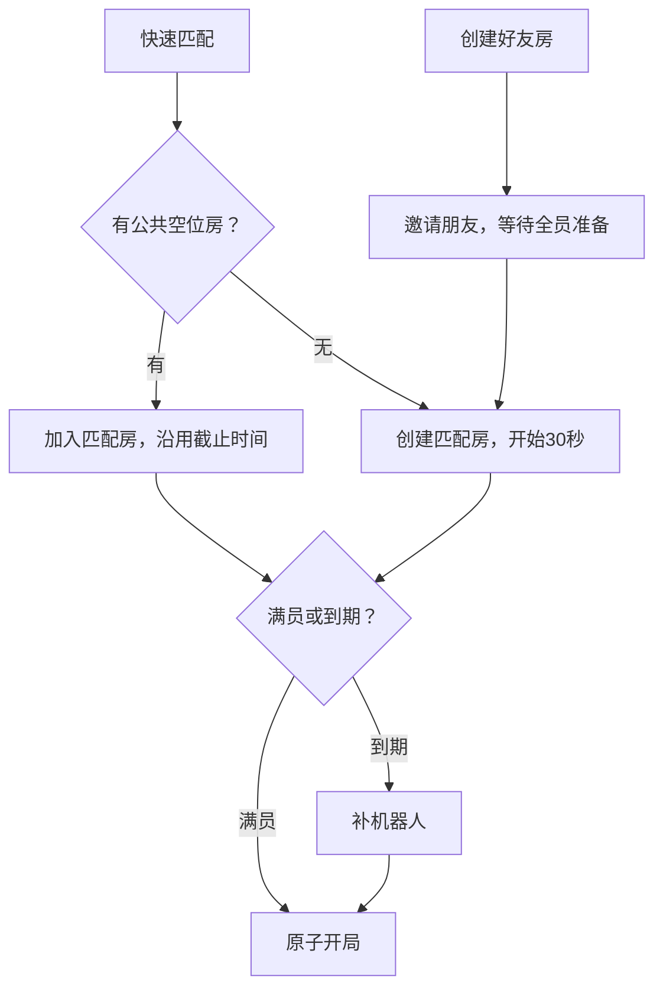

# Flight Party 开发方案

版本：1.1（Redis优先写入与异步落库）｜日期：2026-10-31｜对应原型：0.7.2  
用途：交给 Codex 分阶段实现真实多人在线游戏。本文是开发规格，不表示后端功能已经完成。

**推荐方案：保留现有前端、棋盘和动画，新增 Java 21 + Spring Boot + WebSocket + Redis + PostgreSQL 后端。第一版采用单实例模块化单体，通过 Docker Compose 部署。**

选择 Java 是为了适配维护者已有的 Java 后端经验。代价是需要把规则迁移至 Java，并用固定样例对照现有 JS 引擎；不能直接把浏览器计算的结果当作可信结果。

## 1. 使用方式与开发边界

1. 先解压现有 [FlightParty-v0.7.zip](https://chatgpt.com/library?file_id=libfile_eddf924e48308191aacced7adb450a9a&account_id=personal)，确认 `package.json` 为 `0.7.2`。
2. 阅读项目中的 `AGENTS.md`、`docs/RULES.md`、`docs/V07-CONTRACT.md`、`docs/HANDOFF.md`、`docs/QA.md`。
3. 本方案与配套 `images/` 文件夹放在一起阅读。单独下载 MD 时，图片请从配套文档包取得；不要把缺少图片的文档当作完整视觉交接。
4. 开发以用户最新明确要求为准。技术架构以本方案1.1为准，覆盖原项目文档中旧的无Redis建议；游戏规则仍与最新产品契约一致。本方案对未明确的细节给出**建议默认值**，不得称为用户已经确认。
5. 先锁定视觉基线并保留截图对比，再分阶段接后端。不要因为实现联机而重做界面、替换棋盘或删除现有动画。

### 当前已有与需要开发

| 项目 | 当前原型 | 本次后续开发目标 |
|---|---|---|
| 棋盘与飞机 | 固定视角 2.5D，已有素材、编号、接触阴影 | 保留画面，仅接收服务端状态 |
| 骰子 | 独立真实 3D 模型，已有动画 | 服务端生成点数，客户端播放对应结果 |
| 游戏规则 | 本地 JS 引擎；结束条件仍是旧版 | Java 权威规则，新版前两名完成即结束 |
| 匹配与好友房 | 本地 UI 示例与 30 秒倒计时 | 真实房间、邀请、自动匹配、自动补机器人开局 |
| 登录与排行榜 | 示例数据，没有真实账号 | 邮箱密码、Google/GitHub、积分榜、对局数榜 |
| 统计与额度 | 没有服务端存储和限制 | 自动结算、每天 20 局、会员不限 |
| 断线与表情 | 本地状态/效果预览 | 服务端托管、重连、全房间广播 |
| 防篡改 | 本地原型不具备可信边界 | 服务端判定、鉴权、幂等和事务 |

当前 26 项测试覆盖旧引擎、动画、骰子与地面投影。它们不能证明新规则、真实联机或安全功能已经通过。

## 2. UI 与素材基线

### 2.1 对局页美术方向


此图是既有美术方向参考，不能将生成图中的每个格子位置当作规则数据。合法路线和坐标以原型 `engine.js` 的 `TRACK` 及规则定义为准。

### 2.2 撞机效果


保留短暂停顿、挤压、弹飞、弧线、烟雾、星星和 BOOP；音效在接触事件触发一次，不做真实事故表现。

### 2.3 地面与道路对齐约束


这是历史问题标注，要求保留 0.6.2 之后的地面校准结果，不要照图重新制造偏差。棋盘、公路、飞机位置、阴影和点击命中使用同一投影；不能只调整 CSS 把棋盘拉宽。

### 2.4 玩家卡片位置参考


图中框选位置继续用于统计。**旧的胜率要求已经取消，当前显示“积分、已完成局数”。** 图片只保留位置和风格参考。

### 2.5 不得随功能开发改动的视觉细节

- 蓝色主调，蓝/橙/绿/红四阵营；高饱和玩具质感，统一字体、按钮与圆角。
- 保留整岛取景、云层标题栏、低矮路缘、切角基地和清晰的路线格侧面。
- 飞机机身保留 1/2 编号；镜像转向后数字仍正读。
- 飞机阴影仍包含柔和外围与较深接触核心，飞行高度与地面阴影锚点分离。
- 骰子六面身份固定，对面之和为 7；显示结果须与服务端一致。
- 飞机选择按钮出现前后，骰子宿主尺寸不变。
- 默认英文，保留中文切换；桌面和手机浏览器均可操作。
- 当前飞机是图片整体动画，棋盘不是完整实时 3D。不要在此次联机工作中额外引入模型重制。

**视觉状态：已有局部方向和细节获得认可，但不宣称所有页面已最终验收。** 接口开发可以并行进行；任何明显视觉改版先给对比图，禁止以模板后台样式替换现有游戏风格。

## 3. 已确定的产品规则

### 3.1 匹配与好友邀请

| 场景 | 行为 |
|---|---|
| 快速匹配 | 点击后直接加入有空位的公共匹配房；没有合适房间则自动创建 |
| 创建房间 | 立即进入等待房，支持分享邀请链接和房码 |
| 好友准备 | 当前真人各自点击“准备起飞”；全员准备后，原房间匹配其他玩家，朋友席位保留 |
| 倒计时 | 房间进入公共匹配时开始 30 秒；等待朋友阶段不计时 |
| 满员 | 提前自动开局，不要求再次点击开始 |
| 到期 | 剩余空位自动补机器人并开局，不弹补位确认 |
| 退出等待 | 未开始时可离开，不扣对局额度 |
| 对局中离开 | 机器人接管原席位；重新进入时恢复原对局 |

快速匹配入座视为已准备。新加入者沿用房间剩余时间，加入、离开和重连均不得重置 30 秒。一名房主也可准备并进入匹配；没有任何真人的等待房应清理，不开始纯机器人空局。

### 3.2 基础飞行规则

这些规则来自现有原型，不改成其他版本的飞行棋：

| 项目 | 规则 |
|---|---|
| 参赛方 | 2–4 个独立阵营，每方 2 架飞机；不是 2v2 |
| 路线 | 公共路线 52 格，每方 5 格私人航道 |
| 进度编码 | 基地 `-1`；公共路线 `0..51`；私人航道 `52..56`；完成 `57` |
| 起点 | 四方公共起点相隔 13 格；具体坐标复用原型 TRACK |
| 起飞 | 任意骰子点数都可以起飞；基地掷 N 到本方进度 N−1 |
| 掷骰 | 1–6 点；掷 6 不额外奖励回合 |
| 完成 | 到达或超过终点即可完成，不要求刚好点数 |
| 撞机 | 公共非安全格落到敌机上，敌机回基地；同格多架敌机全部处理 |
| 安全格 | 四个公共起点不发生撞机；私人航道没有敌方碰撞 |
| 同方同格 | 允许，不形成阻挡或加成 |
| 超时 | 沿用现有两个操作阶段：掷骰阶段最多 15 秒，骰子落定后选机阶段另给 15 秒；动画期间不扣操作时间 |
| 派对模式 | 独立于经典模式，保留事件投票，不混入经典规则 |

### 3.3 新结束条件和积分

1. 一个阵营的两架飞机全部完成后，才算该阵营完成。
2. 第二个阵营完成时，整局立即结束；四人局不继续等待第三名。
3. 两人局也必须双方都完成，不能第一名完成就直接结束。
4. 未完成阵营按已完成飞机数、飞机进度决定剩余名次；精确同分规则见第 4 节。

| 最终名次 | 积分变化 |
|---|---:|
| 第一名 | +2 |
| 第二名 | +1 |
| 第三名 | −1 |
| 第四名 | −1 |

只处理实际存在的席位。原生机器人参与名次竞争，但没有账号统计；接管真人席位的机器人，成绩仍归原参与账号。

### 3.4 账号、统计和次数

- 匿名与登录用户都可以玩，不强制登录开局。
- 邮箱+密码注册/登录，暂不需要邮箱验证码；支持 Google、GitHub 登录。
- 登录账号自动记录完整结果，包括负分；取消手动上传和结算后认领匿名成绩。
- 匿名不保存累计积分或完成局数，不参加排行榜。
- 首页仅保留积分榜和已完成对局数榜，各展示 Top 10。
- 每个正式结算的登录参赛者 `completedGames + 1`，输赢都计；等待、取消、重连不计完成一局。
- 普通用户每天限制 20 次正式开局，会员不限。等待不扣次，重复开局请求不重复扣次。
- 房间内的表情向所有当前成员可见；断线时不保证即时收到，重连以最新游戏状态为主。

## 4. 建议默认值：明确记录，不暗改规则

以下是为使第一版可执行而给出的推荐值，属于实现默认，均集中配置并标注；用户后续修改时按新要求调整。

| 未完全明确的细节 | 推荐默认 |
|---|---|
| 在线目标人数 | 简化入口默认 4 席、经典模式；本地练习保留 2–4 方，不永久删除人数能力 |
| 好友房开始匹配 | 当前所有真人准备后自动进入；房主一人准备也可进入 |
| 未完成者排序 | 完成飞机数降序 → 两架总进度降序 → 最远未完成飞机进度降序 → 固定席位序 |
| 进度比较 | 基地计 0；公共/私人进度 p 计 p+1；完成计 58；只用于排名比较，不改变移动 |
| 同榜同分 | 主指标降序，另一指标降序，最后 accountId 升序，保持确定性 |
| 累计积分 | 允许负数；不未经确认增加最低 0 分保护 |
| 账号计分归属 | 正式开局固定 accountId；退出登录不能清除归属或逃避负分 |
| 匿名中途登录 | 本局仍不计分，从后续新局开始；等待房中登录可在开局时绑定 |
| 可计分模式 | 线上经典局计分，包含机器人补位局；本地练习不计分、不扣线上额度；派对暂不入总榜 |
| 每日重置 | UTC 00:00，界面展示重置时间；匿名暂同 20 局/日 |
| 断线判定 | 连接关闭立即标记；无响应按心跳超时判定，建议 10 秒心跳、30 秒无响应 |
| 空闲好友房 | 建议 30 分钟无活动后过期；不要混同公共匹配的 30 秒 |
| 再来一局 | 生成新 matchId，回到同组等待/准备流程；重新检查额度，不复用上局结算键 |

匿名配额是基础限制：清 Cookie、更换设备可能获得新身份，不能承诺彻底识别同一个自然人。使用限流和异常检测降低滥用，不增加未经要求的强制登录或验证码。

如果以后允许好友对刷、纯机器人局长期计分等策略调整，须单独确认。防篡改不能自动解决玩家串通或排行榜刷局问题。

## 5. 技术架构

### 5.1 推荐组件

| 层 | 推荐选择 | 原因/边界 |
|---|---|---|
| 前端 | 保留原生 HTML/JS/CSS、Canvas 与现有 Three.js 骰子 | 避免重写导致视觉偏离；不强制迁移 React/Vue |
| 后端 | Java 21、Spring Boot 4.1.x，初始化时锁定兼容的稳定补丁 | 适配维护者 Java 经验；依赖由 Boot BOM 管理 |
| 通信 | HTTPS REST + 原生 WebSocket JSON | REST 处理账号/房间入口，WS 处理动作、状态和表情 |
| Redis | Spring Data Redis/Lettuce、Redis Streams、AOF | 实时对局状态、命令去重、已校验事件队列与榜单缓存 |
| 数据库 | PostgreSQL 18、Flyway | 账号、额度与正式结算账本；异步事件投影和快照 |
| 认证 | Spring Security、服务端会话、OAuth2 Client | 不自创密码协议或 OAuth 流程 |
| 数据访问 | Spring JDBC/JdbcClient | 显式事务和锁较容易审查；不同时引入多个 ORM |
| 部署 | Docker Compose：反向代理 + 应用 + Redis + PostgreSQL | 第一版单节点，优先保证正确性 |
| 观测 | Actuator/Micrometer、结构化日志 | 指标服务仅内部可访问 |

本方案是建议选型，不是已安装依赖清单。开工时固定版本、生成 Maven Wrapper 并做兼容检查；不使用浮动 `latest` 镜像。原型本地启动仍可保留 `node server.mjs`，它只是静态预览服务。

Spring 支持原生 WebSocket；密码使用 Spring Security 的 `PasswordEncoder`。会话与 WS 安全配置以官方文档及 OWASP 指引为依据，参考链接见文末。[S1–S4]

### 5.2 职责划分

| 浏览器负责 | 服务器负责 |
|---|---|
| UI、点选飞机、显示倒计时 | 会话、成员身份与席位权限 |
| 播放 3D 骰子和飞机动画 | 骰子随机值、合法移动、撞机、终点、名次 |
| 提交“掷骰/选飞机”意图 | 匹配、30 秒截止、15 秒操作期限、机器人 |
| 显示服务端返回的统计 | 日额度、会员资格、一次性结算、榜单 |
| 本地音效与减少动画设置 | 状态版本、命令去重、断线接管和恢复 |

浏览器不发送最终分数、目标棋格或会员标志供服务器采信。前端代码被修改只应影响攻击者自己的画面，不能改变权威对局。

### 5.3 Redis优先写入与异步落库

**服务器校验 → Redis原子写入状态与事件 → 返回操作已接收 → Streams消费者异步写PostgreSQL → 数据库提交后刷新Redis正式统计。** 浏览器原始请求不是可信成绩，不能未经规则校验直接写进排行榜。

| 数据类型 | 首先写入 | 后续同步/读取 |
|---|---|---|
| 已校验的掷骰、移动、托管、对局进度 | Redis状态、命令回执和Streams事件原子写入 | 异步写事件与快照，客户端实时读取Redis状态 |
| 对局结算事件 | Redis Streams，标记PENDING | 消费者在PG事务中一次记分；提交后改COMMITTED并刷新Redis |
| 账号、密码、OAuth绑定、会员资格 | PostgreSQL事务 | Redis可缓存非敏感查询结果；不把账号写入做成无确认的异步任务 |
| 开局与每日额度 | 先写Redis开局意图，再执行PG开局/扣次事务 | PG成功后激活Redis比赛并广播；失败不得先开始游戏 |
| 积分/对局数榜、个人统计 | PG已提交的账本产生结果，推送至Redis缓存 | API优先读Redis，缺失时从PG重建 |
| 表情、在线心跳 | Redis/WS短期状态 | 不要求每条表情或心跳写数据库 |

开局扣次与身份仍是低频事务，不能为了异步化让用户并发绕过20局限制。高频对局动作的请求链路不等待PG落库；“操作已接收”和“成绩已持久保存”使用不同状态。

### 5.4 Redis键与原子性

建议第一版单Redis实例、单房间调度服务，Redis不暴露公网。按固定数量分片队列，例如16个分片；属于实现配置，不是并发容量保证。

| 键示例 | 内容 |
|---|---|
| `fp:{s03}:room:<roomId>` | 房间状态、成员、当前比赛及版本 |
| `fp:{s03}:match:<matchId>` | 权威运行快照、turnId、seq、deadline、busyUntil |
| `fp:{s03}:receipt:<principalId>:<commandId>` | 请求hash与服务端返回值，重试不重新抽骰 |
| `fp:{s03}:events` | 该分片的Redis Stream，承载已校验状态变更 |
| `fp:{s03}:due` | 按服务器到期时间排序的匹配/回合任务 |
| `fp:stats:<accountId>` | PG已提交的积分、局数及statsVersion |
| `fp:leaderboard:points` / `fp:leaderboard:games` | Top10 JSON缓存，保留原确定性同分排序 |

同一个原子脚本访问的键使用同一hash tag。Redis Cluster不是本期部署目标，但禁止设计跨slot的原子脚本。

每房间命令串行计算；用有界执行器，不能每房无限建线程。提交Lua脚本先验证expectedVersion、阶段及去重回执，随后一次更新状态、写回执、XADD事件并更新到期索引；失败不广播成功。脚本参数先校验、命名空间受控、键类型固定，写入阶段不得出现可预见运行错误：Lua脚本具有执行隔离但没有数据库式错误回滚。超时后先按commandId查回执，不能直接重新计算或重新抽点。

Java内存只是计算副本，Redis为运行状态来源；PG为已提交成绩与可恢复事件的长期记录。保留规则版本与完整事件结果，不只存会丢中间动作的最终JSON快照。

### 5.5 Streams消费者与一致性

- 使用XREADGROUP读取，数据库事务成功后才XACK；建议起始批量50条、最长聚合等待100ms，均可配置并通过压测调整。不能用每分钟全量扫缓存替代事件消费。
- 按分片有序消费，正常消费和pending重领不得并发打乱同房seq；PG按roomId+seq去重、校验连续序号，有缺口先补齐。不同房间可以并行。
- PG事务原子写入事件、更新快照/消费进度；结算事务另外保证matchId和账号结果唯一。消费是至少一次，业务效果靠幂等实现一次，不声称消息天然恰好一次。
- 进程在PG提交后、XACK前崩溃：重投返回已有结果，不重复加分。用XPENDING与XAUTOCLAIM恢复超时pending；持续失败事件隔离告警，相关房间暂停推进，不能静默丢掉并继续后续事件。[R1]
- PG提交后再以绝对值和statsVersion更新Redis个人统计，拒绝旧版本覆盖；榜单缓存失效后从PG重建。不要重投一次就ZINCRBY一次。
- PG提交与Redis缓存更新之间无分布式事务：通过PG统计缓存outbox记录待更新账号，缓存更新成功后标记完成；后台补偿与过期重建兜底。PG成功但Redis更新失败时，重新消费也要执行这一步。
- 榜单允许短暂最终一致；结算页在PG提交前显示“正在保存”，提交确认后才显示“已自动记录”。Redis刷新失败不重新结算。
- 不对未确认落库的Stream记录设置TTL或随意MAXLEN裁剪。只有PG消费水位确认且保留恢复余量后才trim；同房快照、回执不能先于恢复所需事件过期。

### 5.6 持久化、背压与故障恢复

Redis启用AOF与持久磁盘，建议初版`appendonly yes`、`appendfsync everysec`，另做备份和恢复演练。该配置在故障时可能丢失最近约1秒尚未fsync的写入，不是零丢失保证。[R2]

普通动作可在Redis写入成功后返回已接收；正式成绩以PG提交为准。若要将“已接收”升级为更强的本地落盘确认，可对关键写使用部署版本支持的WAITAOF并检查返回值，或评估always策略；它们会增加延迟，也不能代替PG账本或备份。超时表示结果待查，不能认定写入失败并重复执行。[R3]

- Redis不可用：暂停新动作/匹配，展示恢复中，不切到浏览器自算，也不无声绕过队列直接写PG形成两条竞争写链。
- PG不可用：Streams短期缓冲，统计显示保存中；监控队列长度、最老未同步时间、pending和磁盘水位。超过配置阈值先停止新开局，必要时暂停活跃房；不无限接收直到内存耗尽。
- 核心状态/Streams实例使用`maxmemory-policy noeviction`并预留容量；缓存以显式TTL管理。后续如拆缓存实例，不能让普通缓存淘汰权威状态和未落库事件。
- 应用重启：优先读取Redis状态及due索引，恢复定时器；消费者继续pending。Redis恢复后若落后于PG，按PG已应用水位修复；Redis有未落库尾部时先消费/重放再开放相关房间。
- Redis数据整体丢失：进入维护恢复，从PG快照与事件重建；尚未持久化且未入PG的动作可能丢失，不能承诺原地无损继续。正式已提交积分不回退，不重新抽取已保存的骰子。
- 第一版仍单房间服务；加入Redis不自动获得多实例房间归属、故障切主和水平扩容能力。多实例需要另加租约、fencing与消息路由，仍以实测容量为准。

## 6. 房间与匹配实现



好友路径中的“创建匹配房”指**将原好友房转为匹配状态**，不是新建另一房或拆散成员。

### 6.1 房间状态

| 状态 | 可进行的操作 | 转移条件 |
|---|---|---|
| `WAITING_FRIENDS` | 邀请入座、准备/取消准备、离开 | 当前真人全准备 → MATCHING |
| `MATCHING` | 新真人匹配入座、开局前离开 | 满员或 deadline 到期 → PLAYING |
| `STARTING` | 冻结新入座与取消，显示正在开始 | PG开局事务成功且Redis激活 → PLAYING；失败按startId补偿 |
| `PLAYING` | 掷骰、选机、表情、重连、离线托管 | 新结束条件满足 → SETTLED |
| `SETTLED` | 查看结算、发起再来一局、离开 | 新 matchId 进入新一轮等待；不能重用旧结果 |
| `CLOSED` | 返回首页 | 空房、过期或管理员结束 |

### 6.2 快速匹配原子处理

1. 根据服务端身份恢复已有活动房间；同一账号不得同时占多个活动席位。
2. 校验基本资格和剩余额度；这里只检查，不扣次。
3. 选择同模式、未开局、有空位的公共房，推荐优先截止时间较近的房。
4. 在Redis版本校验/原子脚本中再次检查房间状态、容量、deadline；过期房不能继续塞人。
5. 分配唯一 seatIndex，标记准备；无可用房时创建 MATCHING 房，持久化 `matchingDeadline=serverNow+30s`。
6. 满员则在同一串行入口触发开局；返回最新快照，不返回伪造在线人数。

并发无房时可能创建多个等待房，第一版可在单实例匹配协调器内短暂串行化查找/创建；Redis须原子维护房间席位及活动身份占用索引，PG投影另以唯一约束校验。身份占用与入座不能分成无保护的两次写；第一版跨房匹配由单实例协调器串行化，实例启动须先恢复占用索引。

### 6.3 到期补位和正式开始

- 定时任务读取Redis到期索引，每次通过版本校验确认房间仍是MATCHING；不能只依赖易丢失的keyspace过期通知。
- 无真人则关闭房间；有真人则用明确 BOT 身份填满空席。
- 重新核验真人资格、账号绑定和当日额度；失败不能部分扣次。移出不合格成员并通知，其余真人按原截止时间继续/立即补位。
- Redis先记录带唯一startId/matchId的STARTING意图并冻结入座；PG事务创建比赛参与记录、固定账号和扣次；提交后原子激活Redis的PLAYING、初始化第一回合并追加事件。应用崩溃后按startId查询PG补齐，不能再次扣次；STARTING期间客户端只显示正在开始。
- Redis激活成功后才广播 `MATCH_STARTED`，不能在PG扣次失败时开始。真人入座、取消、机器人补位和开始并发时只认一个事务结果。
- 后续即使用户离线，已开始的比赛仍继续，机器人操作原席位。

邀请使用不可预测的随机房码或链接令牌，限定有效期并限流查码。房码只是入房凭据，不是房主权限或重连凭据；不得仅凭房码接管他人的飞机。

邀请入座与准备也须串行进入同一房间并校验Redis版本：WAITING_FRIENDS 新成员未准备；若提交时已变成 MATCHING，新成员按快配规则入座即准备，并沿用未到期的 deadline；已开始或到期则拒绝新入座。不能在 MATCHING 插入一个未准备成员再直接满员开局。

移除额度不足等不合格成员后，必须再次检查真人数量；若最后一名真人被移除，关闭房间，不开始全 BOT 对局。等待房的 expiresAt 清理仅作用于 WAITING_FRIENDS；MATCHING 使用匹配截止时间，PLAYING 不因等待房 TTL、邀请码或会话过期而被删除。

## 7. 规则引擎与前端接入

### 7.1 Java 规则模块

建议独立 `game` 模块，不依赖 WebSocket、数据库或渲染。输入不可变状态、合法命令、已产生的骰子值；输出新状态与规则事件。

核心对象：`GameState`、`PlayerState`、`PlaneState`、`TurnState`、`GameCommand`、`GameEvent`、`MoveOutcome`、`RankingPolicy`。

- 路线坐标及起点偏移来自现有 `engine.js`，不手工照设计图重新画路线。
- 使用服务端安全随机源生成均匀 1–6 点；先原子写Redis状态及Stream事件再广播，数据库异步消费。
- 对同一回合的重复掷骰，不论客户端换不换 commandId，都不能重新抽取结果。
- 新结束条件必须独立实现；不能直接复制旧引擎“剩最后一方就结束”的逻辑。
- Java 先对照 JS 固定样例，只有明确的新结束/排名规则允许产生预期差异。
- 本地练习的 JS 引擎也要同步新结束条件，避免线上与练习规则不同。更新旧引擎哈希保护时，必须同时提交新增结束测试和基础规则回归测试，不能直接删除保护后随意改动。

### 7.2 前端改造范围

| 文件/模块 | 改造要求 |
|---|---|
| `dist/app.js` | 将在线操作改为提交命令、消费服务器快照；保留本地练习入口 |
| `dist/social-ui.js` | 接真实身份、榜单、成员和倒计时，移除已实现功能的示例标识和测试按钮 |
| 新 `online-session.js` | REST/WS、重连、seq 检查、命令状态、快照订阅 |
| 新 `local-session.js` | 封装本地练习引擎；不得上报本地计算的成绩 |
| 新 `game-view-adapter.js` | 将权威状态映射为现有渲染器需要的数据形状 |
| `fallback.js`、`ground-projection.js`、`palette.js` | 保持地面、颜色、飞机、阴影及点击校准 |
| `die3d.js`、`die-geometry.js` | 原样复用结果驱动动画，不额外抽点数 |
| `reaction-preview.js` | 改成消费服务端表情事件，按事件 ID 去重 |

在线和本地练习必须明确隔离。在线页面不可调用本地 `Game.roll()` 或 `Game.move()` 作为正式结果；命中测试只用来得到 planeId。

### 7.3 动画与服务器时间

- 服务器发送 `serverNow`、`turnId`、`phase`、`deadline`、`busyUntil`；浏览器倒计时只作显示。
- 掷骰动画沿用约 1120ms；移动与撞机时长由服务器和客户端共同使用的版本化时长表确定。
- 操作计时沿用原型实际行为：ROLL 阶段最多 15 秒，骰子动画结束后 CHOOSE 阶段重新给 15 秒。ROLL 超时由电脑掷骰并继续选择，CHOOSE 超时由电脑选机；不要擅自改成整回合共用 15 秒。
- 动画阶段由 busyUntil 控制，客户端不能自行延长阶段。原型因弹窗或浏览器后台暂停本地倒计时的行为不带到线上；在线必须由服务端持续推进，避免挂起页面卡住其他玩家。
- 不等待所有客户端发送“动画完成”才推进，否则离线玩家可卡住全房间。服务器按 busyUntil 推进。
- 浏览器后台暂停、卡顿或重连时，直接对齐最新状态；不要求回放所有过期动画。
- 减少动画仅影响本地表现，不改变骰子、时间预算和其他玩家的规则。
- 撞击音效从同一个接触事件触发一次，5 组短音效可随机选；声音随机不参与规则。

## 8. 通信协议

### 8.1 REST 接口清单

| 方法与路径 | 用途 | 权限/关键校验 |
|---|---|---|
| `POST /api/session/guest` | 初始化匿名会话，已有会话则复用 | 限流，不创建匿名累计统计 |
| `GET /api/me` | 当前身份、会员、剩余次数、活动房 | 只返回本人资料 |
| `POST /api/auth/register` | 邮箱密码注册 | 无邮箱验证码；格式、密码、重复邮箱校验 |
| `POST /api/auth/login` | 邮箱密码登录 | 限流、会话轮换，承接匿名身份/用量 |
| `POST /api/auth/logout` | 退出账号 | CSRF；关闭相应 WS，比赛账号绑定不删除 |
| `GET /oauth2/authorization/{provider}` | Google/GitHub 授权入口 | provider 白名单 |
| `GET /login/oauth2/code/{provider}` | OAuth 回调 | 框架验证授权事务；服务端交换令牌 |
| `POST /api/rooms` | 创建好友等待房 | 幂等，同一身份不能重复占活动房 |
| `POST /api/rooms/join` | 按 code/token 加入好友房 | 原子占位，拒绝满房和已开始房 |
| `POST /api/matchmaking/join` | 快速匹配 | 无人数/补位表单，复用或创建公共房 |
| `POST /api/rooms/{roomId}/ready` | 准备/取消准备 | 只改自己的席位，仅好友等待阶段 |
| `POST /api/rooms/{roomId}/leave` | 离开/取消匹配 | 与开局竞态原子；已开始则托管 |
| `GET /api/rooms/{roomId}/snapshot` | 获取当前快照 | 必须是本房成员，不能凭 roomId 窥探 |
| `GET /api/matches/{matchId}/result` | 读取既有结果 | 参赛者；无任意结果写入接口 |
| `POST /api/rooms/{roomId}/rematch` | 发起下一局等待 | 新 matchId，成员重新准备/扣次 |
| `GET /api/leaderboards?type=points|games` | Top10 总榜 | 公开昵称/头像和指标，禁止邮箱/内部会话信息 |

所有写操作使用服务端校验和必要的幂等键。错误结构统一 `{code,message,requestId}`，不要把密码、SQL 或栈信息返回前端。

建议错误码：`ROOM_FULL`、`ROOM_STARTED`、`ROOM_EXPIRED`、`NOT_MEMBER`、`NOT_YOUR_TURN`、`INVALID_PHASE`、`ILLEGAL_MOVE`、`STALE_TURN`、`QUOTA_EXCEEDED`、`RATE_LIMITED`、`COMMAND_CONFLICT`。

### 8.2 WebSocket

连接地址：同域 `/ws`，生产使用 WSS。握手依赖受保护的服务端会话；不用可长期复用的 token 拼在 URL 上。若需要重连票据，限定一次性、短有效期和原席位。

客户端动作示例：

```json
{
  "protocolVersion": 1,
  "commandId": "random-unique-command-id",
  "roomId": "room-id",
  "matchId": "match-id",
  "turnId": 18,
  "type": "MOVE",
  "payload": { "planeId": 1 }
}
```

planeId 固定 `0/1`，对应界面飞机编号 `1/2`。ROLL 的 payload 为空；MOVE 不传终点坐标。身份和 accountId 从会话及参与记录取得，不能由 payload 决定。

服务端消息建议统一为：

```json
{
  "protocolVersion": 1,
  "eventId": "unique-event-id",
  "roomId": "room-id",
  "matchId": "match-id",
  "seq": 42,
  "serverNow": "2026-10-31T03:00:00.000Z",
  "type": "DICE_ROLLED",
  "payload": {
    "turnId": 18,
    "seatIndex": 0,
    "value": 4,
    "busyUntil": "2026-10-31T03:00:01.120Z"
  }
}
```

主要客户端命令：`ROLL`、`MOVE`、`REACTION`、`RESUME`、`PING`；独立派对开放后增加 `VOTE`。主要服务端事件：`ROOM_UPDATED`、`MATCH_STARTED`、`DICE_ROLLED`、`MOVE_RESOLVED`、`TURN_CHANGED`、`CONTROL_CHANGED`、`MATCH_SETTLED`、`REACTION`、`SNAPSHOT`、`ACK`、`ERROR`、`PONG`。

快照至少包含：规则版本、房间阶段、seq、matchingDeadline、matchId、参与者公开资料、在线/控制状态、棋子进度、当前回合、骰子、排名、操作截止时间和 busyUntil。

客户端丢弃旧 seq；发现缺口或重连时拉快照，不自行猜状态。心跳可附服务端最新 seq，避免最后一条事件丢失后永远不知道要同步。表情采用独立 eventId 去重和短时展示，不作为棋盘规则推进条件。

## 9. 数据库设计

统一 UUID 主键、UTC `timestamptz`，局数和积分使用足够范围的整数。金额/付款不在本期范围。

| 表 | 关键字段 | 约束/说明 |
|---|---|---|
| `accounts` | id, emailNormalized?, passwordHash?, displayName, avatarKey, status, createdAt | 邮箱非空时唯一；OAuth-only 账号可无密码；emailVerified 不自动置 true |
| `oauth_identities` | accountId, provider, providerSubject | 唯一(provider, providerSubject)，不靠邮箱自动合并 |
| `principals` | id, accountId?, kind, createdAt | 稳定参与身份，匿名也有服务端随机身份 |
| 会话表 | sessionIdHash, principalId, authenticatedAccountId?, expiresAt | 使用框架会话存储；Cookie 不携带可篡改成绩 |
| `membership_entitlements` | accountId, status, startsAt, expiresAt, source | 仅可信后台/未来支付回调可写 |
| `rooms` | id, inviteTokenHash, state, mode, capacity, hostPrincipalId, matchingDeadline, currentMatchId?, version, expiresAt | 有效房码唯一；容量 2–4，线上默认 4 |
| `room_members` | roomId, seatIndex, principalId?, accountId?, nativeBot, ready, connected, controller, connectionEpoch, leftAt? | 活跃(roomId, seatIndex)唯一；对非空 principalId/accountId 建活动席位唯一约束 |
| `matches` | id, roomId, rulesVersion, status, stateJson, stateVersion, nextActionAt, startedAt, settledAt? | nextActionAt 持久化以恢复超时任务 |
| `match_participants` | matchId, seatIndex, principalId?, accountIdAtStart?, nativeBot, rank?, pointsDelta? | 唯一(matchId, seatIndex)；非空(matchId, accountIdAtStart)唯一 |
| `command_receipts` | principalId, commandId, scope, requestHash, responseJson, createdAt | 唯一(principalId, commandId)；同键不同内容拒绝 |
| `room_events` | roomId, seq, matchId?, eventId, type, payload, createdAt | 唯一(roomId, seq)、eventId；规则事件先写Redis后广播，异步落库 |
| `quota_starts` | matchId, principalId, accountIdAtStart?, quotaDay | 唯一(matchId, principalId)；记录实际开始，不是进入大厅 |
| `quota_identity_links` | guestPrincipalId, accountId, linkedAt | 关联当日额度，禁止重复绑定后重复累加 |
| `stats_cache_outbox` | id, accountId, statsVersion, createdAt, deliveredAt? | 与统计事务同写，Redis刷新失败可补偿 |
| `match_settlements` | matchId, settledAt, rulesVersion | matchId 主键，保证一局一次结算 |
| `account_match_results` | matchId, accountId, seatIndex, rank, pointsDelta, completedAt | 唯一(matchId, accountId)，用于审计/重建统计 |
| `account_stats` | accountId, points, completedGames, updatedAt | accountId 主键，只由结算事务更新，新增statsVersion单调递增 |

`controller=human|bot` 与 `nativeBot` 分开：真人断线后 controller 改 bot，但 accountIdAtStart 不变；原生 BOT 的 accountId 必须为空。

room_members.accountId 用于等待阶段的账号关联和活动席位去重，比赛参与记录另存开局快照。对局中离线不能设置 leftAt 来释放席位；leftAt 表示真正退出等待房或结束后的席位释放。匿名中途登录不得覆写本局 accountIdAtStart。

推荐索引：

- rooms：`(state, mode, matchingDeadline)`；有效 inviteTokenHash。
- matches：未结束比赛的 `(status, nextActionAt)`。
- quota_starts：`(principalId, quotaDay)` 与 `(accountIdAtStart, quotaDay)`；通过 quota_identity_links 合并去重后的当日用量。
- account_stats：`(points DESC, completedGames DESC, accountId)` 以及反向主指标索引。
- command_receipts：唯一键和 createdAt 清理索引；比赛结束前不能提前清掉仍需去重的记录。

事件日志和匿名对局元数据可按明确保留期清理；账号结算明细须足以重建统计。匿名没有累计成绩不等于不能临时保存恢复对局所需的规则状态。建议默认保留期另写运维配置，避免无限保存调试日志。

### 9.1 Streams结算消费者事务

```text
从Redis接收已校验的MATCH_SETTLED_PENDING事件
锁定比赛记录，先确认前序seq已应用
若已有 match_settlements：返回既有结果
验证第二个阵营确已完成，并计算最终名次
写入 match_settlements 与所有席位结果
对每个 accountIdAtStart 非空且非原生BOT的参与者：
  写入唯一 account_match_results
  仅首次写入成功时，积分增加 pointsDelta、完成局数增加1
更新比赛为SETTLED，递增账号statsVersion，写缓存刷新outbox
提交事务后按版本刷新Redis统计、标记COMMITTED、通知客户端并XACK
PG失败则不XACK，重试整个事务；缓存失败走outbox补偿
```

按固定 accountId 顺序更新多个账号，降低死锁概率；遇数据库可重试错误使用有界重试，始终复用同一幂等标识。Redis中可以先展示结算待保存，但正式积分、结果和统计增量必须在同一个PG事务提交；不能把Redis加分成功当作已落库。[S3]

### 9.2 登录与额度合并

- 登录前的同日匿名开局记录必须承接，不能登录后重新领 20 次。
- 合并以去重后的开局记录为依据，不能把两个计数器直接反复相加。
- 绑定与开局检查采用一致的锁顺序，防止登录/开局同时执行绕过额度。
- 用户已在另一活动席位时，恢复原局或拒绝新入座；不能一个账号占两个飞机阵营刷统计。
- 日额度按开局日扣，跨午夜结算不再扣一次；断线、重连和托管均不改变额度。

## 10. 登录、会话与防篡改

### 10.1 登录

- 邮箱密码注册不增加验证码步骤；邮箱未验证状态必须真实保留。
- 使用 Spring Security PasswordEncoder，推荐支持升级的 Argon2id 编码配置，实际成本在部署机器测定；不明文保存、不直接 SHA-256 密码。[S2]
- 会话 Cookie 使用 HttpOnly、Secure、合适的 SameSite 策略；HTTPS 同域部署，登录后轮换会话 ID。
- 注册/登录错误不泄漏密码与内部实现，增加登录失败限流；不要将密码、Cookie、OAuth token 写进日志或 localStorage。
- Google 使用 OIDC/OAuth 授权码流程，GitHub 使用授权码流程；由框架处理 state、回调关联、适用的 PKCE/nonce 检查和服务端令牌交换。[S5–S7]
- 唯一身份分别取 Google 稳定 subject、GitHub 稳定用户 ID。GitHub 无公开邮箱也可按 provider ID 建立账号。
- 同名邮箱不自动关联已有账号；若需要绑定，必须先认证已有账号，再完成另一提供方认证。
- 第三方应用密钥从环境/密钥配置读取；申请提供方应用和配置正式回调由拥有相应账号的人完成。
- 不在本期临时增加复杂找回密码流程；需要时另设计安全的一次性重置链接，不用未验证邮箱直接覆盖账号。

### 10.2 必须做到的校验

| 攻击/异常 | 预期处理 |
|---|---|
| 改骰子点数、棋子坐标 | 服务器忽略/拒绝这些字段，仅接受动作意图 |
| 修改 planeId 为他人飞机 | 校验当前席位与合法飞机，拒绝 |
| 不是自己的回合发 ROLL/MOVE | 拒绝，不推进状态 |
| 重复掷骰、换 commandId 重试 | 同一回合最多一次随机结果 |
| 重放旧回合命令 | turnId、matchId、阶段不匹配，拒绝 |
| 复用 commandId 改 payload | requestHash 不一致，返回 COMMAND_CONFLICT |
| 自报积分、局数、名次 | 没有可信写入口；统计只来自正式结算 |
| 伪造会员、本机日期 | 只读取后端权益与服务端时间 |
| 退出账号躲负分 | 按开局绑定账号结算，WS 转托管 |
| 多次结算/重启重试 | 唯一结果记录和事务保证不重复加分/加局数 |
| 恶意网站跨站连接 WS | 验证 Origin、会话和消息权限；不能只靠 Cookie 存在 |
| 大消息/刷表情/重复入房 | 严格字段、大小与速率限制，必要时关闭连接 |

建议初始消息上限 8KB、表情最多每秒 2 次且短时间累计限额；数值放配置，压测后调整。HTTP 写接口保留 CSRF 防护，WS 握手与每条消息均检查授权；会话失效后关闭连接。[S4]

**防篡改的目标是保护服务器状态，不是阻止用户查看或修改网页源码。** 不把 JS 混淆、前端密钥或浏览器签名当作反作弊方案；不承诺能完全防止多账号或玩家串通。

## 11. 断线、重连和服务重启

1. 连接丢失后保留参与者和棋子，将控制者切换为机器人；不创建额外席位。
2. 机器人使用相同的合法动作入口和阶段校验，不能跳过骰子、超时或动画限制。
3. 重连通过原账号或受保护匿名会话证明原席位归属，不能仅传一个 participantId 就恢复控制。
4. 返回最新快照和 seq。已提交的机器人动作不回滚；在下一个可操作阶段交还控制。
5. 使用 connectionEpoch 或等效机制，确保同一席位只有一个有效控制连接；旧标签页不能继续发命令。
6. 按5.6节从Redis运行快照、到期索引及PG已应用水位恢复；等待队列对齐后开放相关房间。已保存点数不能重新抽取。
7. Redis状态/Stream事件提交后若广播失败，客户端通过重连/seq 检查拉快照；不因为发送失败回滚已确认比赛。
8. 已结算后重连只展示已有结果，不能再次增加积分或完成局数。

窗口刷新和后台挂起属于常见场景；恢复优先保证状态正确，不能让玩家长时间观看补播动画。

## 12. 表情、排行榜与结算 UI

### 表情

- 沿用预设 emoji，不新增自由文本聊天。
- 客户端提交表情枚举值；服务端补充发送者公开昵称/头像，广播全房间。
- 使用 eventId 去重，短时浮泡与玩家头像角标由同一事件驱动。
- 页面显示昵称时使用安全文本输出，不能直接插入未经转义的 HTML。

### 排行榜

- 首页两标签：Points / Games played；中文为积分榜 / 对局数榜。
- 每榜最多 10 位，只显示真实注册账号；数据不足 10 条时显示实际数量，不填假用户。
- 无数据、加载中、加载失败分别设计；禁止继续把示例排名当作在线数据。
- 榜单优先读取Redis缓存；PG结算提交后更新/失效缓存，后台补偿失败刷新；缓存缺失时从account_stats按确定性规则重建。
- 玩家卡片同步显示积分与已完成局数，匿名显示“— / 未记录”，BOT 无账号数据。

### 结算

- 显示名次、每方两架飞机完成情况、积分变化；趣味称号不影响积分。
- 登录用户显示服务端确认的“已自动记录”；服务器未确认时不能先显示保存成功。
- 匿名显示“本局不记录账号成绩”；不提供认领本局或任意上传分数按钮。
- 再来一局回到同组准备流程，生成新比赛；不直接在浏览器重置后继续沿用旧 matchId。

## 13. 建议代码组织与开发顺序

### 13.1 模块

| 目录/包 | 职责 |
|---|---|
| 现有 `dist/` | 保留前端及素材，逐步加入在线适配模块 |
| `backend/.../auth` | 匿名会话、邮箱密码、OAuth、账号绑定 |
| `backend/.../room` | 成员、邀请、准备、快配、30 秒调度 |
| `backend/.../game` | 纯 Java 规则、状态、排名与机器人策略 |
| `backend/.../realtime` | WS 会话、命令路由、事件与重连 |
| `backend/.../stats` | 结算、积分、完成局数、排行榜 |
| `backend/.../quota` | 开局用量、身份合并、会员资格 |
| `backend/.../redis` | 原子状态脚本、Streams、Redis回执、到期索引和缓存 |
| `backend/.../sync` | 消费组、pending恢复、PG投影、结算与缓存outbox |
| `backend/.../persistence` | SQL、事务、快照与正式账本 |
| `backend/src/main/resources/db/migration` | Flyway 版本化迁移 |
| `backend/src/test` | 规则、并发、集成与恶意请求测试 |
| `docs/` | 最终规则、协议、图片、验收与运行说明 |
| `deploy/` | Compose、反向代理、备份和部署说明 |

### 13.2 分阶段交付

| 阶段 | 交付内容 | 完成条件 |
|---|---|---|
| M0 基线冻结 | 保存现有 UI、规则样例、图片、既有测试 | 不改变当前游戏画面，标清已实现与待实现 |
| M1 权威规则 | Java 规则、新结束条件、机器人合法选择 | 固定样例对照通过，新 2/3/4 人结束用例通过 |
| M2 真实房间 | 匿名会话、创建/邀请/准备、快配、30 秒补位、WS | 两个独立客户端同房操作；满员/到期自动开局 |
| M3 认证与统计 | 邮箱密码、Google/GitHub、额度、结算、两榜 | Redis先接收事件，PG异步结算、outbox刷新，匿名不记录，重试不重复 |
| M4 恢复与安全 | 断线托管、重连、重启、权限与限流 | 恶意请求、并发抢位、退出躲负分等用例通过 |
| M5 发布验收 | 前端完整接入、手机体验、监控、备份、发布脚本 | 生产配置烟测通过，文档与实际功能一致 |

每阶段先完成对应测试和可演示结果，再进入下一阶段。不把“按钮可以点”当作多人或数据功能完成。

## 14. 验收清单

### 14.1 游戏规则

- [ ] 基地掷 1/6 分别到进度 0/5，掷 6 不额外回合。
- [ ] 公共路线转私人航道、超过终点、已完成飞机不可再移动正确。
- [ ] 安全格不撞机，非安全格多敌机全部回基地，同方同格不增加额外能力。
- [ ] 两人局第一名完成仍继续，第二名完成才结束。
- [ ] 三/四人局第二名完成立即结算；剩余名次比较可重复、确定。
- [ ] +2/+1/−1/−1 正确；只为实际参赛席位生成结果。
- [ ] JS/Java 固定输入样例一致；新规则差异有明确期望值。

### 14.2 真实多人和匹配

- [ ] 两台设备或两个独立浏览器会话通过邀请加入；同设备本地模拟不算通过。
- [ ] 快速匹配直接入公共空房，无房自动创建，不显示配置表单。
- [ ] 好友等待 30 秒以上不会自动启动；全员准备后才进入公共匹配。
- [ ] 已有好友保持原席位，陌生人仅填空席；快配入座即准备。
- [ ] 后加入者沿用倒计时，满员立即开局，到期补 BOT 并自动开始，无二次确认。
- [ ] 最后一席同时被两人抢、真人加入与 BOT 补位并发，只出现一个占位结果。
- [ ] 取消与开局并发不会造成重复参赛、重复扣次；全真人离开不启动空局。
- [ ] 邀请加入与全员准备并发时按最终房间阶段处理；移除最后一名额度不足真人后不启动全 BOT 对局；等待房清理不会关闭进行中的比赛。

### 14.3 账号、积分和额度

- [ ] 邮箱密码注册登录无验证码步骤，Google/GitHub 各自真实授权成功。
- [ ] 登录身份在开局固定；退出登录、断线和会话过期不能免除负分。
- [ ] 匿名无累计积分/完成局数，无旧认领入口；匿名中途登录默认后续局生效。
- [ ] 正式完成局无论输赢只加 1；重复结算、重启和网络重试都不重复。
- [ ] 排行只有积分/完成局数 Top10，原生 BOT 不入榜；托管结果归原账号。
- [ ] 普通账号第 21 次正式开局被拒绝，会员不限制；等待与取消不扣次。
- [ ] 登录承接同日匿名用量，多次登录不反复增加/重置次数；跨日依据服务端时间。
- [ ] 两个人同时开局，其中一人额度不足，不发生部分扣次。

### 14.4 防篡改和恢复

- [ ] 改点数、坐标、账号、分数、局数和会员参数不能改变权威状态。
- [ ] 重复掷骰、重放旧回合、跨房操作、同 commandId 不同内容被正确处理。
- [ ] 非授权 Origin、过期会话、越权 WS 消息、超大消息与刷表情受限制。
- [ ] 断线后 BOT 继续原席位；重连不回滚、不重复执行动作。
- [ ] 多标签页/旧连接不能同时控制同一席位。
- [ ] 匹配中、掷骰后、移动后、结算前后分别重启服务器，状态和统计均可恢复。

### 14.5 Redis与异步同步

- [ ] Redis状态、命令回执和Stream入队同一原子提交，超时重试不重新掷骰。
- [ ] PG提交前杀消费者可重投；提交后XACK前杀进程不会重复加分/局数。
- [ ] pending恢复、同房seq缺口和乱序得到处理；失败消息不静默丢弃。
- [ ] PG停机后可缓冲并触发阈值背压；恢复后追平，不重复结算。
- [ ] Redis断开时暂停动作，未落库数据不被TTL/MAXLEN/内存淘汰。
- [ ] PG成功而Redis缓存刷新失败，outbox最终补偿且不被旧statsVersion覆盖。
- [ ] 结算待保存与已持久提交在UI中区分，榜单最终追平PG账本。
- [ ] STARTING阶段分别在PG提交前后杀服务，可恢复且只扣一次额度。
- [ ] Redis AOF/数据丢失恢复有实际演练，记录可接受数据丢失窗口，不假定零丢失。

### 14.6 UI 和声音

- [ ] 原地面校准、颜色、飞机编号、接触阴影、3D 骰子保持。
- [ ] 骰子结果与服务端一致，选择飞机前后大小不变。
- [ ] 撞机烟雾/星星/路径和一次接触音同步；重复网络事件不重复播撞击。
- [ ] 两个客户端能看到同一发送者的表情。
- [ ] 桌面与 390px 窄屏无横向溢出，真实手机完成至少一局。
- [ ] 已接入功能去掉示例数据；未完成的功能不显示假成功。

## 15. 部署、监控与交付物

- 同域反向代理提供 HTTPS，静态资源缓存，`/api` 和 `/ws` 转发至 Spring Boot；代理须支持 WebSocket Upgrade。[S1]
- PostgreSQL、Redis 均不直接暴露公网；机密配置不进入 ZIP、Git 或前端。
- 关闭公开调试入口，生产关闭 Try a bump 等会改变本地演示状态的控件；开发预览仍可保留。
- 指标至少覆盖：在线连接/房间数、匹配等待时长、BOT 补位比例、命令处理延迟、拒绝原因、重连恢复率、结算失败/重复命中、额度拒绝、Streams积压/最老延迟/pending、AOF失败/耗时、Redis内存及缓存outbox积压。
- 日志使用 requestId、roomId、matchId、commandId，屏蔽密码、Cookie、令牌；不记录每帧动画。
- PostgreSQL备份与Redis AOF/备份分别验证，实际做一次Redis丢失和队列重放恢复演练。部署前停止接收新匹配，完成持久化后关闭连接，重启从快照恢复。
- 发布使用兼容性数据库迁移；不因回滚旧代码而逆向删除新数据。不要未经压测承诺支持某个并发人数。

Redis模块当前属于开发方案变更，尚未接入原型代码或经过容量压测。

最终交付应包含：前后端源码、Flyway 迁移、Compose、环境变量样例、API/WS 协议、规则对照样例、测试报告、设计图、实际页面截图、启动和备份恢复说明。支付与会员购买流程另开任务；本期先实现可信会员权益读取与测试配置，不放一个任何用户可调用的“变会员”接口。

## 16. 可直接交给 Codex 的任务说明

> 在 Flight Party 0.7.2 原型上实现本方案的多人在线功能。先读项目 AGENTS 和本文，保留现有棋盘、道路校准、3D 骰子、飞机编号、阴影及撞机音画效果。使用 Java 21 + Spring Boot + Redis + PostgreSQL，服务器校验后先原子写Redis状态与Streams，再由消费者异步幂等落库；正式成绩以PG事务提交为准。分 M0–M5 交付，不一次性重写前端。快速匹配直接入空房，无房自动创建；好友房全员准备后原房公开匹配，房间最多等待30秒，满员或到期补BOT后自动开局。服务器统一判定骰子、移动、回合、机器人和结果；前两名各两架完成即结束。登录账号自动记录全部结果，匿名不记累计成绩，积分/完成局数榜各Top10，删除手动上传和胜率。先完成规则迁移对照测试，再做真实双客户端测试、并发和防篡改验收。建议默认值集中配置；不得把尚未完成的服务写成已实现，不得擅自改变基础飞行规则或界面设计。

## 17. 参考资料与版本核查

以下为 2026-10-31 查阅的官方/权威资料，用于实现核对；接口和产品规则仍以本文为准。初始化项目时再次锁定具体补丁版本，避免照搬与所选版本不兼容的示例。

- [S1：Spring Framework WebSocket](https://docs.spring.io/spring-framework/reference/web/websocket.html)
- [S2：Spring Security Password Storage](https://docs.spring.io/spring-security/reference/features/authentication/password-storage.html)
- [S3：PostgreSQL Explicit Locking](https://www.postgresql.org/docs/current/explicit-locking.html)
- [S4：OWASP WebSocket Security Cheat Sheet](https://cheatsheetseries.owasp.org/cheatsheets/WebSocket_Security_Cheat_Sheet.html)
- [S5：Google Web Server OAuth](https://developers.google.com/identity/protocols/oauth2/web-server)
- [S6：GitHub OAuth Web Application Flow](https://docs.github.com/en/apps/oauth-apps/building-oauth-apps/authorizing-oauth-apps)
- [S7：Google OpenID Connect](https://developers.google.com/identity/openid-connect/openid-connect)
- [S8：Spring Boot System Requirements](https://docs.spring.io/spring-boot/system-requirements.html)

原始依据：现有0.7.2的 `docs/V07-CONTRACT.md`、`docs/RULES.md`、`docs/HANDOFF.md`、`docs/QA.md` 及用户最新简化要求。本文没有修改原型源码，也没有替代真实服务的实施和验收。


### Redis参考资料

- [R1：Redis Streams与消费组](https://redis.io/docs/latest/develop/data-types/streams/)
- [R2：Redis持久化与AOF策略](https://redis.io/docs/latest/operate/oss_and_stack/management/persistence/)
- [R3：WAITAOF确认语义](https://redis.io/docs/latest/commands/waitaof/)

本次1.1修改：增加Redis环境、校验后先写状态/Streams、异步PG同步、待保存状态、版本化缓存刷新、消费幂等与故障背压。基础游戏规则和UI参考图不变。
