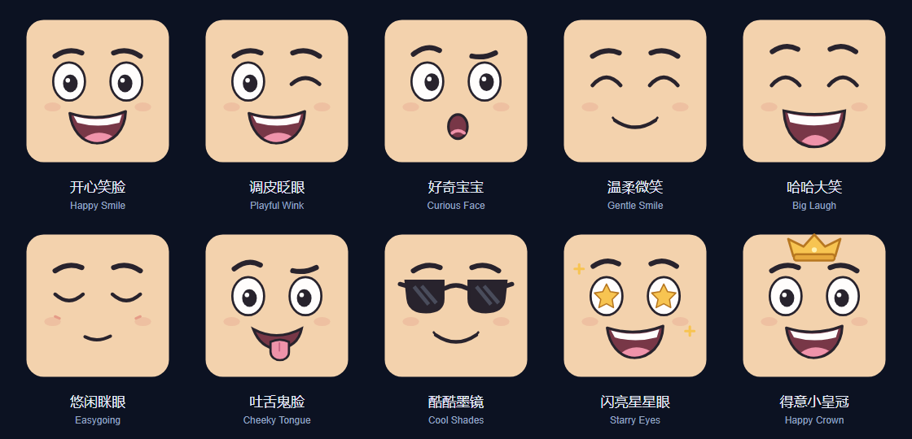

# 同脸型表情头像 · avatar4 · 2026-11-13

同日后续调整：用户指定「开心笑脸」为免费默认头像（`avatar-starling`）。其等级为 default、价格 0，首次拥有并装配；空白或无效旧头像值自动回到该款，已有其他有效头像选择保留。其余九款价格和等级不变。下文素材制作记录保留原阶段信息；最新商城截图见 `verification/shop-default-avatar-20261113.png`。

按最新参考图改为简洁平面卡通脸：十款使用完全相同的暖桃色圆角方脸、基础比例与描边风格，只变化眉眼、嘴巴和少量表情配饰。所有头像肤色统一为 `#F3D2AD`，不以人物、肤色或族群区分商品等级。原有十个商品 ID 保留，稀有度、价格和装备映射由现有商城代码保持。

| 保留 ID | 中文名 | English | 表情 |
|---|---|---|---|
| avatar-starling | 开心笑脸 | Happy Smile | 白眼球、灿烂笑脸 |
| avatar-cloudy | 调皮眨眼 | Playful Wink | 单眼眨眼与笑脸 |
| avatar-owl | 好奇宝宝 | Curious Face | 挑眉、侧看、小惊讶嘴型 |
| avatar-bear | 温柔微笑 | Gentle Smile | 弯弯笑眼与闭嘴微笑 |
| avatar-rocket | 哈哈大笑 | Big Laugh | 眯眼大笑 |
| avatar-luna | 悠闲眯眼 | Easygoing | 放松闭眼与浅笑 |
| avatar-fox | 吐舌鬼脸 | Cheeky Tongue | 吐舌玩笑 |
| avatar-bot | 酷酷墨镜 | Cool Shades | 同脸型加墨镜 |
| avatar-octo | 闪亮星星眼 | Starry Eyes | 白眼球内的金色星星瞳孔 |
| avatar-crown | 得意小皇冠 | Happy Crown | 同脸型加金色小皇冠 |

素材为本次原创代码绘制的 SVG，无下载的第三方素材、无 imagegen 调用，也没有用栅格编辑工具修改图片。所有单图均为 `256×256` / `viewBox="0 0 256 256"`，可无损缩放；每张约 1–1.6KB。基础脸统一为 `x=16,y=16,width=224,height=224,rx=27`。眉眼与嘴型均使用清楚的轮廓，在小头像尺寸下保持辨识度。

素材目录：`dist/assets/shop/avatars-v4/`，文件名沿用 `${id}.svg`。可直接读取 [manifest.json](../dist/assets/shop/avatars-v4/manifest.json) 取得商品 ID、中英名称、描述与路径。接入建议：仅将头像资源分支改为 `/assets/shop/avatars-v4/${id}.svg?v=20261113-avatar4`，独立 `AVATAR_VERSION` 为 `20261113-avatar4`，公共 `VERSION` 不变；更新显示名与描述即可，不改变拥有状态或装备 ID。旧 v2/v3 资源继续保留，方便回退。

展示资料：[矢量总览](../dist/assets/shop/avatars-v4/overview.svg)、[独立预览页面](../dist/assets/shop/avatars-v4/preview.html)。`overview.png` 是 Chrome headless 对本地预览页的直接截图，只用于文档展示，不作为运行头像。已人工查看全部十款总览；已用 XML 解析检查全部 SVG、256px 尺寸、viewBox 与统一基础脸颜色。实际商城接线与浏览器验收由主任务统一完成，尚不代表用户最终视觉批准。
