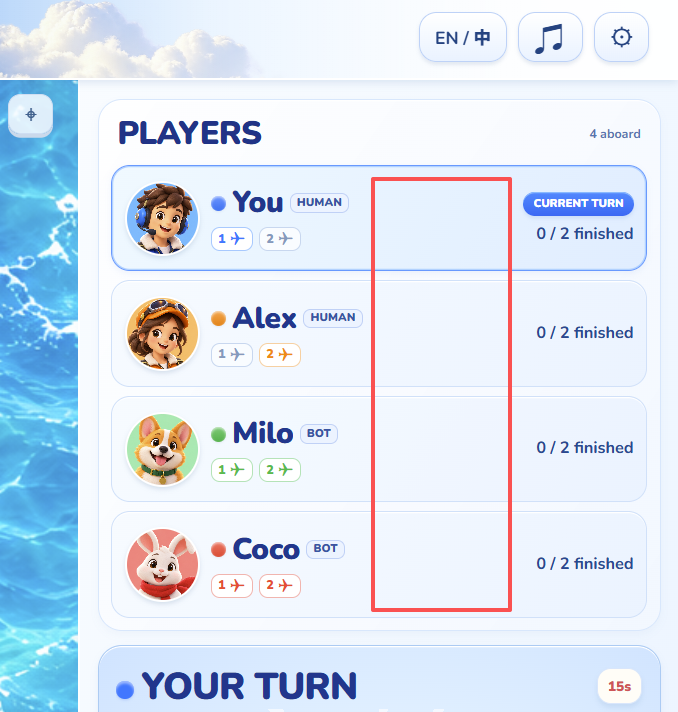
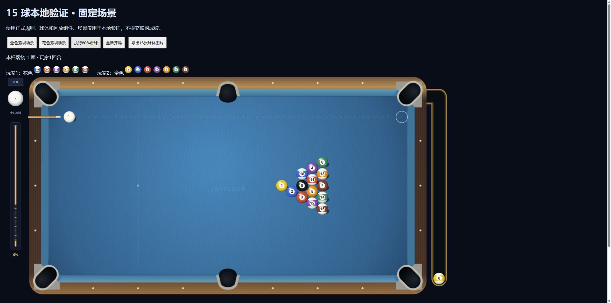
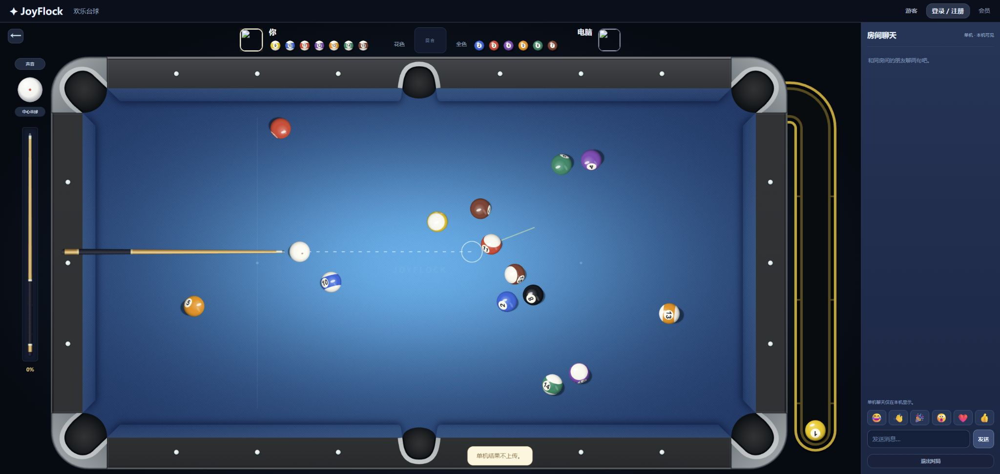

## 2026-11-01 UI38 当前覆盖：可对局的金翼领航
用户批准一款2D会员飞机，替换并删除UI37的三款3D飞机。主页、机库和默认插画对局使用同一张透明PNG，保留动态螺旋桨、机身1/2编号、镜像、跳格、碰撞和投影阴影。房间公开planeStyle由服务端真实会员资格与账号选择产生；旧gold/sapphire/night选择对外兼容到gold2d，到期回到经典飞机，原选择保留。原三款模型、GLB、导出脚本与专用测试页已删除；下方UI37文字仅为历史。
尾迹延长并加入宽度/透明度渐变；中文手机好友房提供系统分享/微信复制指引，邀请带lang=zh。实时3D棋盘仍仅是保留的实验源码路径，不属于本轮VIP飞机验收；3D骰子不变。
# v0.7.2 UI修订目标 · 2026-10-31

本轮继续先做UI，真实功能留给后续Codex。内部版本0.7.2，下载包仍为FlightParty-v0.7.zip。旧检查保留历史身份，本轮执行结果只写入QA，不预先声明通过。

## 本轮验收目标

| 区域 | 设计要求 | 边界 |
|---|---|---|
| 首页 | 快速匹配、创建房间两个主要入口，保留次级房码加入与练习 | 不先展示人数/模式/机器人偏好表单 |
| 快速匹配 | 直接显示房间席位和最多30秒等待；满员或机器人补齐后开始 | 本地预览不能声称匹配到真实玩家；BOT有明确标识 |
| 好友房 | 邀请链接/房码、成员和“准备起飞”；全员准备后匹配其他人 | 等朋友不计30秒，进入公共匹配才计时，朋友保留原席位 |
| 账号 | 邮箱密码无验证码，Google/GitHub入口；登录自动记录说明 | 无真实认证，不存真实密码、不提示真实登录成功 |
| 结算 | 登录后参与的新局自动记录完整结果，匿名不累计 | 无手动保存/认领；开局账号归属固定，退出登录不免结算；本轮不提示真实已保存 |
| 玩家与榜单 | 玩家积分/局数；首页积分榜与对局数榜各Top10 | 移除胜利榜/胜率；样例必须标注预览 |
| 既有画面 | 道路贴合、整岛取景、飞机编号/接触阴影、固定骰子尺寸不变 | 新UI不挤压棋盘或骰子；检查中英文、桌面与窄屏 |

线上默认经典四席是本版实现默认，本地2–4阵营及独立派对配置保留。普通20局/日、会员不限仍保留；匿名同20局是后续建议。服务端防篡改、30秒补位、登录自动统计和排行榜均需独立功能验收，不能由当前静态示例证明。完整要求见 [`V07-CONTRACT.md`](V07-CONTRACT.md)。

---

# v0.7 UI预览与保留画面对照（历史检查）

v0.7当轮先完成玩家统计、账号、排行榜、额度及表情等界面预览，真实功能交后续Codex。保留v0.6.2棋盘与左右公路的地面透视及转角、3D骰子、固定操作区、配色、接触阴影、原本地规则与撞机效果。v0.7已进行桌面与iframe窄视口检查，范围和限制见QA；这不代表用户最终美术验收或真实服务已经完成。

## v0.7 UI当轮检查（2026-10-30）

| 区域 | 实际检查结果 | 真实功能边界 |
|---|---|---|
| 玩家状态 | 1363英文、390中文和1920中文视口已看；卡片均无横向溢出，1920统计在中间列；窄视口最新12px数字/7px说明及112px卡片已截图查看 | 统计样例标预览，原生电脑无账号统计；不是真实账户积分 |
| 账号/会员/额度 | 实际切换匿名用尽无历史统计、会员无限、免费14/20、用尽0/20状态 | 均为UI预览，无真实登录、会员校验或服务端额度限制；UTC日重置是后续建议 |
| Top10 | 首页两榜各10条示例，切换胜利榜后OrangeOtto的196次胜利排第一 | 样例明确预览，无真实排行榜服务；匿名/电脑不入榜是后续规则 |
| 表情互动 | 已查看发送者浮泡和玩家头像角标，文案明确仅当前屏幕可见 | `reaction-preview.js/.css`仅本地展示，无跨设备共享 |
| 托管/重连 | 托管预览保留Alex姓名，标记改为AUTO*，显示UI PREVIEW | 真正断线/下线接管与重连尚未实现，后续须保留身份、避免重复扣次/结算 |
| 骰子与选机 | 1363英文掷前/掷后均300×124；390中文均108×151，点飞机2后其航行而1仍在基地；1920已观察300×249 | 1920掷后尺寸尚未复测；390为iframe视口，不是实体手机 |
| 结算 | 保持原结算界面，本轮未加积分说明或新结算预览 | 当前engine未改；新“前两名各完成两架即结束”和+2/+1/-1/-1结算UI/功能待实现 |

本轮26项测试及修改模块语法检查通过，原引擎哈希未变。1363桌面页面宽/scrollWidth为1363/1363；390窄视口实际内容为375/375，可纵向滚动；1920视口为1920/1920。未增加真实手机、GPU或联网服务验收，详细步骤和未覆盖项见 [`QA.md`](QA.md)。

不得将预览控件包装成真实注册、登录、购买或广播成功；匿名不保存累计统计。v0.7.1曾规划登录认领，已由v0.7.2的登录自动记录替代；旧胜利/胜率展示同样只属历史记录。未来真实接口及验收要求见 [`V07-CONTRACT.md`](V07-CONTRACT.md)。以下图片与条目保留为当前美术基线，不因加入新UI而失效。

## v0.6.2已完成细节（历史验收记录）

| 对照项 | 当前实现 | 验证及边界 |
|---|---|---|
| 左右边缘与路内沿倾斜不同 | 由固定正交边改为同一实测四边形的射影地面 | 依据1254px机场图四角及两侧中段测量；26项测试通过 |
| 四角压到公路或不贴合 | 低路缘切角1.2，地板/罩层按1.15切角裁切 | v0.6.2的1363×936实际画面已查看，衔接改善 |
| 改视角后操作偏移 | 棋格、飞机、阴影及点击命中共用project() | 同一投影关系；v0.6.2交互记录见QA |
| 原有构图 | 海岛图片比例、整岛缩放与外围海面规则保留 | 不拉伸环境，不按视口重新改变透视 |

## v0.6.1保留细节

- 四阵营色彩更鲜明，基地凹槽增加明暗层次，白色棋格和云保持中性。
- 飞机下方增加接触核心和柔边投影，随飞行高度变化；不对整张飞机图添加黑边。
- 按钮行固定占位，掷骰前后骰子宿主尺寸一致；详细数据见QA。

## v0.6骰子

| 对照项 | 当前实现 | 验证及边界 |
|---|---|---|
| 真实3D | 固定六面圆角网格，蓝色点数为凹陷几何 | 无生成图片或CSS面片替代；当前软件3D路径已查看 |
| 掷骰表现 | 1120ms多轴翻滚、轻跳和末段回弹，动态光影 | 程序动画，不是物理引擎模拟 |
| 结果一致 | 原规则决定点数，对应面最终朝玩家，文字显示同一结果 | 六面身份不变，对面点数合计7；包含于v0.6.2基线26项检查 |
| 浏览器兼容 | WebGL优先，软件3D渲染同一模型作为兼容路径 | GPU WebGL实际画面与真实手机性能尚未验证 |
| 交互 | 翻滚时锁定选机，支持减少动画和取消旧投掷 | 不更改回合、起飞、撞机和终点规则 |

v0.6历史预览：`verification/dice-3d-preview.mp4`，640×480、约7.39秒，展示5/2/6点并含音轨。v0.6软件3D路径实际检查覆盖1363×936对局、1366×768和390×844布局；主面和结果文字一致，无横向溢出，窄视口保留纵向滚动。v0.5撞机录屏保留在 `verification/collision-preview.mp4`。

## v0.5保留细节（历史对照）

| 对照项 | v0.5实际实现 | 验证及边界 |
|---|---|---|
| 棋盘过大、贴近镜头 | 整岛按固定比例缩小，保留道路、海岸和外围海面 | 棋盘、全部路线和停机飞机在多个视口完整可见 |
| 棋盘像翘起的独立板 | 固定正交投影与机场地面标定，底座改为低矮路缘 | 路面和棋盘边缘同向，相机不随窗口改变角度 |
| 顶栏缺少背景 | 蓝天、白云、渐变模式标签和蓝白控件 | 是实际网页背景与控件，不是整页概念图 |
| 右上建筑突兀 | 移除机库，接续道路和绿植；保留较纤细的外围塔台 | 新环境图保留原地面布局 |
| 玩家卡片留白过多 | 集中名称/类型，右侧显示回合/完成状态，加入真实飞机1/2状态 | 新玩具卡通头像；状态来自对局数据 |
| 骰子缺乏立体细节 | 三个可见面、凹陷蓝色点数、面间明暗、高光和落影 | 正面为实际点数；已观察正面6与6个点一致 |
| 飞机机身空白 | 白色侧板增加1/2编号，跟随机身动画；镜像时数字正读 | 小屏数字仍较小，可通过同编号按钮和状态识别 |
| 玩法和撞击 | 原engine.js逐字未改，烟雾、星星、轨迹与音效机制保留 | 17项测试通过；视频文件位于verification目录 |

**棋盘仍为固定视角2.5D，地面使用v0.6.2射影标定；骰子是独立真实3D模型。用户认可局部进步，尚未全面验收本版。** 不是逐像素复刻；海面更亮、纹理更密，飞机仍是固定视角图片。飞机没有独立表情或螺旋桨骨骼动画，中央旗帜为静态布面。实验Three.js棋盘路径、骰子GPU WebGL画面和真实手机性能未验收。

v0.5历史浏览器检查覆盖1366×768、1920×1080、2048×960和390×844；桌面无页面溢出，手机视口保留纵向滚动。详细记录见 `QA.md`。

历次参考 `annotated-detail-reference.png`、`collision-detail-reference.png`、`v04-detail-feedback.png` 均保留。v0.4的自适应pitch/背景拉伸和v0.5的depth=1正交边缘都已是历史，不能作为当前地面标定说明。

## 台球15球本地参考（2026-11-05，待用户验收）

球体统一为16半径；独立PNG和运行时球面渲染共享设计。顶部显示剩余目标，右侧槽为与桌沿相接的同尺度管道。当前图片为固定场景的实际Chrome截图。

最新球桌/回球槽本地截图（2026-11-05，待用户视觉验收）：

## 台球布料与袋口细节（2026-11-05，待用户验收）
用户已认可当前碰球声音，本轮只改球桌材质和袋口。全桌与四边采用同源细布纹、透明斜面阴影；袋口置于库边下层，去除原梯形凸块外观。右侧为同一绘制结果的中袋和角袋放大图。

### 2026-11-05 最新台球参考与证据
用户追加关注：袋口缓冲边等厚、深色外框加宽、袋颚不挡桌上球、白球完整入袋、GO与同步跳动声。最终本地截图：verification/pool-corner-rim-20261105.png（统一布料/袋边细节）、verification/pool-latest-table-20261105.png（正式页开球后）、verification/pool-white-middle-20261105.png（白球仍在袋内）、verification/pool-go-20261105.png（GO）。这些是实现证据，不能视为用户已最终批准。

## 2026-11-05 尖端护口、分离双轨及结算参考
当前本地截图：verification/pool-pearl-pockets-20261105.png；verification/pool-double-return-20261105.png；verification/pool-expanded-table-20261105.png；verification/pool-result-dialog-20261105.png。
以用户本轮参考为准：护口两端收尖，袋口斜切布面连贯；袋内中央浅、外围深；外金色高轨与暗低轨隔开，底部双U并有圆弯；球杆加长、桌面扩大。胜负结果移至弹窗，按钮“再玩一局”，撒花覆盖视口。截图只代表已实现本地效果，不代表用户最终视觉批准。音频、回球及真实终局可在QA所列验收页复现。

2026-11-05 袋口连续性：入口布面与台面使用同坐标纹理，阴影沿库边及两侧斜角连续；进袋球不再出现矩形裁切缺口。固定时间截图docs/verification/pool-pocket-continuity-20261105.png，场景为正式渲染函数验收，仍待用户视觉确认。

2026-11-05 角袋护口与直边衔接：将角部灰色面板/直边接缝从32调整到护口尖端18，使护口、蓝色斜口与黑色直边共享接点，去掉护口下方多余灰块。四角镜像一致；不改洞形、球路及物理规则。Chrome正式绘制函数放大截图检查，证据docs/verification/pool-corner-junction-20261105.png。npm test 164/164通过，pool-table.js语法通过。

2026-11-05 护口末端延伸：浅灰护口外缘继续沿斜向伸至黑色直边接缝，末端保留11单位接触宽度，避免提前收成悬空尖点。四角共用轮廓；不改袋口裁切与物理。Chrome放大检查截图docs/verification/pool-guard-extension-20261105.png；语法检查通过，npm test 164/164通过。

2026-11-05 护口两端对称：右上端同样延伸至横向黑框，接触宽度与下端均为11单位。四个角袋共享此护口轮廓。Chrome放大视觉检查，截图docs/verification/pool-guard-symmetric-20261105.png；语法检查与164项测试通过。

2026-11-05 库边外侧投影：删除中袋/角袋垫子内部的深色斜块，减弱鼻口内渐变；阴影改由完整库边轮廓投到外侧桌布，通过evenodd扣除六块库边本体，连续覆盖斜口到直边。仅静态绘制变更。Chrome全桌及中袋/角袋放大截图确认外侧投影：docs/verification/pool-cushion-cast-shadow-20261105.png。JS语法通过，npm test 164/164通过。

2026-11-05 护口宽度微调：两个斜向末端接触宽度由11减至9单位（约18%），保持对称和贴合黑框。Chrome细节检查截图docs/verification/pool-guard-width-20261105.png；JS语法和164项测试通过。

2026-11-05 顶灯明暗对比加强，白色贝壳定位点+16%，中袋视觉宽度约-9%。Chrome正式页满力开球后截图docs/verification/pool-overhead-light-power-20261105.png。亮度与尺寸仍以用户视觉验收为准。

2026-11-05 顶灯再次增强：中央蓝色光区提高亮度、四边和四角进一步压暗，同一台呢连续渐变。Chrome正式单机页实图：docs/verification/pool-strong-light-celebration-20261105.png。截图是本地当前源码渲染；未宣称用户已批准最终美术。

## 2026-11-05 最新球杆、织纹与袋内动作证据

本地正式对局：左拉杆及桌面杆均采用弧形皮头、先角、渐细木纹、握把和连接环；四角及护口阴影、同源细台呢织纹已更新。用户最近要求的球心捕获、袋内实际碰壁、朝管道滚动后由边缘遮挡，以及电脑瞄准后拉出杆，分别在正式模块场景核验。以下是实现截图，仍待用户视觉批准。

细节图：verification/pool-pocket-shadows-weave-20261105.png；逐帧图：verification/pool-directional-pocket-20261105.png；电脑出杆前奏：verification/pool-opponent-cue-20261105.png。逐帧图为实际物理捕获数据驱动的固定时刻渲染，不是整局录像。
