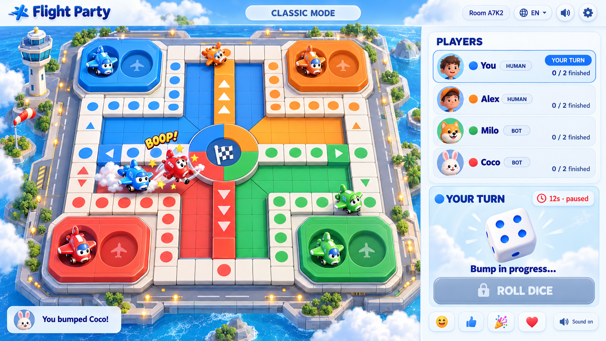
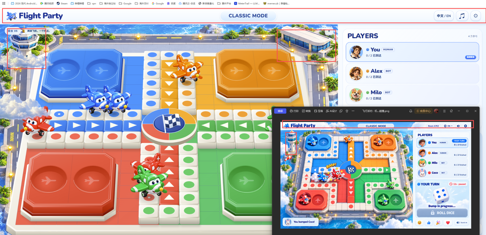
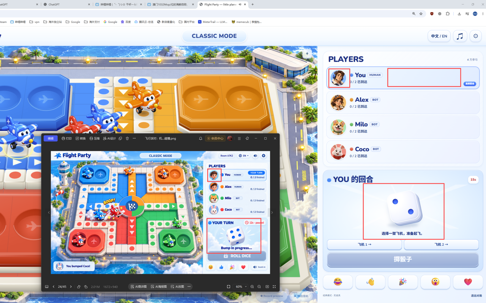
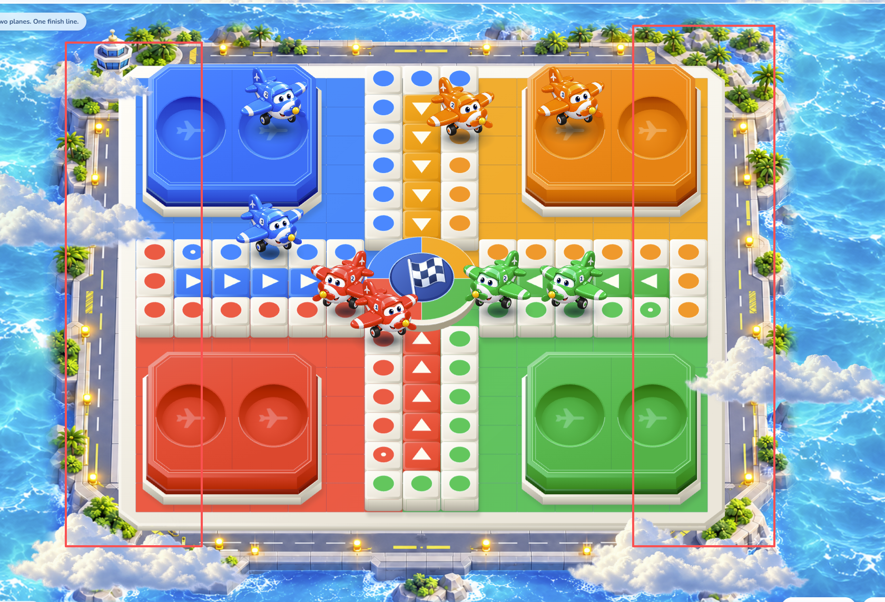
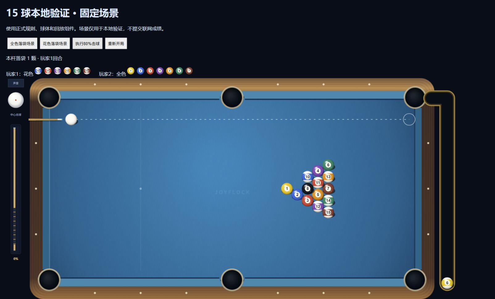
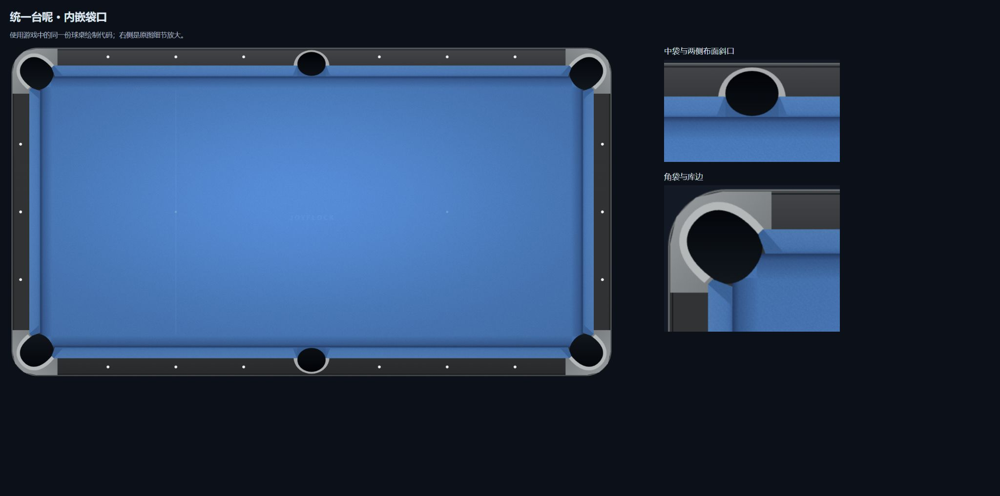

## 2026-11-01 UI38 当前覆盖：可对局的金翼领航
用户批准一款2D会员飞机，替换并删除UI37的三款3D飞机。主页、机库和默认插画对局使用同一张透明PNG，保留动态螺旋桨、机身1/2编号、镜像、跳格、碰撞和投影阴影。房间公开planeStyle由服务端真实会员资格与账号选择产生；旧gold/sapphire/night选择对外兼容到gold2d，到期回到经典飞机，原选择保留。原三款模型、GLB、导出脚本与专用测试页已删除；下方UI37文字仅为历史。
尾迹延长并加入宽度/透明度渐变；中文手机好友房提供系统分享/微信复制指引，邀请带lang=zh。实时3D棋盘仍仅是保留的实验源码路径，不属于本轮VIP飞机验收；3D骰子不变。
# v0.7.2 UI修订目标 · 2026-10-31

本轮继续先做UI，真实功能留给后续Codex。内部版本0.7.2，下载包仍为FlightParty-v0.7.zip。旧检查保留历史身份，本轮执行结果只写入QA，不预先声明通过。

## 本轮验收目标

| 区域 | 设计要求 | 边界 |
|---|---|---|
| 首页 | 快速匹配、创建房间两个主要入口，保留次级房码加入与练习 | 不先展示人数/模式/机器人偏好表单 |
| 快速匹配 | 直接显示房间席位和最多30秒等待；满员或机器人补齐后开始 | 本地预览不能声称匹配到真实玩家；BOT有明确标识 |
| 好友房 | 邀请链接/房码、成员和“准备起飞”；全员准备后匹配其他人 | 等朋友不计30秒，进入公共匹配才计时，朋友保留原席位 |
| 账号 | 邮箱密码无验证码，Google/GitHub入口；登录自动记录说明 | 无真实认证，不存真实密码、不提示真实登录成功 |
| 结算 | 登录后参与的新局自动记录完整结果，匿名不累计 | 无手动保存/认领；开局账号归属固定，退出登录不免结算；本轮不提示真实已保存 |
| 玩家与榜单 | 玩家积分/局数；首页积分榜与对局数榜各Top10 | 移除胜利榜/胜率；样例必须标注预览 |
| 既有画面 | 道路贴合、整岛取景、飞机编号/接触阴影、固定骰子尺寸不变 | 新UI不挤压棋盘或骰子；检查中英文、桌面与窄屏 |

线上默认经典四席是本版实现默认，本地2–4阵营及独立派对配置保留。普通20局/日、会员不限仍保留；匿名同20局是后续建议。服务端防篡改、30秒补位、登录自动统计和排行榜均需独立功能验收，不能由当前静态示例证明。完整要求见 [`V07-CONTRACT.md`](V07-CONTRACT.md)。

---

# v0.7 UI预览与保留画面对照（历史检查）

v0.7当轮先完成玩家统计、账号、排行榜、额度及表情等界面预览，真实功能交后续Codex。保留v0.6.2棋盘与左右公路的地面透视及转角、3D骰子、固定操作区、配色、接触阴影、原本地规则与撞机效果。v0.7已进行桌面与iframe窄视口检查，范围和限制见QA；这不代表用户最终美术验收或真实服务已经完成。

## v0.7 UI当轮检查（2026-10-30）

| 区域 | 实际检查结果 | 真实功能边界 |
|---|---|---|
| 玩家状态 | 1363英文、390中文和1920中文视口已看；卡片均无横向溢出，1920统计在中间列；窄视口最新12px数字/7px说明及112px卡片已截图查看 | 统计样例标预览，原生电脑无账号统计；不是真实账户积分 |
| 账号/会员/额度 | 实际切换匿名用尽无历史统计、会员无限、免费14/20、用尽0/20状态 | 均为UI预览，无真实登录、会员校验或服务端额度限制；UTC日重置是后续建议 |
| Top10 | 首页两榜各10条示例，切换胜利榜后OrangeOtto的196次胜利排第一 | 样例明确预览，无真实排行榜服务；匿名/电脑不入榜是后续规则 |
| 表情互动 | 已查看发送者浮泡和玩家头像角标，文案明确仅当前屏幕可见 | `reaction-preview.js/.css`仅本地展示，无跨设备共享 |
| 托管/重连 | 托管预览保留Alex姓名，标记改为AUTO*，显示UI PREVIEW | 真正断线/下线接管与重连尚未实现，后续须保留身份、避免重复扣次/结算 |
| 骰子与选机 | 1363英文掷前/掷后均300×124；390中文均108×151，点飞机2后其航行而1仍在基地；1920已观察300×249 | 1920掷后尺寸尚未复测；390为iframe视口，不是实体手机 |
| 结算 | 保持原结算界面，本轮未加积分说明或新结算预览 | 当前engine未改；新“前两名各完成两架即结束”和+2/+1/-1/-1结算UI/功能待实现 |

本轮26项测试及修改模块语法检查通过，原引擎哈希未变。1363桌面页面宽/scrollWidth为1363/1363；390窄视口实际内容为375/375，可纵向滚动；1920视口为1920/1920。未增加真实手机、GPU或联网服务验收，详细步骤和未覆盖项见 [`QA.md`](QA.md)。

不得将预览控件包装成真实注册、登录、购买或广播成功；匿名不保存累计统计。v0.7.1曾规划登录认领，已由v0.7.2的登录自动记录替代；旧胜利/胜率展示同样只属历史记录。未来真实接口及验收要求见 [`V07-CONTRACT.md`](V07-CONTRACT.md)。以下图片与条目保留为当前美术基线，不因加入新UI而失效。

## v0.6.2已完成细节（历史验收记录）

| 对照项 | 当前实现 | 验证及边界 |
|---|---|---|
| 左右边缘与路内沿倾斜不同 | 由固定正交边改为同一实测四边形的射影地面 | 依据1254px机场图四角及两侧中段测量；26项测试通过 |
| 四角压到公路或不贴合 | 低路缘切角1.2，地板/罩层按1.15切角裁切 | v0.6.2的1363×936实际画面已查看，衔接改善 |
| 改视角后操作偏移 | 棋格、飞机、阴影及点击命中共用project() | 同一投影关系；v0.6.2交互记录见QA |
| 原有构图 | 海岛图片比例、整岛缩放与外围海面规则保留 | 不拉伸环境，不按视口重新改变透视 |

## v0.6.1保留细节

- 四阵营色彩更鲜明，基地凹槽增加明暗层次，白色棋格和云保持中性。
- 飞机下方增加接触核心和柔边投影，随飞行高度变化；不对整张飞机图添加黑边。
- 按钮行固定占位，掷骰前后骰子宿主尺寸一致；详细数据见QA。

## v0.6骰子

| 对照项 | 当前实现 | 验证及边界 |
|---|---|---|
| 真实3D | 固定六面圆角网格，蓝色点数为凹陷几何 | 无生成图片或CSS面片替代；当前软件3D路径已查看 |
| 掷骰表现 | 1120ms多轴翻滚、轻跳和末段回弹，动态光影 | 程序动画，不是物理引擎模拟 |
| 结果一致 | 原规则决定点数，对应面最终朝玩家，文字显示同一结果 | 六面身份不变，对面点数合计7；包含于v0.6.2基线26项检查 |
| 浏览器兼容 | WebGL优先，软件3D渲染同一模型作为兼容路径 | GPU WebGL实际画面与真实手机性能尚未验证 |
| 交互 | 翻滚时锁定选机，支持减少动画和取消旧投掷 | 不更改回合、起飞、撞机和终点规则 |

v0.6历史预览：`verification/dice-3d-preview.mp4`，640×480、约7.39秒，展示5/2/6点并含音轨。v0.6软件3D路径实际检查覆盖1363×936对局、1366×768和390×844布局；主面和结果文字一致，无横向溢出，窄视口保留纵向滚动。v0.5撞机录屏保留在 `verification/collision-preview.mp4`。

## v0.5保留细节（历史对照）

| 对照项 | v0.5实际实现 | 验证及边界 |
|---|---|---|
| 棋盘过大、贴近镜头 | 整岛按固定比例缩小，保留道路、海岸和外围海面 | 棋盘、全部路线和停机飞机在多个视口完整可见 |
| 棋盘像翘起的独立板 | 固定正交投影与机场地面标定，底座改为低矮路缘 | 路面和棋盘边缘同向，相机不随窗口改变角度 |
| 顶栏缺少背景 | 蓝天、白云、渐变模式标签和蓝白控件 | 是实际网页背景与控件，不是整页概念图 |
| 右上建筑突兀 | 移除机库，接续道路和绿植；保留较纤细的外围塔台 | 新环境图保留原地面布局 |
| 玩家卡片留白过多 | 集中名称/类型，右侧显示回合/完成状态，加入真实飞机1/2状态 | 新玩具卡通头像；状态来自对局数据 |
| 骰子缺乏立体细节 | 三个可见面、凹陷蓝色点数、面间明暗、高光和落影 | 正面为实际点数；已观察正面6与6个点一致 |
| 飞机机身空白 | 白色侧板增加1/2编号，跟随机身动画；镜像时数字正读 | 小屏数字仍较小，可通过同编号按钮和状态识别 |
| 玩法和撞击 | 原engine.js逐字未改，烟雾、星星、轨迹与音效机制保留 | 17项测试通过；视频文件位于verification目录 |

**棋盘仍为固定视角2.5D，地面使用v0.6.2射影标定；骰子是独立真实3D模型。用户认可局部进步，尚未全面验收本版。** 不是逐像素复刻；海面更亮、纹理更密，飞机仍是固定视角图片。飞机没有独立表情或螺旋桨骨骼动画，中央旗帜为静态布面。实验Three.js棋盘路径、骰子GPU WebGL画面和真实手机性能未验收。

v0.5历史浏览器检查覆盖1366×768、1920×1080、2048×960和390×844；桌面无页面溢出，手机视口保留纵向滚动。详细记录见 `QA.md`。

历次参考 `annotated-detail-reference.png`、`collision-detail-reference.png`、`v04-detail-feedback.png` 均保留。v0.4的自适应pitch/背景拉伸和v0.5的depth=1正交边缘都已是历史，不能作为当前地面标定说明。

## 台球15球本地参考（2026-11-05，待用户验收）

球体统一为16半径；独立PNG和运行时球面渲染共享设计。顶部显示剩余目标，右侧槽为与桌沿相接的同尺度管道。当前图片为固定场景的实际Chrome截图。

最新球桌/回球槽本地截图（2026-11-05，待用户视觉验收）：

## 台球布料与袋口细节（2026-11-05，待用户验收）
用户已认可当前碰球声音，本轮只改球桌材质和袋口。全桌与四边采用同源细布纹、透明斜面阴影；袋口置于库边下层，去除原梯形凸块外观。右侧为同一绘制结果的中袋和角袋放大图。

### 2026-11-05 最新台球参考与证据
用户追加关注：袋口缓冲边等厚、深色外框加宽、袋颚不挡桌上球、白球完整入袋、GO与同步跳动声。最终本地截图：verification/pool-corner-rim-20261105.png（统一布料/袋边细节）、verification/pool-latest-table-20261105.png（正式页开球后）、verification/pool-white-middle-20261105.png（白球仍在袋内）、verification/pool-go-20261105.png（GO）。这些是实现证据，不能视为用户已最终批准。

## 2026-11-05 尖端护口、分离双轨及结算参考
当前本地截图：verification/pool-pearl-pockets-20261105.png；verification/pool-double-return-20261105.png；verification/pool-expanded-table-20261105.png；verification/pool-result-dialog-20261105.png。
以用户本轮参考为准：护口两端收尖，袋口斜切布面连贯；袋内中央浅、外围深；外金色高轨与暗低轨隔开，底部双U并有圆弯；球杆加长、桌面扩大。胜负结果移至弹窗，按钮“再玩一局”，撒花覆盖视口。截图只代表已实现本地效果，不代表用户最终视觉批准。音频、回球及真实终局可在QA所列验收页复现。

2026-11-05 袋口连续性：入口布面与台面使用同坐标纹理，阴影沿库边及两侧斜角连续；进袋球不再出现矩形裁切缺口。固定时间截图docs/verification/pool-pocket-continuity-20261105.png，场景为正式渲染函数验收，仍待用户视觉确认。

2026-11-05 角袋护口与直边衔接：将角部灰色面板/直边接缝从32调整到护口尖端18，使护口、蓝色斜口与黑色直边共享接点，去掉护口下方多余灰块。四角镜像一致；不改洞形、球路及物理规则。Chrome正式绘制函数放大截图检查，证据docs/verification/pool-corner-junction-20261105.png。npm test 164/164通过，pool-table.js语法通过。

2026-11-05 护口末端延伸：浅灰护口外缘继续沿斜向伸至黑色直边接缝，末端保留11单位接触宽度，避免提前收成悬空尖点。四角共用轮廓；不改袋口裁切与物理。Chrome放大检查截图docs/verification/pool-guard-extension-20261105.png；语法检查通过，npm test 164/164通过。

2026-11-05 护口两端对称：右上端同样延伸至横向黑框，接触宽度与下端均为11单位。四个角袋共享此护口轮廓。Chrome放大视觉检查，截图docs/verification/pool-guard-symmetric-20261105.png；语法检查与164项测试通过。

2026-11-05 库边外侧投影：删除中袋/角袋垫子内部的深色斜块，减弱鼻口内渐变；阴影改由完整库边轮廓投到外侧桌布，通过evenodd扣除六块库边本体，连续覆盖斜口到直边。仅静态绘制变更。Chrome全桌及中袋/角袋放大截图确认外侧投影：docs/verification/pool-cushion-cast-shadow-20261105.png。JS语法通过，npm test 164/164通过。

2026-11-05 护口宽度微调：两个斜向末端接触宽度由11减至9单位（约18%），保持对称和贴合黑框。Chrome细节检查截图docs/verification/pool-guard-width-20261105.png；JS语法和164项测试通过。

2026-11-05 顶灯明暗对比加强，白色贝壳定位点+16%，中袋视觉宽度约-9%。Chrome正式页满力开球后截图docs/verification/pool-overhead-light-power-20261105.png。亮度与尺寸仍以用户视觉验收为准。

2026-11-05 顶灯再次增强：中央蓝色光区提高亮度、四边和四角进一步压暗，同一台呢连续渐变。Chrome正式单机页实图：docs/verification/pool-strong-light-celebration-20261105.png。截图是本地当前源码渲染；未宣称用户已批准最终美术。

## 2026-11-05 最新球杆、织纹与袋内动作证据

本地正式对局：左拉杆及桌面杆均采用弧形皮头、先角、渐细木纹、握把和连接环；四角及护口阴影、同源细台呢织纹已更新。用户最近要求的球心捕获、袋内实际碰壁、朝管道滚动后由边缘遮挡，以及电脑瞄准后拉出杆，分别在正式模块场景核验。以下是实现截图，仍待用户视觉批准。

细节图：verification/pool-pocket-shadows-weave-20261105.png；逐帧图：verification/pool-directional-pocket-20261105.png；电脑出杆前奏：verification/pool-opponent-cue-20261105.png。逐帧图为实际物理捕获数据驱动的固定时刻渲染，不是整局录像。

## 2026-11-12 商城卡片「已拥有」标识收敛

用户截图判定右上角绿色斜角标与底部胶囊重复。已移除右上角斜标，卡片上「已拥有」仅由底部绿色胶囊表达一次；等级标签、1px 细边、深色渐变与 hover 黄色内框保持 11:00 / 11:11 两轮校准结果不变。已装备仍由稀有度色细环与顶部当前装扮栏表达，会员免费仍由底部文字表达。

单卡放大：verification/nostate-card-zoom-20261112.png；hover 内框：verification/nostate-hover-20261112.png；VIP 场景：verification/nostate-vip-20261112.png；390px 移动端：verification/nostate-mobile-390-20261112.png。以上为本地当前源码的 Chrome 实机渲染，仍待用户视觉批准。

## 2026-11-12 游戏道具：棋子 / 棋盘造型（待用户视觉批准）

商城新增「对局棋子」「对局棋盘」两个分区，各 3 款（霓虹 / 翡翠 / 星曜），一套造型适配四子连珠、五子棋、国际象棋、井字棋。装备后的**己方**棋子换成所选造型，对手保持默认；棋盘为双方公用，按 年VIP > VIP > 普通 → 累计得分 → 随机 裁决后统一渲染。商城卡片预览与对局使用同一份 CSS 色表。

四子连珠：verification/cosmetics-four-20261112.png（己方翡翠棋子、对手默认粉棋、霓虹棋盘）；井字棋：verification/cosmetics-xo-20261112.png（绿 X、粉 O）；国际象棋：verification/cosmetics-chess-20261112.png；五子棋：verification/cosmetics-gomoku-20261112.png（主题木纹、格线与外框，己方绿子 / 对手白子）；棋盘分区：verification/cosmetics-shop-boards-20261112.png；390px：verification/cosmetics-mobile-390-20261112.png。以上为本地当前源码的 Chrome 实机渲染，仍待用户视觉批准。

## 2026-11-12 台球 / 斯诺克：球、球杆、桌球台造型（待用户视觉批准）

商城新增「台球用球」「球杆」「桌球台」三个分区，各 3 款（霓虹 / 翡翠 / 星曜），一套同时适用欢乐台球与斯诺克。球组按**每颗球**单独设计：16 颗球各自保留号码、条纹与配色，卡片预览展示 1/3/8/9/12/15 六颗互不相同的球；球杆只替换本人出杆那一根；台呢为双方公用，按 年VIP > VIP > 普通 → 累计得分 → 随机 裁决，说明显示在棋盘上方。显示方式与上一批棋子 / 棋盘卡片完全一致（同样的深色渐变、细边、等级标签、绿色「已拥有」胶囊、每行 6 个）。

球杆分区：verification/billiards-shop-cues-20261112.png；桌球台分区：verification/billiards-shop-tables-20261112.png；欢乐台球对局：verification/billiards-pool-20261112.png（逐球彩色签名环、星曜球杆、裁决后的霓虹台呢）；我方积分胜出后的翡翠台呢：verification/billiards-pool-jade-table-20261112.png（台呢由蓝变翡翠绿、说明为「你的积分更高」）；斯诺克对局：verification/billiards-snooker-20261112.png（主题台呢与紫色球杆，红 / 彩球保持语义色）；390px：verification/billiards-mobile-390-20261112.png。以上为本地当前源码的 Chrome 实机渲染，仍待用户视觉批准。

## 2026-11-12 hover 黄色内框收敛为单根（待用户视觉批准）

用户截图问「内黄色框中间还有一根线」。原因是多层描边叠加：卡片 1px 稀有度 hairline（传说款橙金）+ hover 的 2px 亮黄内框 + 内框绿色 inset 阴影 + 顶部 inset 高光 + 已装备环。已把 hover / focus 状态收敛成**只剩一根黄色圆角框**，静止态、等级标签、绿色「已拥有」胶囊、其它卡片描边均不变。

未拥有状态 hover：verification/oneframe-hover-20261112.png；静止态：verification/oneframe-idle-20261112.png；整行对比：verification/oneframe-row-20261112.png；390px：verification/oneframe-mobile-390-20261112.png。Chrome 实测 hover 卡片 `border-top-color` 为透明、内框仅 `2px #ffd84d` 且无 inset 阴影。

## 2026-11-12 商城商品 hover 音效（听觉验收，非视觉）

用户要求鼠标移到商品上时「跟首页一样的音效」。此前 `/shop.html` 未加载共享音效模块，商城整体静音；现已接入 `site-hover-sfx.js`，商品卡片复用首页九张游戏封面的 **zoom grow**（柔和上升 whoosh + pop），而非按钮滴答声，音量略低（`.82`）、节流更紧（150ms），四个静音开关与自动播放手势门控全部沿用。音效本身无视觉，以下截图仅为交互位置证据。

首页封面（同一音色来源）：verification/shopsfx-home-cover-20261112.png；商城 390px：verification/shopsfx-mobile-390-20261112.png。Chrome CDP 21/21：真实点击解锁后 hover 第一张卡 `zoom=1`、立即重入同卡 `throttled=1`、第二张卡 `zoom=2`、静音后第三张卡 `blocked=1`、首页封面 `zoom=1`。仍待用户听觉确认。

## 2026-11-12 顶部渐变只保留等级标签带（待用户视觉批准）

用户红框圈出卡片顶部约 44px 的「稀有」标签带，要求渐变只留这一小块。此前 `linear-gradient` 铺到整卡 46% 高度、`radial-gradient` 铺到 72%，飞机、名称与「已拥有」胶囊都压在蓝色洗色上；现两层都收进 `46px`，下方为纯 `#080e22`。

修复后单卡：verification/topband-card-20261112.png（顶部窄带浅蓝、机身与胶囊落在纯深色上，无硬边接缝）；整行：verification/topband-row-20261112.png（稀有蓝 / 史诗紫 / 传说金三档窄带一致）；hover：verification/topband-hover-20261112.png（单根黄框仍保留）；390px：verification/topband-mobile-390-20261112.png。Chrome CDP 16/16、像素复核 y≥54 起恒为 `(8,16,37)`。仍待用户视觉批准。

## 2026-11-12 卡片外边框发光（待用户视觉批准）

用户对比当前卡片与参考图（红框圈出亮蓝发光顶边），希望外边框像参考那样带光。参考图亮线约 `(48,156,207)`、上方 15px 有蓝色柔光；现在卡片描边提亮为稀有度专属亮色，并叠加两层纯模糊光晕（上方权重更大），仍是 1px 单线，不新增锐利双环。hover 时蓝光晕随描边一起退场，只留黄色内框。

纯卡片特写（隐藏分区标题）：verification/glowborder-card-clean-20261112.png；整行：verification/glowborder-row-20261112.png（稀有蓝 / 史诗紫 / 传说金三档发光）；hover：verification/glowborder-hover-20261112.png（单根黄框，无蓝光晕）；已拥有：verification/glowborder-equipped-20261112.png（光晕更强、无第二根线）；390px：verification/glowborder-mobile-390-20261112.png。Chrome CDP 20/20、像素复核顶边上方约 15px 蓝色渐亮。仍待用户视觉批准。

## 2026-11-12 对局内装扮说明横幅移除（待用户视觉批准）

用户红框圈出欢乐台球对局中双方头像上方那一行「球组 星曜 · 球杆 翡翠 · 台呢 霓虹（你的积分更高）」，要求去掉。现在整条说明横幅（四棋类的「棋子 / 棋盘」同款）不再渲染；头像、回合、电脑、球桌与已装备的球组 / 球杆 / 台呢造型全部保留，裁决规则与联机数据接口也不变。

改动后顶部特写：verification/noteoff-pool-top-20261112.png；完整台球对局：verification/noteoff-pool-20261112.png；斯诺克：verification/noteoff-snooker-20261112.png；四子棋：verification/noteoff-four-20261112.png；390px：verification/noteoff-mobile-390-20261112.png。Chrome CDP 34/34：8 个页面 / 场景无 `#cosmetic-note` 与说明文案，注入的星曜球组与翡翠球杆仍生效，年 VIP 对手裁决仍为 `tier / b / jade`。仍待用户视觉批准。

## 2026-11-12 台球击球后卡死与球杆消失（已修复，待用户确认）

用户换球杆后打了一球，画面卡住、球杆不再显示。控制台报 `createRadialGradient … non-finite`：进袋球绘制时把皮肤对象误放进光源参数，算出 NaN，一个异常把整条动画帧循环打断。现已修正参数顺序并给球体绘制加了有限值兜底。

修复前完整对局：verification/poollight-before-after-shot-20261112.png（红框区域无球杆）；修复后完整对局：verification/poollight-after-after-shot-20261112.png（球杆与瞄准线恢复、回合继续，逐球主题配色与签名环也真正生效）。Chrome CDP 修复前 4/9 精确复现、修复后 9/9，上一批说明横幅验收回归 34/34。用户当前标签页为旧缓存，需 Ctrl+F5 后确认。

## 2026-11-12 商城免费默认款与「装配中」斜标（待用户视觉批准）

商城现在每一类装扮都有免费的原样基线：飞机是默认蓝色飞机、拖尾是无拖尾、光标是默认光标，棋子 / 棋盘 / 球组 / 球杆 / 桌球台也各有默认款；**头像按你的要求不设默认款**。「默认」不是第四档稀有度，只是把原样外观显示成一张免费卡片，可购买的三档仍是稀有、史诗、传说，排序变成「默认 → 稀有 → 史诗 → 传说」。

之前看不出哪件正在用，现在把上次去掉的右上角斜标加回来了，但只在**当前装配**的那张卡上出现，文字改成「装配中」；底部绿色「已拥有」胶囊保持不变，两处不再重复。

球杆分区切换前后：verification/shopdefault-cue-section-before-20261112.png（斜标在「默认球杆」）与 verification/shopdefault-cue-section-equipped-20261112.png（点「霓虹球杆」后斜标移到第二张，默认球杆不再有斜标）。无拖尾分区：verification/shopdefault-trail-section-20261112.png（默认款只有虚线占位、不画尾迹）。

默认款在**游戏里不发布任何装扮属性**，所以换回默认就是原样外观：台球为原始蓝色台呢、原始木杆（verification/shopdefault-pool-default-20261112.png），装上主题款后球组与球杆才变色（verification/shopdefault-pool-themed-20261112.png）；五子棋默认棋子 / 棋盘见 verification/shopdefault-gomoku-default-20261112.png。商城整体与 390px 移动端：verification/shopdefault-shop-overview-20261112.png、verification/shopdefault-shop-top-20261112.png、verification/shopdefault-mobile-390-20261112.png。

Chrome CDP 42/42：50 张卡 / 9 个分区 / 8 个默认款 / 8 个「装配中」斜标，真实点击切换后斜标与装扮属性同步发布或移除，对局页默认款无皮肤属性，0 JS 异常、0 意外 404，390px 无横向溢出；`npm test` 557/557。仍待用户视觉批准；当前标签页是旧缓存，请 Ctrl+F5 后再看。

## 2026-11-12 四个棋类各自设计、互不共用（待用户视觉批准）

你指出「一套造型四游戏通用」不对，原意是**四个棋类都要设计，但不共用**。现在四子连珠、五子棋、国际象棋、井字棋各有自己的分区，每个分区各有 4 款棋子 + 4 款棋盘；买五子棋的棋子只在五子棋生效，其它三个游戏一点都不会变，公共棋盘也按各自游戏单独裁决。台球与斯诺克按你上次确认的仍共用一套，本批没动。

四个分区的卡片预览也按棋类分别画了不同外形，而不是同一套圆盘换个颜色：

五子棋分区：verification/boardpergame-gomoku-section-20261112.png（交叉细格线与黑白子）。下图是买下「霓虹棋子」之后：斜标从「默认棋子」移到「霓虹棋子」，而「默认棋盘」仍显示装配中——棋子槽和棋盘槽是两个独立装备位，所以同一分区里会有两张「装配中」，这是「不共用」的直接结果。

真实五子棋对局：verification/boardpergame-gomoku-match-20261112.png（棋子主题生效、没有装扮说明横幅）；商城整体与 390px 移动端：verification/boardpergame-shop-overview-20261112.png、verification/boardpergame-shop-top-20261112.png、verification/boardpergame-mobile-390-20261112.png。

Chrome CDP 44/44：74 张卡 / 11 个分区 / 14 个免费默认款 / 14 个「装配中」斜标，四个游戏分区各 8 张卡的预览背景四种全不同；真实点击购买后只有该游戏的斜标与装扮属性变化；四个对局页分别只发布自己的主题（neon / jade / aurora / 默认无皮肤）；0 JS 异常、0 意外 404、390px 无横向溢出；`npm test` 561/561。仍待你视觉批准；当前标签页是旧缓存，请 Ctrl+F5 后再看。

## 悬停黄色内框：100% → 50% 透明度（20:02，hover501）

你确认要改的是鼠标悬停时那圈黄色内框。现在整层设为 `opacity:.5`，边框与辉光同比变淡，从纯亮黄变成柔和的暗金色；卡片静止时的稀有度发光外框、深色底板、绿色「装配中」斜标与「已拥有」胶囊全都不变。

悬停实拍：verification/hover50-hover-half-20261112.png；静止实拍：verification/hover50-idle-20261112.png；稀有卡悬停：verification/hover50-rare-hover-half-20261112.png；390px：verification/hover50-mobile-390-20261112.png。

Chrome CDP 22/22：真实鼠标悬停后 `getComputedStyle(card,'::after').opacity === '0.5'`（静止 `'0'`、移出后 `'0'`），边框色仍是 `rgb(255,216,77)`、hover 时外边框透明保证只有一条框，稀有卡 / 已装配卡 / 键盘 `:focus-visible` 共用同一半透明规则，0 JS 异常、0 意外 404、390px 零溢出；`npm test` 565/565。仍待你视觉批准；当前标签页是旧缓存，请 Ctrl+F5 后再看。

> **注意：本节方案已于 20:11 回退，仅作历史对照，不代表当前状态。见下一节。**

## 回退：恢复 100% 亮黄内框（20:11，frameback1）

你要求「这个边框回退吧」，所以上一节的 50% 透明度方案已整体撤销，鼠标悬停时重新是原来的明亮纯黄框。上一节与 `hover50-*.png` 仅作对照。

回退后悬停实拍：verification/frameback-hover-full-20261112.png；静止实拍：verification/frameback-idle-20261112.png；稀有卡悬停：verification/frameback-rare-hover-full-20261112.png；390px：verification/frameback-mobile-390-20261112.png。

Chrome CDP 21/21：CSSOM 中半透明 `::after` 规则 0 条，真实悬停 computed `opacity='1'`（静止 / 移出 `'0'`），边框仍 `rgb(255,216,77)`、辉光不变、hover 时仍只有一条框，0 JS 异常、0 意外 404、390px 零溢出；`npm test` 561/561。当前标签页是 50% 版本的旧缓存，请 Ctrl+F5 后再看。

## 2026-11-12 五子棋与斯诺克材质预览（natural1，待用户确认）
五子棋：浅暖实木色、细网格、简化外沿，黑白棋子改柔和反光与小型末手标记。保持原 17 条显示线 / 内部 15×15 可落子点及命中映射。
斯诺克：按用户参考图 docs/design/snooker-user-reference-20261112.png 调整红棕木框、柔和木纹、独立细绒绿呢，去掉重复内框亮线及袋口装饰环；保留原袋口和库边几何。新增 snooker-cue.js 与 snooker-power-cue.svg，默认白蜡木色前段、深色拼接后把，两处球杆同步风格；仍支持装备配色。未改欢乐台球绘制、规则、物理、计分或音频。
验证：修改 JS 语法检查通过；npm test 564/564，通过日志 docs/verification/board-materials-20261112-tests.log。内置浏览器检查五子棋示例棋子、斯诺克正式单机开局及独立预览落袋；演示红球进袋后 1:0 / 彩球 / 单杆1，击球按钮恢复；斯诺克两个页面未捕获 error 日志。未验证真实手机、联机或已装备所有主题组合；纯 Canvas/SVG 材质绘制，非照片扫描素材；未部署。
效果图：docs/verification/gomoku-natural-20261112.png、docs/verification/snooker-natural-20261112.png、docs/verification/snooker-natural-live-20261112.png。用户需 Ctrl+F5 刷新现有标签页；未宣称最终视觉批准。

## 2026-11-12 斯诺克六袋口打开（openmouth1，待用户确认）
反馈图：docs/design/snooker-closed-mouth-feedback-20261112.png。此前角袋的前侧圆弧跨过入袋方向，中袋亮线朝台面弯；仅减弱高光不能形成真实开口。现改为六段独立库边，两端各自延伸到相邻袋洞内；填充、投影和亮线共用同一轮廓，入口不再跨接。球台木框、材质、球杆沿用 natural1。
落袋显示同时修复：snookerCirclePath 原来将圆形袋洞与台面矩形分开，默认中袋留下 7 单位裁切缝；现以连续渐宽通道连接，随下沉深度收拢，完全下沉后裁切为空。仅显示层调整，物理袋口、半径、击球结果和计分不变。
验证：修改 JS 语法检查通过；npm test 568/568（docs/verification/snooker-open-mouths-tests-20261112.log）。几何测试覆盖六个入口成对端点、贝塞尔两侧不跨中心线、8 单位球半径通过空间；新增落袋裁切测试覆盖连续通道、球体完整性、随深度收缩及原袋洞尺寸。浏览器正式绘制函数的六袋放大图与中袋/角袋 0、80、160、400ms 固定帧检查通过；独立预览真实进球完成 1:0 / 彩球 / 单杆1，击球按钮恢复，最终预览无 error 日志。固定帧不是整局录像；未做远程联机或实体手机验证，未部署。
验收入口：/table/snooker-mouth-preview.html。六袋特写：docs/verification/snooker-open-mouth-six-20261112.png；含落球帧全图：docs/verification/snooker-open-mouth-details-20261112.png；全桌：docs/verification/snooker-open-mouths-20261112.png。现有页面需 Ctrl+F5 刷新。

## 2026-11-13 袋洞厚度、库边收口与中央灯光（pocketdepth1，待用户确认）
参考：docs/design/snooker-pocket-depth-reference-20261113.png、snooker-cloth-light-reference-20261113.png。保留 openmouth1 的六个开放通道与原物理，进一步将绿色库边画为各自封闭的实体轮廓；去掉整圈绿色袋边、前唇环和袋口径向黑晕。木质后侧倒角/暗壁与直边准确衔接，洞内为深黑。库边投影放到独立缓存层，入口通道清除投影，保留两侧库外接触阴影。
台呢增加细绒纹和低对比起伏，灯光改用共享 snooker-light.js 的精确中心 (500,250)。斯诺克球体开启独立 overhead 选项：高光向中央灯，投影背向灯，接触核心贴在球下；桌面和落袋球使用同一灯光坐标。共享 pool-ball 默认分支沿用原欢乐台球表现；未改半径、规则、物理和计分。
实测：修改 JS 语法通过；npm test 572/572（docs/verification/snooker-depth-light-20261113-tests.log）。新增光向/投影/坐标一致性测试；浏览器检查六袋特写、固定时刻落袋帧与九位置红球光向图、正式单机开局。入口 1092 点与相同坐标原台呢对照最大 RGB 差 0；四处直库外侧绿通道下降 15/15/13/15，证明阴影留在外侧。正式页未捕获 error 日志。本轮固定落袋帧不是整局录像；未验证联机或实体手机，未部署。
效果图：docs/verification/snooker-depth-mouths-20261113.png、snooker-depth-light-audit-20261113.png、snooker-depth-light-live-20261113.png。验收页 /table/snooker-mouth-preview.html 已保留像素对照与中央灯光场景。现有页面需 Ctrl+F5 刷新；用户认可上一轮开放入口不代表本轮最终批准。

## 2026-11-13 斯诺克瞄准/收球槽与商城头像（guidecollector1 / avatar2，待用户确认）
- 用户参考已保存：docs/design/snooker-guide-feedback-20261113.png、snooker-guide-reference-20261113.png、snooker-collector-reference-20261113.png、snooker-jaw-tip-feedback-20261113.png、shop-avatar-feedback-20261113.png。
- 瞄准入射线、目标球出射线、ghost 和等待提示圈共用白色 2.4 单位描边与细暗边；保留真实球半径、命中计算及等待脉冲时序。六段绿色库边内外轮廓在袋洞边缘收合，台呢改用 Pool 同源细斜织纹，中央顶灯和入口无投影保留。
- 右侧新增黄铜收球槽，画布扩至已有 TABLE_WIDTH=1232，比赛台面与 PAD 坐标不变，窄屏比例同步。snooker-collection.js 只依据最终棋盘中实际缺席的球 ID 收集：白球不收集、需要复位的彩球不留槽；回放等袋内下沉结束再滚入，重复快照去重，重新开局清空，重连及 reduced motion 直接显示停稳位置。未改规则、物理、计分或音频。
- 商城十款头像使用 imagegen 原创柔和角色插画，512×512 PNG 位于 dist/assets/shop/avatars-v2/；商品 ID、价格、等级与装备行为保留。assetUrl 同时供卡片、详情和已装备头像使用；仅头像资源用 AVATAR_VERSION=20261113-avatar2。公共 VERSION 与页面脚本标签维持原值，本地 no-store 服务，现有页面请 Ctrl+F5。来源与提示词见 docs/AVATAR-ASSETS-20261113.md、docs/avatar-prompts-20261113.json，设计总览 docs/design/shop-avatars-v2-20261113.png。
- 实测：7 个修改 JS 的 node --check 通过；npm test **578/578**，日志 docs/verification/snooker-avatars-20261113-tests.log。新增6项收球功能测试覆盖复位/白球排除、重复快照、分时回放、连续路线、全台21球间距、重连及 reduced motion；头像测试调用真实 assetUrl 并检查10张PNG签名/512尺寸。
- 浏览器：六袋特写入口1092点对照原台呢最大RGB差0，四处直库外侧阴影绿通道下降15/15/12/15；正式单机开局、独立真实进球演示通过，红球进中袋后比分1:0/彩球/单杆1且槽底仅一红球。商城10款显示完整，猫头鹰详情和390px星仔详情可见；只查看并取消兑换，未扣余额或更换装备。正式斯诺克、独立进球预览、商城未捕获 error 日志。390px宽度检查无横向溢出，球桌比例保持1232/644；未验证实体手机、远程联机或真实支付，未部署。
- 最终效果：docs/verification/snooker-guide-collector-live-20261113.png、snooker-guide-collector-pot-20261113.png、snooker-joined-jaws-20261113.png、snooker-guide-collector-mobile-20261113.png、shop-avatars-v2-20261113.png、shop-avatar-owl-dialog-20261113.png、shop-avatars-v2-mobile-20261113.png。截图与自动检查不代表用户最终视觉批准。

## 2026-11-13 库边内层去阴影（innerlight1，待用户确认）
用户标注 docs/design/snooker-inner-shadow-feedback-20261113.png 指的是绿色库边本体内部。去掉该带内的深色渐变与4px暗鼻线，仅保留柔和正向高光及闭合浅色轮廓；台呢侧外投影和袋口入口清除保持原样。袋口几何、中央灯、瞄准线、收球槽及头像均未变。
验证：两份修改JS语法检查通过；npm test 578/578（docs/verification/snooker-inner-light-20261113-tests.log）。浏览器正式绘制函数六袋特写通过，无error日志；新增预览像素核对绿色内层2340点最大压暗0、入口1092点最大RGB差0，外侧阴影四点绿通道下降15/15/12/15。效果图 docs/verification/snooker-inner-light-20261113.png。本次仅局部材质修正，未重测联机、真实手机；现有页面 Ctrl+F5 刷新，未部署。

## 2026-11-13 四角袋口稍微扩大（待用户确认）
参考 docs/design/snooker-corner-wider-feedback-20261113.png。只把表现层 SNOOKER_CORNER_R 从32调到36，默认比例下半径16→18（+12.5%），四角对称扩大；洞心与中袋不变。黑洞、后壁倒角、库边端头和 snookerCirclePath 落袋裁切共用同一半径，避免只扩大黑圆造成边界错位。物理捕获/碰撞与计分未改。
验证：pool-geometry.js 语法检查通过；npm test 578/578（docs/verification/snooker-corner-wider-20261113-tests.log）。浏览器六袋特写确认四角扩大、中袋原样，无error日志；入口1092点最大RGB差0、绿色内层2340点最大压暗0、外投影四点下降15/15/12/15。效果图 docs/verification/snooker-corner-wider-20261113.png。沿用现有本地 no-store 服务，Ctrl+F5 刷新；未部署或重测远程联机。

## 2026-11-13 收球回弹、抬高桌灯与库边收窄（已验证，待用户确认）
本节记录这一轮已完成的三项调整，不包含随后追加的需求。设计反馈：docs/design/snooker-collector-reaction-feedback-20261113.png、docs/design/snooker-lamp-height-feedback-20261113.png、docs/design/snooker-cushion-width-feedback-20261113.png。

收球槽中落到底部或碰到已有球时，增加 250ms 的两段回弹；21 球排列间距测试通过。共享桌灯高度由 420 提高到 640，中央位置仍为 (500,250)，典型球位的阴影中心偏移缩短 21–29%，保留朝灯高光、背灯投影与贴地接触核心。绿色库边宽度由 20 收到 16（外缘收窄20%），内沿 0 / 1000 / 500 保持不变，未借此改变球路或物理边界。

验证：修改 JS 语法检查通过；已运行 npm test，581/581 通过，日志 docs/verification/snooker-rebound-light-20261113-tests.log。浏览器三个独立验收页核验完成，未捕获 error 日志；绿色内层 1716 点最大压暗 0，入口 1092 点最大 RGB 差 0，四处库边外投影绿通道下降 15/15/13/15。正式渲染器的本地进球演示已出现 1:0 / 彩球 / 单杆1；本轮没有保存最新全桌对局图，以下局部及独立预览截图不作为最新完整对局截图。未验证远程联机或实体手机，未部署。

效果图：docs/verification/snooker-slim-cushions-20261113.png、docs/verification/snooker-raised-light-20261113.png、docs/verification/snooker-collection-rebound-20261113.png。以上是本地实现与核验记录，不代表用户最终视觉批准。

## 2026-11-13 白圈停留、紧凑金属入口与黑洞内动画（wellmotion1，待用户确认）
- 白色目标提示圈保留原600ms渐入/渐出，中间增加1000ms完整停留；单次可见时长1200→2200ms，原10秒等待和5秒周期、白色描边/尺寸不变。
- 右侧集球槽入口高度41→28，缩小约32%；下弯头与上扣环上移。增加各管身独立的金属截面明暗、窄白金反光、暗侧与铆钉倒角；竖槽、底部和上轮250ms收球回弹保留。
- 新增独立 snooker-pocket-motion.js，正式 snooker-view 的袋内绘制与碰撞声共用该动作。保留真实回放捕获点，先通过入口进入真实黑洞；擦边球按实际入袋速度在黑洞内旋转，正面球1–4次衰减回弹后下沉。完整球体受黑洞范围约束，不再按共享Pool大袋路径缩放而在绿色入口打圈。已在洞内的捕获点不向外推移；完整下沉不超过原650ms生命周期。仅表现层修改，未改进球判定、物理、比分或Pool默认动画。
- 原图：design/snooker-ring-hold-feedback-20261113.png、snooker-collector-metal-feedback-20261113.png、snooker-pocket-cloth-orbit-feedback-20261113.png、snooker-pocket-black-orbit-reference-20261113.png、snooker-pocket-glance-reference-20261113.png、snooker-pocket-rebound-reference-20261113.png。
- 实测：8份修改JS及4份预览页内联脚本语法检查通过；npm test **588/588**，日志 verification/snooker-wellmotion-20261113-tests.log。新增测试检查六袋全球轨迹边界、连续入洞、力度分级、接触/反转时刻、缓存/旧快照、洞内初始点和650ms退场，以及缩小入口后的球体通行间隙。
- 浏览器：上中袋、左上角袋轻/中/重擦边与正面固定帧通过；六袋两种方向三种力度共21720次洞内采样，完整球体越过黑洞边缘0次。绿色内层1716点最大压暗0，入口1092点最大RGB差0，外投影下降15/15/13/15。正式渲染器本地进球演示显示1:0 / 彩球 / 单杆1、击球按钮恢复及槽底一红球；金属入口、袋内预览、六袋页、实际渲染演示均未捕获error。白圈延时按实际渲染代码核对，本轮未录制其完整计时视频。未验证实体手机、远程联机；未部署。
- 预览：/table/snooker-pocket-motion-preview.html（连续播放，可选六袋；?frame=well固定洞内帧）、/table/snooker-collection-preview.html。效果图：verification/snooker-blackwell-motion-20261113.png、snooker-blackwell-corner-20261113.png、snooker-compact-metal-20261113.png、snooker-wellmotion-live-20261113.png。页面仍使用现有本地no-store服务，Ctrl+F5刷新。截图与测试不代表用户最终视觉批准。

## 2026-11-13 库边对称、透明瞄准圈、同源碰撞声与人脸头像（humanring1 / avatar3，待用户确认）
- 绿色长库两端使用同一贝塞尔弧的镜像形状：中袋肩部从约9.93扩到22.37单位，与角袋端头一致；四个长库对称。中袋木质倒角覆盖1.4单位接缝，去掉左右两处浅色亮头，保持黑洞半径/中心和开放入口。新增四种尺寸下的六段端头镜像检查。
- 瞄准线在白圈近侧边缘停止，去除圈内短线；瞄准圈和等待提示圈增加20%白色透明膜，白色描边、真实碰撞半径和上轮延长1秒停留保留。提示膜在球体下方绘制。
- 斯诺克实际碰撞事件直接交给和Pool相同的 poolImpact / poolImpactBurst，不再额外 chainLevels 放大已测得的强度；只有无事件帧回放仍保留双方原有补偿。两游戏继续共享A v1球撞声、增益和音高；生产ball-clack-a-solid.wav与audition/a-solid-v1.wav的SHA256相同（7D6AB1E9350DD3585D0F4DC17457DDA389F4033594D7DECEE4701B971D323D34）。独立袋内接触时刻及木质碰袋声未撤销。本轮未重新制作音频样本。
- 商城10款头像替换为原创人脸插画（男女各5、不同友好表情），运行素材 dist/assets/shop/avatars-v3/*.png，全部512×512；assetUrl独立版本20261113-avatar3。显示名称及中英文说明同步更新，商品ID/价格/稀有度/拥有和装备关系不变，旧v2素材保留。制作来源、映射及完整提示词见 AVATAR-HUMAN-ASSETS-20261113.md / avatar-human-prompts-20261113.json；总览 design/shop-human-avatars-v3-20261113.png。公共VERSION未修改。
- 参考图：design/snooker-symmetric-jaw-feedback-20261113.png、snooker-wood-junction-feedback-20261113.png、snooker-filled-ring-reference-20261113.png、snooker-empty-ring-feedback-20261113.png、shop-human-avatar-feedback-20261113.png。
- 验证：9份修改JS及5份预览HTML内联脚本语法通过；npm test **589/589**，日志 verification/snooker-human-avatars-20261113-tests.log。17项袋口/光照/几何及25项现有音频检查均通过，头像资源测试检查真实assetUrl、PNG签名和512尺寸。没有以录音试听代替样本一致性验证的声明。
- 浏览器实际检查：六袋特写确认中袋宽缓弧与木色接缝；实际渲染器本地进球demo完成1:0/彩球/单杆1；重新开局看球前瞄准圈，透明膜内不再有瞄准线。商城10款人脸及新名称显示齐全，阳光青年详情正常；仅打开并取消详情，没有购买或更换装备。商城和球桌未捕获error。本轮未重测实体手机、远程联机或支付，未部署；现有本地页Ctrl+F5刷新。
- 截图：verification/snooker-symmetric-wood-jaws-20261113.png、snooker-clear-aim-circle-20261113.png、shop-human-avatars-v3-20261113.png、shop-human-avatar-detail-20261113.png。当前截图和自动测试不代表用户最终视觉批准。

## 2026-11-13 个人装扮、分级光标与同脸型头像（personal1 / pointer1 / avatar4）

最新头像反馈覆盖上一节 avatar3：十款改为同一种圆角方脸、同肤色，以表情与配饰区分。光标每档两款并按用户要求分级动画；Four/Gomoku/XO 只售个人棋子/标志，Chess 只售棋盘，原始棋子保留。旧拥有记录保留，停用商品槽恢复默认。范围、接口与最终参考图见 [本轮交付记录](SHOP-PERSONAL-COSMETICS-20261113.md)。

实际验证：`npm test` 600/600；11份JS语法通过；Maven 111项，90通过、21项数据库/Redis集成检查因环境未配置跳过。商城与只读实际渲染预览通过，未修改钱包；未验证真实跨设备联机或购买资格，也未部署。房间API仅同步认证席位的白名单外观选择，不能作为服务器已验证所有权的证据。日志和截图在上述记录中，旧记录保持历史含义，当前视觉仍待用户试用。

## 2026-11-13 开心笑脸设为免费默认头像

用户指定 `avatar-starling` 为默认值：默认等级、0 Joy Coin、首次拥有并装配。空/无效旧头像值自动回到开心笑脸；已有其他有效头像选择、拥有记录和余额保留。恢复默认与切回均免费，跨标签同步采用相同规则。只调整现有商城前端默认值，未改远端玩家头像或购买资格服务。

验证：两份修改JS语法通过，定向49/49及 `npm test` 604/604通过；日志 `verification/shop-default-avatar-20261113-tests.log`。实际商城显示「默认 / 已拥有 / 装配中」，原1,000价格消失，余额仍10,000。用户原图 `design/shop-default-avatar-reference-20261113.png`，最终截图如下；未部署。

## 2026-11-13 四子连珠通透圆片与声画反馈

默认青绿/粉红玻璃圆片与桃木棋盘；落子触底和回弹同步音；2/3 连提示光、4 连胜利光环/粒子/结果音，落稳后保留棋盘 1600ms 再结算。用户参考、实际截图、实现边界与验证限制见 [专项记录](FOUR-FEEDBACK-20261113.md)。此项尚待用户试用视觉与听感确认；未改游戏规则。

## 2026-11-13 · 四子连珠分区：棋子 / 棋盘两个横栏（`20261112-gamelanes1`）

用户截图要求「棋子和棋盘要分开两个栏位」。选项确认后采用：**「四子连珠」仍是一个分区**，内部上下两个横栏，各有小标题「棋子」「棋盘」与副标题，左侧 2px 强调条（棋子蓝 `#63b3ff` / 棋盘金 `#ffc861`）；每栏 4 张卡按 默认 → 稀有 → 史诗 → 传说 排列，占六列网格前 4 列。其余 10 个分区不变，卡片尺寸与 6 列网格不变，不再出现「第一行 6 张 + 第二行 2 张」的棋子/棋盘交错。

Chrome CDP **25/25**：11 分区 / 59 卡 / 恰好 2 个栏且只在 `four` 分区、栏序 `piece → board`、标题与副标题、每栏 1 个网格 + 4 张卡且 id 家族不混、等级序正确；栏内网格与飞机分区同为 6 列 `239.156px…`、卡片宽度同为 `239px`；12 个「装配中」斜标（四子连珠 2 个）不变，真实点击已拥有的 `four-piece-default` 后仍 8 卡 2 斜标且无弹窗；390px 两栏上下堆叠、零溢出；`exceptions: 0`、`unexpected404: []`（原始日志 2 条 `404 /api/me` 为静态预览预期请求）。本批相关 7 份测试 **48/48**；全量基线 `npm test` 642/646，4 项为其它会话遗留的既有失败，与本批无关。仍待你视觉确认；当前标签页是旧缓存，请 **Ctrl+F5** 后再看。未提交、未部署。

## 2026-11-13 · 击球音色回退到前天（11-11）最终版（`20261112-hitbefore1`）

用户反馈「现在击球的声音有点问题」。诊断确认当前本来就是 11-12 的 `hitrollback1`（素材哈希一致、录音正常加载、无 JS 异常），经选项确认后按用户要求**刷新到前天的最终版**：跳过昨天 6 轮 A 系列调音，把球碰球录音换回 `ball-clack.mp3`（Za-Games CC0），恢复三播放速率变体 `.97 / 1.00 / 1.03`、随力度开启的低通 `2500+3500×力度 Hz` 与 110 ms 裁切窗口。A 系列 WAV 保留在磁盘供试听对照，开球 23 ms 合并节奏、袋口/库边/滚动/出杆音与物理规则全部不变。

Chrome CDP **18/18**：真实点击「单机 · 电脑对战」进入对局（蓝色台呢、球、球杆、击球控件齐全，倒计时已过）；`ball-clack.mp3?v=20261112-hitbefore1` 200、旧 A wav **0 次请求**、录音 `ready`；8 次单击实测三变体全部出现、低通 4950 Hz、110 ms 窗口；连锁 toneLock 仍 `rate=1 / 4200Hz`；开球仍 1 个合并 PCM 声源；0 JS 异常、0 意外 404、390px 零溢出。全量 `npm test` 647/651，4 项为其它会话遗留的既有失败，与本批无关。

**限制**：自动化只覆盖加载、参数、调度与触发，**未作真人扬声器听感验收**；截图只能证明对局正常显示，不能代表声音已被你认可。11-12 的 24 声/120ms 旧开球节奏未恢复，只换了音源；若希望连节奏一起回到前天，需要另行回退。仍待你试听确认；当前标签页是旧缓存，请 **Ctrl+F5**。未提交、未部署。

## 2026-11-13 · 排行榜头像框：圆形环 → 圆角方形框（`20261113-avatarframe1`）

用户截图红框圈出头像列：「头像现在是方的，框要改下」。放大后确认 10 款头像素材都是**圆角方形桃色脸 + 四角透明**，套在 `50%` 圆形白 / 金色会员环里就露出四块深色缺口。按商城头像卡的既有风格处理：**保留方形插画，把框改成 22% 圆角方形**，并给透明边距填同一桃色 `#F3D2AD`，白 / 金边框与会员光晕随新形状走。游戏首页 `#leaderboard` 与首页 `.leaderboard-avatar` 共用 `dist/rank-badges.css` 一条规则，避免两个榜单再次跑偏；带圆形翼环的 VIP 装饰行保留圆形内肖像。

Chrome CDP **7/7**：改前 `50% / transparent` → 改后 `22% / rgb(243,210,173)`，会员金边框与首页白边框未丢；0 JS 异常、0 意外 404；390px `scrollWidth=clientWidth=390` 零溢出。新增 `tests/leaderboard-avatar-frame.test.mjs` **5/5**；全量 `npm test` **652/656**，4 项为其它会话遗留的既有失败。账号弹窗 / 房间座位 / 胜利头像仍是旧圆框（截图未涉及），本批未动。仍待你视觉确认；当前标签页是旧缓存，请 **Ctrl+F5**。未提交、未部署。

## 2026-11-13 · 语言下拉：按钮与菜单项文字居中（`20261113-langcenter1`）

用户截图是展开的顶栏语言选择器：「中文」按钮文字偏左，菜单里的「English」「中文」也都左对齐。实测 `text-align:center` 只能居中闭合按钮，Chrome 把原生下拉画成 OS 级弹层，`option` 的对齐 CSS 被忽略。因此改成网页内菜单：按钮文字与两个选项都真正水平居中，选中项仍用浅蓝高亮，站点深蓝底与圆角保持一致；原生 `select` 保留在 DOM 中作为状态源，切换语言的既有逻辑零改动。

Chrome CDP **22/22**：6 页中 shop 与门户首页均挂载；按钮与两项 `textAlign=center`；点击展开 → 选 `English` → `select.value` / `data-locale` / localStorage / 标签 / CSS 翻译同步且菜单收起；点外部与 Escape 关闭；0 JS 异常、0 意外 404；390px 零溢出、菜单完整。新增 `tests/site-language-picker.test.mjs` **7/7**（含 VM 实跑交互）；全量 `npm test` **659/663**，4 项为其它会话遗留的既有失败。**原生系统弹层已被网页内菜单替换，外观略有变化**，这是让菜单项文字可居中的必要代价，仍待你视觉确认。当前标签页是旧缓存，请 **Ctrl+F5**。未提交、未部署。

## 2026-11-13 11:20 · 顶栏昵称加宽 + 本地演示额度 100,000

用户截图里红框标出「zhiyua…」被截断、右侧 ✦ 余额为 0。昵称改为 160px 固定槽（760/600/480px 断点分别 120/96/84px），顶栏保留宽度同步调整，首帧不抖动；本地演示钱包一次性刷到 100,000 Joy Coin。

Chrome CDP **23/23**：桌面 `zhiyuan2024` 完整显示（文本 70px ≤ 可用 121px）、按钮 160px / cluster 351px、余额 `100,000` 与 aria / 存档 / marker 一致；刷新不重复写入、模拟购买 `48,500` 不被覆盖、服务端 `live:true` 覆盖仍生效；门户首页一致；390px `scrollWidth=clientWidth=390`、7 位余额完整、0 JS 异常、0 意外 404。新增 `tests/site-account-width-grant.test.mjs` **4/4**；全量 `npm test` **662/666**，4 项为其它会话遗留的既有失败。**390px 下昵称仍保留省略号**（84px 容纳不下 11 字符，为避免横向溢出刻意保留），桌面完整；额度是本地演示数据，不是服务端结算或真实支付。仍待你视觉确认；当前标签页是旧缓存，请 **Ctrl+F5**。未提交、未部署。

## 2026-11-13 11:48 · 商城全部卡片背景换成机库蓝色

用户截图红框圈出上方「选一架，准备起飞」机库横幅的蓝色，箭头指向下方「飞行器」第一张卡片的底色。确认范围为**所有商城卡片**后，把 11 个分区共 59 张卡片共用的底色从近黑 `#080e22` 换成与横幅完全相同的 `linear-gradient(150deg,#1a2750,#0e1734 72%)`；46px rarity 顶部条、白色高光、1px 亮边、圆角与 hover 黄色内框保持原样。

Chrome CDP **26/26**：59/59 卡片的 `backgroundImage` 末层与机库横幅完全一致且含 `150deg`、`backgroundColor` 透明无 solid 底；文字仍为 `rgb(244,248,255)` 浅色、6 列网格 / 16px 圆角 / 1px 亮边未变；hover 黄框 opacity 0→1；向下滚动到光标 / 头像分区仍 59/59 蓝；390px `scrollWidth=clientWidth=390` 且 59/59 蓝；0 JS 异常、0 意外 404。改前对照由同一页面注入旧 `#080e22` 生成，视口、滚动位置与画帧完全一致。新增 `tests/site-shop-card-blue-bg.test.mjs` **6/6**；全量 `npm test` **669/673**，4 项为其它会话遗留的既有失败。**只换了底色**，横幅、卡片内容、价格、装备 / 购买逻辑未动；仍待你视觉确认；当前标签页是旧缓存，请 **Ctrl+F5**。未提交、未部署。

## 2026-11-13 12:02 · 兑换确认弹窗排版优化

用户截图反馈「里面的排版有点乱」。CDP 量过改前盒模型：左右两栏本来就等高对齐（top=298 / bottom=546），真正乱的是**两条几乎相同的金色规则说明**，以及右栏把说明夹在主按钮和「取消」之间、左栏金框贴底像第二个按钮。

**改法**：左栏商品卡去掉底部金色框、内容垂直居中；右栏只保留**一条**柔和说明并紧跟价格卡，主按钮 / 余额不足提示 / 取消包进 `.shop-buy-actions` 用 `margin-top:auto` 成组置底，中间靠留白分组（没有加分隔线）。说明从金色 700 居中改成 `var(--jp-muted)` 600 左对齐，并加 `text-wrap:balance` 修掉中文第二行只剩「换。」两个字的孤字行。两条双语文案与 `.shop-buy-vip-note` 类名保留在源码（既有测试断言），只是不再同时渲染；价格、余额、按钮文案、购买 / 装备逻辑全未动。

Chrome CDP `after` **21/21**：`noteCount 2→1`、说明 `top 484→433`（紧贴价格卡 `bottom 423`）、主按钮 `top 436→482` 置底、`cancel.top - submit.bottom 49→8`、两栏 top/bottom 完全相等且同为 254px 高；0 JS 异常、0 意外 404；390px 单列、说明单行、`scrollWidth=clientWidth=390`、弹窗无需滚动。新增 `tests/site-shop-redeem-layout.test.mjs` **6/6**（含 mini DOM 实跑中英双语与 confirm/cancel 委托点击）；全量 `npm test` 复跑 **675/679**，4 项为其它会话遗留的既有失败，另 1 项 `bot-difficulty` 随机抽样是 flaky（单跑 3 次 1 次失败）。改前截图是改代码前同环境采集，未用注入还原。

仍待你视觉确认；只重排了 DOM 顺序与样式，若想让规则说明更醒目可调回金色。当前标签页是旧缓存，请 **Ctrl+F5**。未提交、未部署。

## 2026-11-13 12:20 · 商城白色光点恢复

**问题**：商城页整页看不到其它页面都有的 10 个白色小光点。CDP 实测门户首页 `motes=10`、商城 `motes=0`；`ambient.css` 的静态星点在允许动效时被 `display:none` 关掉，商城 `<main>` 又是不透明深蓝底，所以既没有旧的静态星点，也没有新的浮动针点。根因是 11-11 新建 `dist/shop.html` 时漏接 `site-floating-dots.js`（11-09 全站统一光点时接入的是另外 14 个 HTML），与卡片换蓝底、兑换弹窗排版都无关。

**改法**：只在商城壳页补一行共享脚本引用 `site-floating-dots.js?v=20261110-glove2`，放在流星脚本之前。商城现在和门户首页一样有 10 个 2–4px 的白色径向针点，以 54–108s 的周期缓缓上升、明暗呼吸；层 `position:fixed / z-index:21474810 / pointer-events:none`，不挡点击、不改布局。卡片蓝底、hover 黄框、59 张卡、弹窗布局、共享版本链一律未动。

**验收**：Chrome CDP **17/17**（商城 10 点 1 层、白色 `rgb(255,255,255)`、`joymote-rise`、门户仍 10 点、390px 零溢出、0 异常 / 0 404）；`tests/site-shop-motes.test.mjs` **6/6**；全量 `npm test` **681/685**（4 项其它会话遗留）。改前 / 改后对照 `verification/shopdots-before-after-20261113.png`，提亮细节 `shopdots-after-bright-20261113.png`。

光点很淡且随机分布（10 个散布全屏），某一帧截图只拍到 2–4 个是正常的；真人视觉请停留几秒看清上升效果。当前标签页需 **Ctrl+F5**。未提交、未部署。

## 2026-11-13 12:41 台球瞄准线改白色（待你视觉确认）
截图为斯诺克的细白实线；台球此前是淡蓝白滚动虚线，幽灵圈淡蓝、目标球出射线淡黄。现在台球与斯诺克共用 `AIM_COLOUR='#ffffff'` / 2.4px / 深色 3.8px 底描边的实线，幽灵圈与提示圈也是白色描边 + 半透明白填充；台球开球线同步提亮为白色。

**验收**：`tests/pool-white-aim.test.mjs` **6/6**；全量 `npm test` **687/691**（4 项其它会话遗留）；Chrome CDP 同一紫色 Aurora 桌布改前 / 改后各 **8/8**，瞄准走廊纯白像素 50→2770、最长连续白段 12px→604px，斯诺克页与 390px 窄屏正常，0 JS 异常。对照 `verification/poolwhite-before-after-20261113.png`、局部放大 `poolwhite-line-zoom-20261113.png`。

真人请确认：白线是否够醒目、深色描边在浅色台呢上是否偏重、开球线变白是否可接受。球杆与球体配色未动。当前标签页需 **Ctrl+F5**；未提交、未部署。

## 12:56 · 斯诺克撞库声（听感验收）
视觉无变化，本批是**听觉**验收：打开 `verification/snookerrail-audition-20261113.html`，固定音量后点「A → B 连续对比」；A 是原来的低沉「咚」，B 是新的短促轻巧「哒」。波形对照 `verification/snookerrail-waveform-20261113.png`（同一纵轴刻度）可直接看出振幅减半、尾音缩短一半。

生产模块实测：68.21 → 32.81 ms、峰值 0.4477 → 0.2207、RMS 0.0871 → 0.0464、主频 161 → 305 Hz。真实 Chrome CDP **19/19**（44.1 kHz 下 3008 → 1447 samples，peak 0.4342 → 0.2244），斯诺克页 voice=`snooker`、台球页 voice=`auto` 且保持原声，0 JS 异常、390px 零溢出。

真人请确认：新撞库声是否够清脆而不刺耳、在多次连续撞库时会不会太轻、以及是否也要把球-球击球声一起变轻（当前**故意未动**，因为那是 11-13 指定回退的 CC0 录音）。截图 `verification/snookerrail-{snooker-table,pool-table,mobile-390}-20261113.png`。当前标签页需 **Ctrl+F5**；未提交、未部署。

## 2026-11-13 13:40 · 斯诺克球放大到 16px（待你视觉确认）

你选的是「桌面红球直径 12px → 16px」。实现是 `radius 8 → 11` 表单位，球堆间距按同一个 `11/8` 等比摊开，物理、机器人、进袋动画、右侧收球槽、比例说明页全部跟随同一个半径值；台球球体、袋口、桌布和装扮没动。

**像素测量**（同一 1378×802 Chrome 视口，只统计能分离成独立圆形的红球）：宽度中位数 **12.0px → 16.0px，×1.333**，正好命中目标；球堆仍紧密接触但没有糊成一团，粉球点 / 黑球点与首末列红球各留一个球直径净空。CDP `.workbuddy/tmp/snookerball-cdp.mjs` **10/10**（radius=11、开局 22 球、桌面 `1363≤1378`、390px `scrollWidth=390`、0 JS 异常、0 意外 404），`tests/snooker-ball-size.test.mjs` **4/4**。

请确认：球是否够大、球堆会不会显得太松、放大后与袋口的比例是否还自然。当前标签页需 **Ctrl+F5**；未提交、未部署。

## 2026-11-13 14:00 · 六项截图反馈（待你视觉 / 听感确认）

**① 顶部比分条整体放大** —— 不是只放大中间比分牌，头像、昵称、当前回合、目标球、比分牌一起按 ≈1.25× 放大；窄屏断点同步但保持不溢出。

CDP 实测 `.snooker-matchup` **900×88**（原 70 高）、头像 **48×48**（原 36）、比分 **23px**、比分牌 **140×60**、目标球 **21×21**、座位间距 **190px**；桌面与 390px 均零溢出。

**② 胜利音乐不再提前** —— 「刚开始打、球还没进洞就响」的原因是画布回放类游戏的权威 `board.over` 比最后一颗球落袋动画早；现在斯诺克和台球一样，由结算弹窗等动画结束后统一播一次。开局 5.2 秒音频探针 `sfxAtStart=[]`；结算后 `dialogSfx` 只有一条 `win`，弹窗 `open=true`。这一条是**听感**验收，请在真实对局里打完一杆确认。

**③ 白球只剩一个黑点** —— 桌面白球上的红色击球点已去掉，保留 `pool-ball.js` 的黑色旋转点（球滚动时能看到转动）；击球点选择仍生效，可见标记留在左栏白球控件上。CDP 只扫白球圆盘得到 `redDot=0 / blackDot=32`。

**④ 国际象棋** —— 鼠标扫过棋盘不再有 hover 音；非法走棋改成台球同款金色浮层，2 秒淡出、不挡点击，底部 `#message` 不再弹字。

**⑤ 井字棋座位卡显示我的样式** —— 「你」这一行右侧是蓝色 X，「电脑」是粉色 O；已装备自定义棋子时会改用 `--personal-mark`。

**⑥ 四格汇总**：

**验收**：`tests/feedback-batch-20261113.test.mjs` **7/7**、相关专项 **32/32**、全量 `npm test` **701/705**（4 项其它会话遗留基线；首次复跑多出的 `bot-difficulty` 是随机抽样 flaky，单跑 3 次 11/11）；Chrome CDP `.workbuddy/tmp/fb-batch-cdp.mjs` **33/33**，0 JS 异常、0 意外 404（仅既有 `/api/csrf`）。

两个早期 CDP 失败都是**验收脚本误判**，不是产品 bug：扫全画布找红点会把 15 颗红球的渐变当成红点；模拟结算时漏调 `updateTableChat()` 会让 `pool-shell.js` 的守卫合法地跳过 reveal。两处脚本已修正。

请确认：HUD 是否还偏小 / 偏大、金色浮层压在棋盘上是否可接受、X/O 徽标大小是否合适、以及结算音的时机是否和台球一致。当前标签页需 **Ctrl+F5**；未提交、未部署。

## 2026-11-13 14:50 · 井字棋座位卡：头像换成棋子（待你视觉确认）

上一轮把 X/O 加在了座位卡右侧，你随后圈出左侧两个一模一样的笑脸头像；确认后按「头像换成棋子」处理：**左侧头像直接换成各自的棋子，右侧重复的 X/O 徽标去掉**，每行只留一个视觉标识。

改后桌面（蓝 X 是「你」、粉 O 是「电脑」）：

390px 窄屏，棋子与昵称都完整、无横向溢出：

装配商城「星芒标志」后，「你」这行会换成自己的 `--personal-mark`（对手仍保持默认 O）：

四子连珠**没有跟着改**，仍是笑脸头像 + 右侧圆形棋子徽标：

**验收**：Chrome CDP `.workbuddy/tmp/xo-seat-avatar-cdp.mjs` **22/22**（每行 1 个棋子、位于昵称左侧、继承原头像槽 50px、默认 X/O 与装备款都生效、390px 零溢出、四子连珠回归、0 JS 异常、0 意外 404）；新增 `tests/xo-seat-avatar.test.mjs` **5/5** 与本批更新后合并 **12/12**；全量 `npm test` **706/710**，4 项为其它会话遗留的既有失败。

请确认：棋子大小是否与原头像槽协调、右侧留白会不会显得空、以及是否也要把四子连珠改成同款（当前**故意保持原样**）。当前标签页需 **Ctrl+F5**；未提交、未部署。
- **15:18 纠正（上一节的「头像换成棋子」视觉已作废）**：用户要的是**把圆形头像框改成方框**，不是替换头像。已还原两个笑脸头像与右侧 X/O 徽标，只把头像外框从 `50%` 圆形改成 `22%` 圆角方形（与排行榜头像框同款）；空座位占位框同步，VIP 圆形徽饰例外保持圆形。实拍对照 `verification/seat-frame-before-after-20261113.png`：上栏圆形笑脸 + 右 X/O，下栏方形笑脸 + 右 X/O，棋盘与规则不变。`verification/seat-frame-after-{desktop,mobile,equipped}.png` 显示 1378 桌面、390px 窄屏、装备自定义星芒 X 三种状态；`verification/seat-frame-four-regression.png` 显示四子连珠仍是「笑脸 + 右侧圆形棋子」。CDP 24/24：所有座位 `border-radius="22%"`、3 个子元素结构、零溢出、0 JS 异常。请确认方框圆角是否合适（若要更方可用 `12%`、若要直角用 `0`）、以及首页房间列表是否也要同款（当前**只作用于对局页 `.players-panel`**）。当前标签页需 **Ctrl+F5**；未提交、未部署。
- **15:13 斯诺克**：顶部比分条二次放大（88→104px 高、头像 48→58、比分 23→28px、比分牌 140×60→166×72、目标球 21→25px），球桌与顶部条一起右移 20px 且两者中心关系严格不变；390px 位移归零。实拍 `verification/snooker-hud-align-hud-before-after-20261113.png`（顶部条局部上下对照，改后明显更大、无重叠裁切）、`verification/snooker-hud-align-overview-20261113.png`（整页上下对照）、`verification/snooker-hud-align-after-{desktop1378,wide1920,shot1140,mobile390}.png`。CDP 35/35：`canvas.r≤panel.r` 零裁切、四视口零横向溢出、0 JS 异常。**已知既有问题**：390px 下「当前打红球 ×1.5」目标球标签两侧被裁，改前截图同样存在，本次未扩大也未擅自修。请确认：20px 右移是否够明显（改 `--snooker-axis-shift` 即可，最大安全值随右侧留白增加）、顶部条是否还要再大、以及 390px 目标球标签是否要本次一起收窄。当前标签页需 **Ctrl+F5**；未提交、未部署。
- **15:46 斯诺克力量 −30%**：视觉上**界面没有任何变化**——力度条仍显示 0–100%（真实 100% 拖拽时 `.pool-power-value` 读到 `100%`，不是 70%），只是白球与目标球走得更慢、撞库更少、回放帧 408→398。`verification/snooker-power-split-20261113.png` 是改前蓝 / 改后金的累计行程曲线与数值卡片（首帧 66.8→46.8、路径 3757→2980、台球首帧 66.8→66.8 且末帧逐字节一致）；`verification/snooker-power-acceptance-20261113.png` 是 2×2 实拍：斯诺克 100% 出杆后红球散开、台球同引擎仍原速、两游戏 390px 均零溢出。CDP 23/23、0 JS 异常。**请真人确认**：30% 是否偏软、轻推时会不会停不到目标球、机器人（已补偿到 89 力度）看起来是否比玩家还用力；若要微调只改 `SNOOKER_POWER_SCALE`（前后端各一处 + 机器人自动跟随）。当前标签页需 **Ctrl+F5**；未提交、未部署。

- **16:04 结算弹窗积分奖励（视觉需确认）**：保留「这一局，胜利属于你。」原句，在其下方新增一块金色描边的两行面板。三阶段实拍对照：

① 弹窗打开时只显示「本局奖励 +200 积分」（金色），「当前积分」一行先隐藏、位置预留避免跳动；② 约 380ms 后第二行淡入，数字从奖励前的 200 开始 **200 → 201 → 202 … 逐 +1**，实测中途停在 230；③ 结束时停在奖励后的 **400** 并有一次金色轻微放大。完整弹窗实拍 `verification/points-ticker-{reward,counting,done}-20261113.png`；英文态 `Round reward +200 pts / Total points` 见 `points-ticker-english-20261113.png`；390px 窄屏两行完整、按钮全部可见、无横向溢出，见 `points-ticker-mobile-20261113.png`；系统开启「减少动效」时直接显示最终 400，见 `points-ticker-reduced-20261113.png`。数据来自 `game-points.js` 的真实结算快照，弹窗**不重复计分**；匿名访客面板 `title` 提示「匿名仅显示，不保存」。
- **验收**：Chrome CDP `.workbuddy/tmp/points-ticker-cdp.mjs` **41/41**（三相位、`values` 含 200..400 全部整数且单调、只记一次分、英中切换、390px 零溢出、减少动效、0 JS 异常、非 `/api/` 0 404）；`tests/result-points-ticker.test.mjs` **6/6**；全量 `npm test` **727/723/4**（4 项既有基线）。请确认：数字字号是否够醒目、累加约 3.2s 是否偏慢（改 `pointsStepMs`）、以及是否希望「当前积分」在累加时也显示 `+200` 的对照值。当前标签页需 **Ctrl+F5**；未提交、未部署。

- **16:33 商城卡片 hover 纠正（视觉需确认）**：三栏实拍对照（静止 / 改前 hover / 改后 hover）：

① 静止时只有一圈 1px 品质色亮边（传说为金色）；② 改前 hover 会把这圈外框设成透明、整卡上移 2px，只剩一圈 **100% 不透明**的亮黄内框；③ 改后 hover 外圈金色亮边**原位保留、颜色 / 光晕 / 位置全不变**，内部淡入一圈 **50% 透明度**的金线，两圈之间有约 3px 间隙。放大细节 `verification/shophover-static-new-20261113-zoom.png` 与 `shophover-static-old-20261113-zoom.png`；单卡实拍 `verification/shophover-static-{idle,hover,old,new}-20261113.png`；390px 窄屏 `verification/shophover-static-mobile-20261113.png` 零溢出。
- **验收**：Chrome CDP `.workbuddy/tmp/shophover-static-cdp.mjs` **34/34**（hover 前后 `borderColor` / `borderWidth` / `boxShadow` / `transform` / `background` 逐项相同、`transform=none` 无上移、内框 `0 → 0.5 → 0`、已装备卡一致、CSSOM 无 hover 规则触碰外框、`:focus-visible` 共用 0.5、0 JS 异常 / 非 `/api/` 0 404）；`tests/site-shop-hover-static-frame.test.mjs` **7/7**、商城专项 **41/41**、全量 `npm test` **735/731/4**（4 项既有基线）。请确认：50% 是否够淡、外框与内框两圈金线是否显得偏近（可调 `::after` 的 `inset`），以及是否希望键盘 focus 也完全不出现 outline（当前保留可访问性描边）。当前标签页需 **Ctrl+F5**；未提交、未部署。

- **17:23 商城操作提示上移（视觉需确认）**：用户红箭头从下往上，澄清后确认是底部那条「成功替换头像」提示「下面完全看不到」。改前改后整页对照：

① 改前提示固定在视口最底部（`bottom:26px`，实测 `y=1038` / 1100），深蓝底、混在光标分区卡片里几乎看不见；② 改后提示居中出现在视口 **26%** 处（实测 `top=286px`），落在顶部横幅下沿与分区之间，清晰可见且不挡顶栏、不遮商品名称。放大/单页实拍 `verification/shop-toast-{up,down,up-after}-20261113.png`；390px 窄屏 `verification/shop-toast-mobile-20261113.png` 提示条 x=142..248 完整在屏、零横向溢出。真实点击一张已拥有卡片弹「成功替换飞行器」也在同一上方位置。
- **验收**：Chrome CDP `.workbuddy/tmp/shop-toast-position-cdp.mjs` **24/24**（computed `top=286px`=1100×0.26、水平居中、`opacity=1` / `z-index=9999`、CSSOM 声明 `bottom:auto` + `top:26%`；注入旧规则复现 `bottom=26px`；`portal/index.html` 仍保持底部 `bottom=26px` 证明作用域隔离；390px `top=219.438px`=844×0.26；0 JS 异常 / 非 `/api/` 0 404）；`tests/site-shop-toast-position.test.mjs` **6/6**、商城专项 **47/47**、全量 `npm test` **741/737/4**（4 项既有基线）。
- **说明**：只作用于商城页（`body:has(.shop-page)`），其它 14 页的底部提示保持原样；共享 `site-points.css` 与版本链未动。请确认：26% 的高度是否正好是你箭头指的位置（想更高改 `top:18%`、更低改 `top:34%`）、以及是否希望其它页面也一起上移。当前标签页需 **Ctrl+F5**；未提交、未部署。

## 2026-11-13 商城光标新增五款（cursor2 / pointer2，待用户视觉确认）

用户要求商城再增加 5 款光标。沿用既有「纸飞机箭头 + 右下标志」的同一套矢量语言与分级动画规则，新增五款并接入商城目录、钱包稀有度、动画层与验收预览页：

- 稀有（静态指针 + 静态标志）2 款：**气泡光标** `cursor-bubble`（水蓝 `#7fd0e0`，气泡簇）、**贝壳光标** `cursor-shell`（蜜桃 `#f2a78b`，扇形贝壳）。
- 史诗（静态指针 + 动态标志）2 款：**心动光标** `cursor-heart`（玫红 `#e8799a`，爱心跳动 `badge-beat`）、**蝶舞光标** `cursor-butterfly`（丁香紫 `#b98fe0`，蝶翼扇动 `badge-flap`）。
- 传说（指针流光 + 动态标志）1 款：**星爆光标** `cursor-nova`（紫罗兰 `#9d7bff`，星爆旋转 `badge-nova` + 指针流光 `arrow-glint`）。

实现：`scripts/build-shop-cursors.mjs` 扩展五组并新增 `badge-beat` / `badge-flap` / `badge-nova` 关键帧，`scripts/render-shop-cursors.ps1` 渲染对应 32×32 PNG（稀有仅整图 PNG；史诗 / 传说另出 `-pointer.png` 原生箭头底层，动画层仍用 `-effect.svg`）。目录、稀有度、动画层分别接入 `dist/site-shop.js`（光标增至 12 款，已按 默认 → 稀有 → 史诗 → 传说 排序）、`dist/site-points.js`（RARITY_BY_ID）与 `dist/site-cursor-effects.js`（animated 映射）；`dist/cursor-motion-preview.html` 同步为 11 款。另外把四子连珠 / 五子棋 / 井字棋的 coral / pearl 目录项在源码中按稀有度归位（渲染顺序不变，仅满足「源码按档分组」既有不变量）。

验证：修改的 JS 全部 `node --check` 通过；`npm test` 全量 **738 / 744 通过**，其余 **6 项为既有基线失败**（`billiard-cosmetics`、`game-cosmetics`×2、`pool-return-light`×2、`site-shop-redeem-layout`），均为台球 / 个人棋子 / 绘制器 / 兑换文案等其它会话遗留，与本批无关；商城相关 75 项测试全过（光标资产、稀有度、排序、动画层、装备、六列网格、栅格蓝底等）。光标资产 `dist/assets/shop/cursor-{bubble,shell,heart,butterfly,nova}*.svg|png` 由脚本生成，卡片图与真实指针同源。未验证实体手机 / 远程联机 / 真实支付；当前标签页需 **Ctrl+F5**；未提交、未部署。仍待用户视觉确认。

### 同日补修：传说指针「发光」不可见（pointer2b）

用户反馈传说光标（紫晶 / 彗星 / 星爆）换上去后指针没有发光，只有右下标志在动。排查确认：`arrow-colour` 的渐变两端此前都是同一底色（`s.colour`），动画只在同一个紫色系里做极小的 `stop-color` 偏移，`arrow-glint` 白色扫光又只有 0.75 不透明且很细，在 32px 光标尺寸下肉眼几乎不可见，并非动画没跑。修复：渐变改为「左上高光 → 右下底色」的可见双色渐变（新增 `glow` / `glowMid` 高光色），`arrow-colour` 在高光色与更亮的峰值之间脉动，`arrow-glint` 峰值透明度提到 `.95`，使指针有明确的光感扫过。资源由 `scripts/build-shop-cursors.mjs` + `scripts/render-shop-cursors.ps1` 重建，`npm test` 仍 **738 / 744**（6 项既有基线）。仅改传说三款的箭头渐变与扫光，稀有 / 史诗、目录、价格、装备逻辑均未动。待用户视觉确认；当前标签页需 **Ctrl+F5**。

## 2026-11-13 四子连珠新增粉色棋子一套（fourpink1，待用户视觉确认）

用户要求四子连珠的棋子皮肤从「只有蓝色一套」补成「蓝色 + 粉色各一套」。默认对局里蓝、粉是双方各自的队伍底色；此前 6 款（默认 + 霓虹/珊瑚/翡翠/珍珠/星曜）都只装饰蓝色（你/1 号位）的棋子。本轮新增一套粉色棋子（默认 + 5 款全新图案），底座沿用默认粉色（`--four-two`），图案为全新设计，不与蓝色套的 5 款重复：

- 默认粉色棋子 `four-pink-piece-default`（免费默认款）。
- 樱花徽章 `blossom`（稀有）、爱心徽章 `heart`（稀有）、蝴蝶结徽章 `bow`（史诗）、粉钻徽章 `diamond`（史诗）、糖果徽章 `candy`（传说）。

实现：`dist/table/personal-piece-art.js` 新增 5 组粉色调色板与图案（`blossom/heart/bow/diamond/candy`，原名 `gem` 为避免与「无第二货币」测试的 `gem` 断言撞名改为 `diamond`）；`dist/table/cosmetics-rules.js` 的 `themeOf` 兼容 `-pink-piece-`；`dist/table/game-cosmetics.js` 增加 `fourPiecePink` 独立装备槽并在本地对局把它映射到 2 号位（粉色/电脑对手）；`dist/site-points.js` 增加稀有度、`kindOf`、`GAME_IDS`、`GAME_DEFAULTS`、装备槽与 `cosmeticTheme`；`dist/site-shop.js` 目录新增 6 项并把四子连珠分区拆成「棋子 / 粉色棋子 / 棋盘」三栏（新增 `data-lane="pink"` 与粉色栏色）；`scripts/build-personal-shop-art.mjs` 生成 6 张粉色底座卡片图。稀有度对齐蓝色套：默认 + 稀有×2 + 史诗×2 + 传说×1。

验证：修改 JS 全部 `node --check` 通过；`npm test` 全量 **739 / 745 通过**，剩余 6 项仍是既有基线（台球 / 个人棋子 / 绘制器 / 兑换文案，与本批无关）。`themeOf`、`emblemSvg` 对五款粉色的解析已单点核验；四子连珠分区三栏、目录总数（84 项 / 99 稀有度）与装备槽（15 → 16 槽）的测试已同步更新。粉色款在远程房间的同步仍未接（服务端尚无第二棋子字段），本地练习已生效。未验证实体手机 / 远程联机 / 真实支付；当前标签页需 **Ctrl+F5**；未提交、未部署。仍待用户视觉确认。

## 2026-11-13 国际象棋棋盘新增两款（chessboard2，待用户视觉确认）

用户要求国际象棋棋盘再多两款。此前国际象棋只有 4 款棋盘（默认 / 霓虹 / 翡翠 / 星曜），现补齐到 6 款，与四子连珠 / 五子棋 / 井字棋的「默认 + 稀有×2 + 史诗×2 + 传说×1」一致：

- **珊瑚棋盘** `chess-board-coral`（稀有）：暖珊瑚与奶油色方格，玫瑰木边框 + 流动釉纹。
- **珍珠棋盘** `chess-board-pearl`（史诗，VIP 免费）：象牙珍珠与石板灰方格，香槟金边框 + 贝纹。

实现：`dist/site-shop.js` 目录新增 2 项并把分区说明从「4 款」改为「6 款」；`dist/site-points.js` RARITY_BY_ID 增 `coral`（稀有）/`pearl`（史诗）；`dist/table/game-cosmetics.js` 的 `validId` 国际象棋放开到全部 6 个主题（原 `slice(0,4)`）；`scripts/build-personal-shop-art.mjs` 给 `board(theme)` 加 coral/pearl 调色板与纹理并取消国际象棋对 coral/pearl 的过滤；`dist/site-cosmetics.css` 增 `[data-cosmetic-board="coral"]` / `["pearl"]` 的 `--cos-*` 变量。原始国际象棋棋子不受影响。

验证：修改 JS `node --check` 通过；`npm test` 全量 **739 / 745 通过**，剩余 6 项仍为既有基线（与本批无关）；目录总数 84 → 86、稀有度 99 → 101 的测试已同步更新。`chess-board-coral/pearl` 卡片图已生成。未验证实体手机 / 远程联机 / 真实支付；需 **Ctrl+F5**；未提交、未部署。仍待用户视觉确认。

## 2026-11-13 台球用球/球杆/桌球台各新增两款（billiard2，待用户视觉确认）

用户反馈台球三件套现有款式「只是换颜色」，要求台球用球、球杆、桌球台各加 2 款更有意思的设计。新增两套主题（每套同时覆盖球组 / 球杆 / 桌球台）：

- **冰晶玻璃 `crystal`**（稀有）：切面玻璃球身 + 霜面内芯与冰蓝亮边；透明玻璃杆身带亮光内芯；霜面玻璃桌框 + 浅冰蓝台呢。
- **星云星河 `galaxy`**（史诗，VIP 免费）：深空球身缀星点 + 星云漩涡；深空杆身缀星点与紫光；星点桌框 + 深靛台呢紫色边条。

实现：`dist/table/billiard-materials.js` 增 `crystal`（surface=crystal）/`galaxy`（surface=galaxy）两套材质，并在 `paintFrameFinish`（玻璃斜光 / 星点星云）与 `paintSphereFinish`（切面棱线 / 星点 + 漩涡）各加新 surface 分支；`dist/table/pool-cue.js` 增水晶光芯与星空点杆身；`dist/site-cosmetics.css` 增 `--ball-*`/`--cue-*`/`--cloth-*` 两组变量；`scripts/build-billiard-shop-art.mjs` 增 crystal/galaxy 图案并生成 6 张卡片图；`dist/site-shop.js` 目录增 6 项（每分区 4→6 款）；`dist/site-points.js` RARITY_BY_ID 与 `game-cosmetics.js` 的 `pick` 白名单同步。稀有度对齐其它分区：默认 + 稀有×2（霓虹/冰晶）+ 史诗×2（翡翠/星云）+ 传说×1（黑曜）。

验证：修改 JS `node --check` 通过；`npm test` 全量 **739 / 745 通过**，剩余 6 项仍为既有基线（与本批无关）；目录总数 86 → 92、稀有度 101 → 107 的测试已同步更新，`billiard-cosmetics` 三件套计数与主题映射测试同步为 6 款。未验证实体手机 / 远程联机 / 真实支付；需 **Ctrl+F5**；未提交、未部署。仍待用户视觉确认。

## 2026-11-13 补修：商城鼠标光晕丢失（pointerfx-shop）

用户反馈门户首页鼠标有「一闪一闪」的光晕、到商城就没有了。排查确认 `shop.html` 是唯一漏接 `site-pointer-fx.js`（光标光环 + 静止呼吸动画）的壳页——与之前商城漏接 `site-floating-dots.js` 同一根因。修复只在 `dist/shop.html` 补一行该脚本引用（`?v=20261110-glove2`，与全站一致），商城 `.topbar .brand`/`.brand-mark` 结构齐全可正常倾斜，光晕层 `mix-blend-mode:screen` 在商城深蓝底同样可见。新增回归测试 `tests/site-shop-pointer-fx.test.mjs`。需 **Ctrl+F5**；未提交、未部署。

## 2026-11-13 清掉 6 项既有测试失败（green-fix）

用户要求把遗留的 6 项既有失败修掉，`npm test` 现已 **748/748 全绿**。其中一处是视觉一致性修复：`billiard-materials.js` 里 neon/jade/aurora 的台呢色 `cloth` 与商城卡片 `--cloth` 不一致（对局画布用 JS 色、商城卡片用 CSS 色），已把 JS 同步为 CSS 值，使对局台呢与商城卡片同色（crystal/galaxy 之前已一致）。其余为测试写死旧代码/旧文案的同步，及 `drawPoolBall` 对 `skin.metal` 缺省时的兜底。详见 `docs/QA.md` 同日「green-fix」段落。未提交、未部署。

## 2026-11-14 15:05 · 顶栏对照（邀请链接直开 vs portal 内打开）

用户两张截图的差异在顶部这一条：浅色云纹 / 深蓝品牌 / 无导航，对深色 / 亮色品牌 / 游戏·商城导航。按「上面的列头样式不一样，修改下」统一为 **portal 那套深色全站 chrome**（站内 portal / shop / terms / privacy / contact 都用它，浅色云纹只在游戏页 play 屏直开出现）。

三栏对照 `verification/invite-header-before-after-20261114.png`：
1. **改前**：`cloud-bank.png` 渐变、68px、`2px #fff` 底边、`✦ JoyFlock` 深蓝 25px、面包屑「四子连珠」、右侧白色立体按钮。
2. **改后**：`#0b1020`、38px、`1px #ffffff0c`、`✦ JoyFlock` 亮色 19px + 淡紫星标、「游戏 / 商城」96×24 胶囊、24px 深色登录胶囊（无白色下沿）。
3. **参照 portal**：与 ② 的背景 / 高度 / 边框 / 品牌字号逐项相同。

右侧控件结构仍按各页保留（游戏页是「游客 / 登录·注册 / 会员 / Joy Coin」，portal 是「中文 / 登录 / 注册 / Joy Coin」），因为 `#account-open` 绑定游戏页自己的账户弹窗逻辑，不能替换。若要连结构也统一，需另开一轮改 DOM + JS。390px 下顶栏 34px、导航不溢出。需 **Ctrl+F5**；真人视觉（是否希望反过来让 portal 用云纹浅色）待确认，未提交、未部署。

## 2026-11-14 17:58 · 在线托管状态徽章（席位卡）

用户要求「在游戏页面人物旁边需要有状态提示是托管状态」。共享渲染器
`dist/online-custody-ui.js` 动态注入一份样式（`#joyflock-custody-style`），
桌游 10 个游戏与飞行棋席位卡、飞行棋船员弹窗用同一套徽章与文案，
`prefers-reduced-motion` 时关闭脉冲点。

真实 Chrome CDP 四态截图（`verification/online-custody-*-20261114.png`）：
1. **等待重连**（`grace`）：名字右侧黄色胶囊「等待重连 29s」，左侧脉冲圆点，
   `title=玩家已离开，30 秒内回来可继续本局`，席位卡加 `data-custody="grace"` 描边；
   2 秒后同一位置变 27s，倒计时逐秒递减。
2. **托管中**（`hosted`）：同一位置变蓝紫胶囊「托管中 · 简单电脑」，
   `title=由简单电脑代走，回来即可接管原席位`；棋盘上出现由简单机器人落下的棋子，
   证明不只是文案变化。
3. **重连后**：徽章消失、`data-custody` 清空，席位卡回到普通状态。
4. **单机电脑对战**：0 个徽章、0 个房间提示键、`?room=` 清空，印证「打机器人豁免」。

样式由 JS 一次性注入而非改各页 CSS/版本链，所以 10 个桌游无需逐个改 HTML；
本地需 **Ctrl+F5** 才会重新拉取新增的两个 `?v=20261114-custody1` 模块。
CDP **23/23**、0 JS 异常。规范与边界见 `docs/ONLINE-GAME-MANAGEMENT.md`。

## 18:06 顶栏语言按钮：去掉下拉箭头

真机截图 `verification/lang-noarrow-20261114.png`：顶栏语言胶囊里只剩居中的「中文」，V 形箭头完全消失；按钮仍是原来的 75×24、`text-align:center`，右侧账号 / Joy Coin 胶囊位置不变，没有因删元素产生位移。箭头原本是 `.lang-trigger-chevron` span（两条 border 旋转 45° 画成），不是浏览器原生 select 箭头；现从 `portal-language-ui.js` 与 `site-language.css` 一并移除。点击整个标签仍能展开「English / 中文」菜单并切换语言，CDP 14/14 通过。6 个 shell 页面缓存键 bump 到 `20261114-noarrow1`，本地需 **Ctrl+F5**。

## 19:06 好友房「准备」三态与已准备角标

`verification/table-ready-highlight-20261114.png`：两个真人席位都在时，「准备」按钮变成亮蓝色渐变 + 淡蓝光晕，位于「邀请好友」上方；席位卡仍保持原来的两列紧凑布局。`verification/table-ready-own-vote-20261114.png`：点击后按钮变为墨绿底「✓ 已准备」，高亮完全消失；左侧席位卡片右上角出现绿色「已准备」胶囊（复用商城 `--shop-owned` 绿），头像框同时出现一圈绿色描边，右侧未准备的席位保持原样。对方投票后右侧也会刷出同款标签，两个标签同屏停留 211ms 后弹窗关闭、棋盘出现（`verification/table-ready-started-20261114.png`）。CDP **23/23**、0 JS 异常。桌游版本链统一 `20261114-ready1`，本地需 **Ctrl+F5**。

## 19:12 电脑对战弹窗按钮对齐邀请弹窗

`verification/local-dialog-aligned-20261114.png` 对照 `verification/invite-dialog-reference-20261114.png`：两个弹窗现在都是 360px 深蓝圆角卡片、17px 标题、24px 右上关闭、同样的 -8vh 上移与 backdrop；「开始游戏」与「准备 / 邀请好友 / 退出房间」都是 322×34 全宽深蓝按钮（`rgb(28,42,75)` 底、`rgb(61,79,125)` 描边、8px 圆角、12px 居中白字），右下角的小亮蓝按钮已消失。下拉框与复选框换成同族配色，难度四档与「不显示引导线」位置不变。CDP **35/35**、15 项共享计算样式逐项相等、0 JS 异常。桌游版本链 bump 到 `20261114-dialog1`，需 **Ctrl+F5**。

## 20:15 托管状态的倒计时显隐：`cards` 真人房实拍对照

5 张实机截图 `verification/custody-activity-{grace,hosted,double-hosted,pointer,reclaimed}-20261114.png`（Chrome CDP，两真人 guest 好友房）：

1. **等待重连**（`custody-activity-grace`）：右侧「房间玩家」第一张席位卡右上角出现蓝紫胶囊「等待重连 29s」，逐秒递减；下方回合面板仍显示 `29s`，说明宽限期内真人回合的 30 秒时钟照常保留。
2. **单席托管**（`custody-activity-hosted`）：胶囊变「托管中 · 简单电脑」，棋盘已有机器人出的牌；此刻轮到另一位真人，回合面板仍显示 `30s`——倒计时只属于真人回合。
3. **双托管**（`custody-activity-double-hosted`）：两个席位卡都挂「托管中 · 简单电脑」；回合面板的 `30s` **完全消失、留白**（放大裁剪 `.workbuddy/tmp/custody-double-panel.png` 确认无 `1s` 之类残留）。服务端 `turnClockUntil=0`、`deadline-serverNow=1199ms`，机器人按 1.2s 节奏连续代走，界面上不再有逐秒跳动的数字。
4. **动鼠标回收**（`custody-activity-pointer`）：一次 `pointermove` 后第二张卡的胶囊消失，回合面板重新出现 `30s`，第一张卡仍是托管中。
5. **重新接入回收**（`custody-activity-reclaimed`）：两张卡的胶囊全部清空，回合面板恢复 `30s`（放大裁剪 `.workbuddy/tmp/custody-reclaimed-panel.png`）。面板标题「游客 的回合 · 超时电脑代走」是**所有在线房共有的静态说明**（`table.js#render()` 里 `room ? ' · 超时电脑代走' : ''`），不是托管残留提示。

对照放大图：`.workbuddy/tmp/custody-double-panel.png`（无数字）vs `.workbuddy/tmp/custody-reclaimed-panel.png`（`30s`）。CDP **34/34**、0 JS 异常、0 意外 4xx。桌游/飞行棋共享链 bump 到 `20261114-hosted1`，本地需 **Ctrl+F5**。

## 20:38 结算奖励框：三行等距 + 每日积分上限进度条

`verification/daily-cap-result-zh-20261114.png`：奖励框内前 3 行「本局奖励 +120 积分」「基础分 + 难度加成 100 + 20（+20%）」「当前积分 7,870」现在**行盒同为 22px、中心距同为 36px**，比原来更宽松且完全等距（原 `gap:9px` 配 `align-items:baseline` 时第 1→2 行偏挤、第 2→3 行偏松）。第 4 行是新加的「今日积分上限 `1,240 / 2,000`」，下方一条 7px 金色渐变进度条约 62% 满，再下面一行小字「每日最多累计 2,000 积分」。整块仍在同一张深蓝金边卡片里，与下方两张玩家卡、「再玩一局」黄色主按钮的间距保持协调，弹窗没有被撑出屏幕。

`verification/daily-cap-result-en-20261114.png`：同一位置变成 `Round reward / Base + difficulty bonus / Total points / Daily points cap`，进度条与小字 `Up to 2,000 pts per day` 位置不变（弹窗标题与按钮保持原有固定中文文案，属既有行为）。

`verification/daily-cap-result-capped-20261114.png`：当日已累计 2,000 时再打一局，奖励变 `+0 积分`、「基础分 + 难度加成」整行隐藏（避免 `100 + 20` 与 0 分自相矛盾）、进度条满格偏亮、数值 `2,000 / 2,000`、说明变「今日已达上限 · 本局原 +120 积分」；「当前积分」停在 3,550 不再增长。

CDP **22/22**、0 JS 异常、0 意外 4xx，实测 `gaps=[36,36]`、三行 `height=22`、进度条 62% / 100%。共享版本链 `20261114-dailycap1`，本地需 **Ctrl+F5**。

## 20:51 去掉说明文字 + 两段逐分前台动画（截图已用新版覆盖）

三张 `verification/daily-cap-result-{zh,en,capped}-20261114.png` 已重新拍摄为最新版：

- **文字去掉**：进度条下方原「每日最多累计 2,000 积分」/「Up to 2,000 pts per day」整行消失，奖励框变紧凑，只剩「本局奖励 / 基础分 + 难度加成 / 当前积分 / 今日积分上限」四行 + 一条金色进度条，弹窗底部按钮与玩家卡上移、无裁切。
- **前台效果**：弹窗打开后先看到 `7,750 → … → 7,870` 的当前积分逐分跳动（数字转金色），**滚完后**焦点转移到下一行，`1,120 → 1,121 → … → 1,240 / 2,000` 继续逐分跳动（该行数字转金色），进度条从 56% 同步长到 62%，两段每加一分都有一声金币音，最后一颗收尾音 + 两处数字同时轻微弹跳。封顶态同理但两段增量都为 0，直接显示 `+0 积分 / 2,000 / 2,000 / 满格`，不再出现任何说明文字。
- CDP 25ms 采样实测 phase `reward → counting → daily → done`、total 第 244 样本落地而 daily 第 247 样本才起步、daily 共 121 个不同中间值、金币音效 `counting 120 + daily 120 + final 1`、进度条 56%→62%、说明文字节点 0。
- 三行等距保持不变（22px 行高、36px 中心距）。共享版本链 bump 到 `20261114-dailycap2`，本地需 **Ctrl+F5**。

## 21:00 · 每日上限 ↔ 当前积分换位（视觉）

三张 `verification/daily-cap-result-{zh,en,capped}-20261114.png` 再次重拍。奖励框现在自上而下是「本局奖励 `+120 积分` / 基础分 + 难度加成 `100 + 20 (+20%)` / 今日积分上限 `1,240 / 2,000` / 金色进度条 62% / 当前积分 `7,870`」——今日上限连同进度条整块移到当前积分**上方**，当前积分成为最后一行。放大对照 `.workbuddy/tmp/daily-cap-swap-zoom.png`：进度条紧贴「今日积分上限」下方，与「当前积分」之间仍留有呼吸空隙，没有挤成第五行，弹窗无裁切。

CDP 实测四个文字行 `height=22`、中心距 **36 / 36 / 36**，与上一轮的三行等距完全一致；封顶态 `+0 积分 / 2,000 / 2,000 / 满格 / 3,550`，进度条仍在今日上限下方，其下无任何说明文字，英文态同理。两段前台逐分效果、金色高亮与金币音效的顺序均未受位置交换影响（CDP **23/23**、0 异常 0 意外 4xx）。共享版本链 bump 到 `20261114-dailycap3`，本地需 **Ctrl+F5**。

## 21:13 · 结算卡片胜 / 负 / 平插画（视觉）

三张 `verification/result-art-{win,loss,draw}-20261114.png` 用真实桌游页 + 真实记分器拍摄，奖励框与插画同屏；放大图 `.workbuddy/tmp/result-art-{win,loss,draw}-zoom.png`：

- 胜方卡片右侧是**金色正立奖杯**，杯身一颗星、两侧金色星光，配原有「胜方」角标与金色边框；
- 败方卡片右侧是**冷蓝银色奖杯**，整体倾斜 11°、杯身换成向下箭头、只留一颗冷蓝星光，明显不是第二个冠军；
- 平局时两张卡都是**青绿正立、杯身等号**的中性杯，没有胜方角标。
- 三张 SVG 共用同一 `100×120` 奖杯轮廓，所以左右两张读起来是一组，而不是两张随手拼的图。

文字统一在左、图片统一在右，名字与分数不被遮挡；CDP 实测 `copyRight ≤ artLeft`、`artRight ≤ cardRight`，图片固定 50×58，480px 以下收到 42×50。入场有轻微上浮缩放，reduced motion 直接禁用。CDP **33/33**、0 JS 异常、0 意外 4xx，三态图片 `naturalWidth=125` 全部真实加载。共享版本链 bump 到 `20261114-dailycap4`，本地需 **Ctrl+F5**。

## 21:39 · 傍晚批处理视觉（三张 `verification/batch-2114-*.png`）

- **门户封面**：9 张卡片封面恢复 **208×208 完整正方形**（台球、飞机、四子、五子、国象、井字棋、纸牌、斯诺克、泡泡都不再被底部黑栏裁切），黑色名称栏紧贴图片下沿 `copyTop=artBottom=528`，hover「立即开玩」回到封面正中。顶栏只剩 English / Sign in / ✦10,000，Sign up 已去掉。
- **结算弹窗**：「今日积分上限 `1,240 / 5,000`」下面的金色进度条与说明小字全部消失，只剩四行 `+120 积分 / 100 + 20 (+20%) / 1,240 / 5,000 / 7,870`，四行中心距 36/36/36；两张玩家卡片的金/蓝奖杯插画保留。
- **托管警灯**：头像正中一个红橙旋转警灯（1/4 大小、带红色光晕）。CDP 实测 `14.25×18px` 落在 `57×72px` 头像盒上、inset `21.375 / 27px` 即精确 37.5%，`animation=joyflock-custody-siren`；grace 状态头像干净。静态截图只能看到某一帧，旋转由计算样式验证。

CDP **25/25**、0 JS 异常、0 意外 4xx。共享链 `20261114-dailycap5`、门户 CSS 键 `20261114-cardart1`、头像键 `20261114-avatar5`，本地需 **Ctrl+F5**。

## 22:03 — SEO 落地页（中文 / 英文 / 目录）
- `/games/pool/`：深蓝底 1080px 居中容器，`✦ JoyFlock` + 游戏大厅 / 全部游戏 / 商城，右上 English 切换；面包屑「首页 / 全部游戏 / 欢乐台球」；左栏金色 eyebrow「免费在线游戏 · 无需下载」→ 54px 大标题 → 简介 → 3 个圆角 chips → 金色「立即开玩 ↗」+「浏览全部 9 款游戏」；右栏 **正方形** 封面（22px 圆角 + 投影）。下方依次为「关于 / 怎么玩 / 游戏信息表(6 行) / 常见问题(3 问) / 更多 JoyFlock 游戏(8 卡)」，卡片 1px 描边、hover 金边上浮 2px。
- `/en/games/pool/` 全英文文案、右上角「中文」，同一套版式；`/games/` 目录页 9 张链接卡 + 五子棋封面 hero。
- **比例修复**：`.hero-art` 最初被 `height="600"` 属性撑成约 340×500 竖条，补 `height:auto` 后为 340×340 正方形，左右栏垂直居中且首屏不再裁切。
- 9 张 OG 图 1200×630：封面 cover 裁切 + 左侧深色渐变 + 中文大字 / 英文副名 / 金色 JoyFlock 品牌 / 双语 tagline / 玩家数徽章。站点默认图为 3×3 九宫格封面拼贴；井字棋为程序化棋盘背景。

CDP **24/24**、0 异常 0 意外 4xx。新增产物走独立键 `20261114-seo1`，本地需 **Ctrl+F5**。

## 23:25 — 顶栏昵称胶囊收紧
- 登录态账号胶囊从 160px 收到 112px，`zhiyuanC` 右侧空尾从约 70px 降到 **22.3px**；左侧 39.3px 是头像占位（17px 头像 + 5px 间距 + padding），不是浪费的空白。昵称完整显示、无截断、与右侧积分胶囊保持 10px gap。
- 三档移动端同步收紧：760px `96 / tail 14.3`、600px `84 / 8.6`、480px `76 / 7`，四档 `overflow=0`，guest 布局与「中文 / English」语言按钮完全不动。
- CDP **13/13**、0 JS 异常。截图 `verification/account-gap-compact-20261114.png`。`site-points.css` 键未变，需 **Ctrl+F5**。

## 23:36 — 结算奖杯不再脉冲
- 用户实拍「在线托管后输了」的结算弹窗：左蓝杯 / 右金杯反复缩放。原因是每次在线快照都重建卡片 DOM，`result-art-in`（`scale .84→1`，第二张延迟 .09s）不断重播，两张错开看起来更像抖动。
- 修复后弹窗首次打开仍保留一次轻量上浮缩放入场，之后**完全静止**；真实浏览器连续 6 次同局快照后两个 `` 是同一节点、动画状态无 running。截图 `verification/result-art-stable-20261114.png` 显示奖杯尺寸与位置正常。
- 新结果（胜方改变）仍会重新构建并交换金杯/银杯，视觉反馈不丢失。CDP **9/9**、0 JS 异常。共享键 `20261114-cardstable1`，需 **Ctrl+F5**。

## 23:59 — 再来一次的三张真机画面
- `verification/rematch-quick-20261114.png`：五子棋中间页（「快速开始 / 创建房间 / 单机 · 电脑对战」三档按钮、封面、怎么玩、排行榜）完整可见，顶部居中重新弹出蓝色「正在寻找对局 · 预计等待约 27s」匹配条——即「回中间页 + 重新匹配」。
- `verification/rematch-friends-waiting-20261114.png`：好友房弹窗「好友到齐，准备开玩」，两张真人席位卡（蓝 X / 红 O），下方蓝色高亮「准备」+「邀请好友」+「退出房间」三个同宽按钮，背景是虚化的中间页。这就是与第一局一致的等待准备阶段。
- `verification/rematch-computer-20261114.png` / `verification/rematch-flight-computer-20261114.png`：电脑对战点「再来一次 / 再来一局」后直接是全新棋盘 / 全新飞行局，无中间页、无匹配条。

CDP **36/36**、0 异常 0 意外 4xx。共享键 `20261114-rematch1`，需 **Ctrl+F5**。

## 00:50 — 结算逐分动画跟着位置换：先加上面，再加下面
- 用户实拍：两行互换位置后红框内是「Daily points cap 340 / 5,000」在上、「Total points 10,030」在下，但逐分计数仍先跑下面的总数。要求按阅读顺序先加上面的，再加下面的。
- `dist/table/result-points.js`：两阶段由 `counting(总数) → daily(今日上限)` 改为 `daily(上) → counting(下)`。`play()` 的 380ms 延时回调按上方是否有增量选首阶段，`step()` 等上面完全落地才切到下面；无 `daily` 的旧快照仍走单阶段 `counting`，capped 0 分与 reduced motion 行为不变。逐分整数、每分一次金币音、终值与幂等逻辑全部保留。
- `dist/table/result-points.css`：上面的数字落地（进入 `counting`）时先 `pool-points-pop`，下面的在 `done` 时再 pop；两阶段的高亮色仍各自跟随 `--result-accent`。
- 共享链整条 bump `20261114-rematch1 → 20261115-order1`（dist + tests 共 19 个文件）。`npm test` **864/864**。
- Chrome CDP `.workbuddy/tmp/result-order-cdp.mjs` **12/12**：真实 `/table/index.html?game=pool` 加载真实 `result-points.css` 与模块，325 帧采样 phases 为 `reward → daily → counting → done`；`daily` 阶段下面始终 `7,750`，上面 `1,120 / 5,000` 逐分到 `1,240 / 5,000` 之后下面才开始 `7,751 → 7,870`；loss 态上面计数时为蓝色 accent、切到下面后回金色，`pool-points-pop` 已触发，最终 `1,240 / 5,000` / `7,870`。
- `dist/` 由 nginx 只读挂载，无需重建容器；本地需 **Ctrl+F5**。

## 01:10 — 顶栏与结算终于显示同一个数字
- 用户实拍「✦ 44,000」与「Total points 10,030」并问是不是同一个东西；确认是两套独立计数后要求合并，并把全站「积分」改叫 **Joy Coins**。
- 结算弹窗四行现在的英文文案：`Round reward +220 Joy Coins` / `Base + difficulty bonus 200 + 20 (+10%)` / `Daily Joy Coins cap 220 / 5,000` / `Joy Coins balance 10,220`；中文对应「本局奖励 / 基础分 + 难度加成 / 每日 Joy Coins 上限 / Joy Coins 余额」。顶栏 ✦ 胶囊与它同步。
- 逐分动画顺序仍是「先加上面的、再加下面的」，只是起止值改为钱包余额：本局前 `10,000` → 本局后 `10,220`。
- CDP **24/24**：起始 10,000、一局后 10,220、商城买 1,000 装饰后 9,220，顶栏 / 结算 / 排行榜 / 存储 / 第二个标签页全部一致；购买不触发结算动画。共享键 `20261115-joincoin1`；未改商城钱包的冻结键 `20261112-gamelanes1`。需 **Ctrl+F5**。

## 01:20 — 商城价目表 1,000 / 3,000 / 5,000
- 稀有保持 1,000，史诗 1,000 → **3,000**，传说 3,000 → **5,000**。卡片价签、兑换弹窗、hero 页脚、底部说明、史诗/传说的会员路线提示在中英文下全部同步。
- 会员权益视觉不变：史诗卡片对 VIP 显示「VIP 免费」、传说对年度 VIP 显示免费；默认款仍是「已拥有 / 免费」。
- CDP `.workbuddy/tmp/shop-prices-cdp.mjs` **19/19**：卡片价签集合恰为 `1,000 / 3,000 / 5,000`，传说弹窗显示 `5,000 Joy Coin`，实买史诗扣 3,000、传说扣 5,000 后顶栏 `10,000 → 7,000 → 2,000`。`npm test` **865/865**。
- 商城脚本沿用冻结键 `20261112-gamelanes1`（bump 会破坏 20+ 硬编码断言），需 **Ctrl+F5**；未提交、未部署生产。

## 01:40 — 页脚不再重复「Joy Coin 商城」
- 用户圈红页脚第一项要求删除。6 个 shell 页面（游戏大厅 / 会员 / 条款 / 隐私 / 联系 / 商城页）的 footer 都删掉了该链接；顶部导航「商城」与商城页本身保留，所以入口没有丢。
- 现在页脚顺序：`✦ JoyFlock © 2026 JoyFlock` + 「会员与支持 · 服务条款 · 隐私政策 · 联系我们 · 全部游戏介绍」，第一项直接是「会员与支持」。
- CDP `.workbuddy/tmp/footer-shop-link-cdp.mjs` **30/30**：6 个页面 DOM 中 footer 无 `/shop.html`、无商城文案，剩余 5 条链接与顺序正确，顶部导航仍在。`npm test` **865/865**。
- 顺带恢复 `site-shop.css` 里 `.shop-page` 的 `#090d1c` 不透明底色（修好一个既存的白色光点守卫）。静态 HTML 需 **Ctrl+F5**；未提交、未部署生产。

## 01:46 — 页脚去掉「全部游戏介绍」
- 用户圈红页脚最后一项要求删除。6 个 shell 页面 footer 都移除该链接；现在页脚视觉为 `✦ JoyFlock © 2026 JoyFlock` + 「会员与支持 · 服务条款 · 隐私政策 · 联系我们」，右对齐链接组由 5 项收为 4 项，间距/换行沿用现有 `flex-wrap` 规则，未改 CSS。
- 目录页 `/games/`、游戏落地页与 sitemap 保留，只是不再从页脚进入；顶部导航不受影响。
- CDP `.workbuddy/tmp/footer-game-guides-cdp.mjs` **50/50**：6 个页面 DOM 中 footer 无 `/games/`、无中英文残留文案，剩余 4 条顺序正确，顶部导航仍在，目录页 200 且列出落地页。`npm test` **865/865**。
- 截图里仍显示「Joy Coin 商城」是上一轮改动前的旧渲染；静态 HTML 需 **Ctrl+F5** 才会同时呈现两次删除的结果。未提交、未部署生产。

## 02:37 — 页眉「全屏」按钮对齐并铺满全站
- 用户圈出顶栏最右的「全屏」按钮：它原本是 header 直接子元素，与左侧胶囊之间隔着 30px 的 header gap，而胶囊彼此只有 10px。现在按钮进入同一个 `.top-actions`，视觉上「中文 · 昵称 · ✦ 余额 · 全屏」四个胶囊等距 10px；统一 92×28 圆角深蓝胶囊、同样的描边与 hover，标签切换不撑宽。
- **26 个站点页眉**（6 个 shell + 20 个中英游戏介绍页）现在都有同一个按钮；落地页跟在语言切换后面，间距为该页 header 的 26px。iframe 内的游戏页不加，避免双按钮。
- 真机 CDP `.workbuddy/tmp/fullscreen-header-cdp.mjs` **107/107**：10 个页面间距实测 `10/26px == computed gap`、按钮 92×28 可见、无右溢出与 JS 异常；模拟登录态仍 10px；点击后标签变「退出全屏」、`aria-pressed=true`，再点复原；375px 手机变为 38px「⛶」图标，右侧簇仍是原来的 218px。`npm test` **875/875**。
- 共享键 `20261115-joincoin1`，静态资源需 **Ctrl+F5**；未提交、未部署生产。

## 03:05 — 左侧游戏图标栏不再是一块独立背景
- 用户圈出 `?game=pool` 视图左侧竖条要求「背景做透明」。CDP 查明：栏本身是透明的，偏亮的那块其实是站点 ambient 光晕从栏里透出来，而右侧游戏 iframe 是不透明 `#0b1020`，两者形成竖直分界。
- 现在只在工作视图把栏压成与游戏区一致的 `#0b1020`（去掉渐变、无边框），图标像浮在页面上，竖条色块消失；大厅首页仍保持透明 + 光晕/星空。真机像素采样：分界两侧色差 3~4 → **0**。
- CDP `.workbuddy/tmp/rail-bg-acceptance.mjs` **11/11**（rail / stage / iframe 同色、ambient 仍在、大厅态仍透明、页眉全屏按钮未受影响），`npm test` **877/877**。样式键 `20261115-railbg1`；需 **Ctrl+F5**；未提交、未部署生产。

## 03:18 — 刷新首帧右侧不再闪一条纯色
- 用户两张实拍：刷新瞬间右边先出现一条比主体更暗的竖条，稍后自动消失。CDP 复现后确认是 `body::before` 星云层的 26 秒漂移动画**首帧几何不足**：`from` 左移 4% 但只放大 1.05 倍，右边缘停在视口的 98.5%，露出 `body` 纯色；`site-floating-dots.js` 随后用负 `--nebula-delay` 把相位倒带，光晕才铺满。与内容/图片加载无关。
- 把 `from` 的 `scale(1.05)` 提到 `scale(1.12)` 后，首帧右边缘 = 102%、左边缘 = -10%，四边都溢出视口，刷新瞬间即完整。动画幅度变化肉眼不可见。
- CDP `.workbuddy/tmp/nebula-flash-cdp.mjs` **15/15**（首帧 `right=997.6 ≥ 978`、四边覆盖、mid 相位仍覆盖、4 类页面新键生效）；对比截图像素：首帧最右由纯 (11,16,32) 变渐变 (21,31,59)。`npm test` **880/880**。样式键 `20261115-nebula1`；需 **Ctrl+F5**；未提交、未部署生产。

## 03:27 — 首页「会员说明 ↗」外链已移除
- 用户圈出的是 portal 游戏视图里内嵌首页「会员与支持」卡片下方那条带 ↗ 的外链，不是页眉的「会员」入口。删掉后卡片只剩标题、说明与四格事实（会员等级 / Joy Coins / 完成局数 / 累计胜率），底部不再有单独一行链接，视觉上收得更干净。
- 页眉「会员」、6 个共用页脚的「会员与支持」以及 `/membership.html` 本身全部保留，会员页仍有多处可达入口；首页三个开局按钮、排行榜、页眉全屏按钮都没动。
- CDP `.workbuddy/tmp/member-note-link-cdp.mjs` **44/44**（3 个游戏首页 + iframe 内嵌视图，卡片锚点 0、四格事实与布局高度 149px 不变、无 JS 异常）；`npm test` **885/885**。静态 HTML 改动，需 **Ctrl+F5**；未提交、未部署生产。

## 11:40 — 装配栏现在是全部道具的总览
- 原来 hero 下方只有 4 个小项（光标 / 头像 / 飞机 / 拖尾），现在列出 **16 个装备槽位**：再加四子连珠蓝/粉棋与棋盘、五子黑/白子、象棋棋盘、井字 X/O/棋盘，以及台球球组 / 球杆 / 台呢。每项都有 24px 缩略图 + 类别 + 当前装配名称，抬头为「当前装配 / Equipped now」。
- 中文态 1480px 宽下排成 **2 行**（英文约 3 行），chip 自动换行、不溢出、不重叠，栏高约 108px。免费默认款也显示，所以一眼能看出哪些还是原样、哪些换过。
- 装配或购买后对应 chip 立即更新，其它 chip 不动；语言切换后中英标签一起换。CDP **27/27**、`npm test` **892/892**；截图 `docs/verification/shop-current-loadout-20261115.png`。`&d=20261115-loadout1` 保证普通刷新拉到新文件；未提交、未部署生产。

## 11:59 — 顶栏按钮贴右，右侧不再留一大片空位
- 原来按钮簇右边最多空 **145px**（桌面未登录）/ **47px**（登录），原因是固定 479px 宽度里还留着已删除的「注册」按钮槽 + 2.5vw 右内边距。现在只留 **16px**（手机 12 / 4px），四个胶囊整体靠右，间距仍是 10px、彼此不变。
- 只收紧右侧，左侧品牌缩进、导航、页脚留白都不动；全屏按钮与 Joy Coins 胶囊仍在同一行。
- CDP `.workbuddy/tmp/topbar-right-gap-cdp.mjs` **153/153**（7 shell 页 × 1898/390px × guest/signed + 2 落地页），`npm test` **897/897**；截图 `docs/verification/topbar-right-gap-20261115.png`。`&d=20261115-topbar1` 保证普通刷新生效；未提交、未部署生产。

## 12:24 — 排行榜头像框已移除
- 原来只有前三名头像外套了一层金 / 银 / 铜方形框（podium ring），第 4~10 名是干净的圆角头像。现在十行完全一致：头像 + 自带的白色圆角描边，没有额外方框。
- 前三名的金属渐变行底、左侧 3px 色条、圆形名次奖牌全部保留，仍一眼能看出领奖台；VIP 会员的金色头像描边与徽章也不受影响。
- CDP `.workbuddy/tmp/rank-frame-cdp.mjs` **51/51**（3 个游戏首页 + portal iframe + 828×1221 竖屏，10 行均无 ring、无溢出、0 JS 异常）；`npm test` **901/901**；前后对比图 `docs/verification/rank-avatar-frame-20261115.png`。`&d=20261115-rankframe1` 保证普通刷新生效；未提交、未部署生产。

## 12:35 — 聊天面板右上角变成全屏按钮
- 原来「房间聊天」标题右侧是灰色小字「同房间可见 / Room only」，现在是深蓝小胶囊按钮：中文「全屏」/「退出全屏」，英文 `Fullscreen` / `Exit fullscreen`，选中态底色变亮、带 `aria-pressed`。
- 点击就地切换整页全屏，文字立即变成「退出全屏」；再点或按 Esc 还原成「全屏」。站点顶栏那个全屏按钮与新按钮始终显示同一状态，不会出现两个互相打架的控制器。
- `min-width:76px` 让中英文文案切换时按钮宽度稳定，不会挤动标题。真机确认按钮 76×42 / 90×42、无重叠无溢出。
- CDP `.workbuddy/tmp/chat-fullscreen-cdp.mjs` **23/23**、`npm test` **906/906**；前后对比图 `docs/verification/chat-fullscreen-20261115.png`。`&d=20261115-chatfs1` 保证普通刷新生效；未提交、未部署生产。

## 12:57 — 排行榜不再挤在左侧，三个榜单标签平分整行
- 右侧「玩家排行」卡片从 360px（中屏 320px）拉到 **460px / 390px**，整个首页版心同步从 `min(1000px,64vw)` 放到 `min(1160px,74vw)`：1600px 视口下面板实测 529px，版心占 133..1467px，右侧不再空一大片。
- 行内左侧不再贴一起：名次奖牌与头像 **10px → 23px**、头像与名字 **3px → 10.3px**，可用名字轨道 1600px 下 195.3px、中屏 125.3px；奖牌放大到 28px、头像仍 30px，Joy Coins / 局数 表头与数字列偏差 **0px**，十行高度不变。
- 「月 / 周 / 日 Joy Coins 榜」改为各占 **1/3 且文字居中**：1600px 下 163.4px × 3 铺满 490.2px，末尾标签贴到右边缘；选中态下划线保留，中英文标签都不折行、不裁切。竖屏堆叠布局下同样 162px × 3。
- CDP `.workbuddy/tmp/rank-layout-cdp.mjs` **106/106**（3 首页 + portal iframe + 中屏 + 828×1221 竖屏，0 JS 异常）；`npm test` **909/909**；对比图 `docs/verification/rank-layout-20261115-compare.png`。`&d=20261115-ranklayout1` 保证普通刷新生效；未提交、未部署生产。

## 13:13 — 飞行棋头像也换成方框
- PLAYERS 面板四个头像从 **50% 圆框** 改成与两处排行榜一致的 **22% 圆角方框**：桃色脸完整显示，白色描边保留，蓝 / 橙 / 绿 / 红的座位色圆弧不再从透明四角漏出来；座位身份仍由名字前的彩色圆点表示。
- 大厅选座页的四个 `.seat-avatar` 同步变方（70px、3px 白边），对局页 48px、2px 白边；笑脸图案、名字、飞机进度、CURRENT TURN 等都不动。
- VIP 金 / 云 / 夜圆形徽章的内圈仍是圆形，徽章图案照常套在头像外；桌游与台球页面的相框不受影响。
- CDP `.workbuddy/tmp/flight-avatar-square-cdp.mjs` **11/11**（对局 4 头像 + 大厅 4 头像，computed `22%` / `rgb(243,210,173)`，0 JS 异常）；`npm test` **910/910**；前后对比图 `docs/verification/flight-avatar-square-20261115-compare.png`。`&d=20261115-flightsquare1` 保证普通刷新生效；未提交、未部署生产。

## 13:25 — 详情页左侧快捷栏现在是「首页同款」背景
- 之前那 132px 图标栏在对局态被刷成 **实色 #0b1020**，肉眼是一整条比首页更暗、没有渐变的面板；现在改为**完全透明**，透出首页那层完整强度的星云 + 星点。
- 首页一点没动：仍是 `--ambient-nebula-opacity:1`、`--ambient-star-opacity:.9`、底色 #0b1020；内嵌游戏画面仍是较柔的 .62。
- 像素级核对：快捷栏左侧 x=2..8 首页 `(15.0,22.0,42.2)` vs 改后详情页 `(15.0,22.0,42.3)`；图标右侧 x=64..74 首页 `(16.4,23.5,43.7)` vs 改后 `(16.4,23.6,43.7)`。渐变、星点与亮度逐通道一致，改前则整条恒定 `(11,16,32)`。
- CDP `.workbuddy/tmp/portal-rail-transparent-cdp.mjs` **16/16**（首页 + 详情 1600×900 / 1280×800 / 390×844 竖屏，9 图标完整、无溢出、0 JS 异常）；`npm test` **911/911**；三联对比图 `docs/verification/portal-rail-transparent-20261115-compare.png`。`&d=20261115-railclear1` 保证普通刷新生效；未提交、未部署生产。

## 13:38 — 输了不再显示 +50% 难度加成
- 修改前「本局失利」仍是 **+150 Joy Coins**，下面还有一行「基础分 + 难度加成 100 + 50（+50%）」；现在改成 **+100 Joy Coins**，加成行整行隐藏，只剩「本局奖励 / 每日 Joy Coins 上限 / Joy Coins 余额」三行。
- 赢局不变：地狱难度仍是 200 + 100 = **+300**，加成行照常显示 `200 + 100（+50%）`；平局与输局一样只拿基础分 100。
- CDP `.workbuddy/tmp/noloss-bonus-cdp.mjs` **13/13**（真实浏览器连续结算赢 / 平 / 输，打开真实弹窗截图，0 JS 异常）；`npm test` **914/914**；前后对比图 `docs/verification/result-no-loss-bonus-20261115-compare.png`。`&r=20261115-nolossbonus1` 保证普通刷新生效；未提交、未部署生产。

## 13:48 — 圆形头像框全站消失
- 前后对比图 `docs/verification/avatar-square-all-20261115-compare.png`：左边「好友到齐，准备开玩」两个头像是 50% 圆框，右边改成 22% 圆角方框；标题、状态、三个按钮完全不变。
- 真实弹窗放大后：两个头像均为软方框 + 白色细描边，桃色填充把原来头像素材透明边距补齐，笑脸图案无裁切、无座位色弧；`zhiyuanC` / `游客` 两行排版不变。
- CDP 量到的 computed：准备弹窗 `22% / rgb(243,210,173) / 1px white`，对局玩家面板 `22% / 2px`，飞行棋排行榜 10 行 `22%`，飞行棋 11 类头像（账号按钮、账号弹窗、房间座位、外观预览、结算、胜利、顶栏、系统头像、表情、台球/斯诺克 matchup）全部 `22%`，portal 账号弹窗首字母头像 22%。
- 仍为圆形的只有非头像 UI：弹窗关闭 ×、棋子、金银铜奖牌、状态圆点、旋转指示器；以及圆形会员相框的内圈（装饰图适配）。`npm test` **922/922**、CDP **46/46**；`&d=20261115-squareall1` / `&r=20261115-squareall1` 保证普通刷新生效。未提交、未部署生产。

## 14:00 — 前三名奖牌不再挤压
- 四联对比图 `docs/verification/leader-medal-spacing-20261115-compare.png`：左列 BEFORE 里金/银/铜竖条紧贴甚至压在 01/02/03 圆币下面，右列 AFTER 竖条独立在行左缘、与圆币之间留出明显深色空隙；头像与名字完整。
- 实测数值：桌游详情页竖条↔奖牌 0 → **16.1px**（奖牌↔头像维持 23px）；首页竖条↔奖牌 15 → **21px**、奖牌↔头像 16 → **19px**。表头「Joy Coins / 局数」与数字列 right 值 `1339.5 / 1413.1` 改前改后完全一致，首页列中心 `1257.9 / 1328.9` 表头与行一致。
- 十行高度、`--rank-row:34px`、圆形金银铜奖牌、方框头像、VIP 桂冠全部保持；1300×900 与 390×844 竖屏均无横向溢出，名字无省略号。`npm test` **926/926**、CDP **19/19**；`&d=20261115-medalspace1` 保证普通刷新生效。未提交、未部署生产。

## 14:19 — 左侧分界线消失，整页一层星云
- 前后对比图 `docs/verification/portal-stage-transparent-20261115-compare.png`：改前图标栏右侧有一条竖直明暗分界，看起来像一圈带颜色的边框；改后同一位置与右侧游戏画面融为同一片星云，9 个游戏图标仍清晰，说明文字 / 会员卡片 / 台球插画对比度不受影响。
- 量化：iframe 左缘 x=68..86 五个高度的亮度最大跳变改前 `[14.3, 2.3, 0, 0.3, 1.0]`、改后 `[0.7, 0, 0, 0.3, 1.0]`；快捷栏 x=2..8 逐通道完全一致 `(15.0,22.0,42.3)`。首页星云强度仍为 1、星点 .9，`ambient-drift` 首帧 `scale(1.12)` 未动。
- CDP 20/20，`npm test` 931/931；飞行棋 iframe、对局态、独立页面均保留自己的实色底。`&d=20261115-clearstage1` 保证普通刷新生效；未提交、未部署生产。

## 14:33 — 首页与详情页同一帧星云
- 并排对比图 `docs/verification/portal-bg-static-20261115-compare.png`：左门户首页、右游戏详情页，光斑位置、亮度、颜色完全一致；不同的只有内容（九宫格卡片 vs 游戏介绍 + 排行榜）。
- 原因链：14:19 已把 iframe / `.game-stage` / 内嵌 html / body 四层改成透明，两页共用 portal 的 `body::before` 星云；但 26s 漂移动画按每标签页 sessionStorage epoch 回绕，首页与详情页停在不同帧（实测 scale 1.12035 vs 1.12326）。先试墙钟相位 + Web Animations `currentTime`，因动画起点取决于首帧渲染、后台标签节流，仍差 8.9~36.75px；最终把星云固定在 `scale(1.12)` 首帧。
- 双标签页 CDP：两页 transform 同为 `matrix(1.12,0,0,1.12,-64,-22.5)`，纯背景区域像素 delta 0.0；`npm test` 935/935。代价是失去缓慢漂移动效，10 个白色光点仍保留。未提交、未部署生产。

## 14:49 — 全屏按钮：从渐变胶囊到纯文字
- 前后对比 `docs/verification/fullscreen-text-20261115-compare.png`：左侧用户截图是蓝色渐变 + 白边 + 圆角的大按钮「退出全屏」；右侧真机同位置只剩「退出全屏」四个字，背景、边框、圆角、阴影全部消失，旁边的 Joy Coins 胶囊保持原样。
- `docs/verification/fullscreen-text-20261115-header-crops.png` 是同尺寸顶栏裁剪：改前 `Fullscreen` 被包在 92×28 的渐变胶囊里，改后是同一位置的纯文字。文字色 `#c8d3ff`（按下/悬停 `#fff`），字号 12px/700，与顶栏其它文字同一量级。
- 布局零位移：固定槽位 92px（桌面）/ 42px（≤600）/ 38px（≤480）不变，`.top-actions` 的 381 / 373 / 282 / 218px 预算未动，CDP 六场景横向溢出均为 0。手机端为守住 218px 预算保留一个无框 `⛶` 字符。
- `npm test` 937/937，CDP 71/71；普通刷新生效（`&d=20261115-fstext1`）。未提交、未部署生产。

## 15:04 — 房间聊天的「退出全屏」改成纯文字，顶栏不动
- 对比图 `docs/verification/chat-fs-text-20261115-compare.png`：左侧「房间聊天」右上角是蓝色渐变 + 边框 + 圆角的「退出全屏」胶囊；右侧同位置只剩文字，背景、边框、圆角、阴影全部消失，「房间聊天」标题位置逐像素不变。
- 顶栏那个纯文字「全屏 / Exit fullscreen」按用户要求保持原样（14:49 的成果），CDP 在对局态复核其 `background-image:none / border:0 / radius:0` 未变。
- `dist/table/pool-shell.css` 的 `.pool-chat-fullscreen` 现在 `background:transparent / border:0 / border-radius:0 / box-shadow:none / padding:0 / min-width:0`，文字 `#cfe0f7` 10px/700，hover 与按下态只改颜色。`npm test` 938/938、CDP 23/23；普通刷新生效（`&r=20261115-chattext1`）。未提交、未部署生产。

## 15:25 — 排行榜自己行不再用「你」+ 默认笑脸
- 前后对比 `docs/verification/self-row-avatar-20261115-compare.png`：上半是用户截图，第一行「你」配默认睁眼笑脸；下半是改后真机截图，第一行 `zhiyuanC` 配顶栏同款 Ruby Beret 角色头像，01 奖牌、金色竖条、数字列位置都不变。
- 两处排行榜（首页 Pilot leaderboard 与游戏详情页玩家排行）现在都由 `game-points.js` 的 `leaderboardRow()` 提供账号昵称和 `isSelf` 标记，由 `avatar-display.resolve()` 读取商城已装备头像。游客仍保持中性标签与默认笑脸，不借用上一账号的装扮。
- 只改了数据源与登录判定，行高、字号、头像尺寸、奖牌、表头、列宽一律未动。`npm test` 940/940、CDP 10/10；普通刷新生效（`&s=20261115-selfrow1` / `&d=20261115-selfrow1`）。未提交、未部署生产。

## 15:37 — 全屏按钮三处收尾（浅块 / 非全屏 / 顶栏）
- 三联对比 `docs/verification/fs-polish-20261115-compare.png`：第一行 BEFORE 是浅蓝白字「退出全屏」方块，AFTER 只剩深蓝底上的纯文字；第二行 BEFORE「房间聊天」右上角有「全屏」，AFTER 该位置为空；第三行 BEFORE 顶栏「全屏」是裸文字，AFTER 变成与「中文 / zhiyuanC / 45,020」一致的深蓝渐变胶囊（1px 边框、999px 圆角、白色粗体）。
- 浅色方块的来源已定位：原生 `title` tooltip 盖在 hover 态白色下划线文字上，外加按钮文字可被双击选中。四个脚本不再写 `title`（改用 `aria-label`），两个按钮禁止选中与点击高亮。
- 顶栏渐变 `#1d2850 → #141d3c` 与 `site-points.css` 的 `.jp-pill` 完全一致；按下态换成更亮的 `#2a3b76 → #1b2a55`。92px 槽位不变，所以「全屏 ↔ 退出全屏」切换时右侧控件组不会位移；手机端仍是同一胶囊里的 ⛶ 字符（38×24）。
- 聊天面板按钮在嵌入态成为**仅退出**控件：非全屏隐藏，全屏才显示「退出全屏」。独立标签页保留常驻按钮，因为那里没有顶栏全屏入口。
- `npm test` 941/941、CDP 35/35；普通刷新生效（`&d/&r/&t=20261115-fspill1`）。未提交、未部署生产。

## 16:01 — 排行榜从 Joy Coins 换成胜率
- 前后对比 `docs/verification/winrate-board-20261115-compare.png`：左半是用户截图的「月/周/日 Joy Coins 榜」+ `45020 / 65` 等两列；右半是「月/周/日 胜率榜」+ `62/96 / 64.6%` 等两列，10 行、奖牌、头像、VIP 徽章、装饰竖条位置全部不变。
- 左列「胜/局」显示 `胜利局数/总局数`，右列「胜率」保留一位小数（`50.0%`、`0.0%`；`2/9` 即 `22.2%`，单测已覆盖）。三个周期都有独立胜场数据：月 `62/96 64.6%`、周 `18/27 66.7%`、日 `5/6 83.3%`，且各周期都按胜率降序。
- 两列数字从 `64px / 48px` 改成 `60px / 60px` 容纳 `100.0%`；表头与首行数字列 right 值 `1325.7 / 1413.1` 完全一致，名字列仅少 8px，无截断。
- 英文态自动切到 `Monthly/Weekly/Daily win rate` + `Player / Wins/Games / Win rate`；portal 内嵌 iframe 与独立页一致。1300×900、390×844 均无横向溢出。
- `npm test` 948/948、CDP 23/23、Maven 编译通过。普通刷新生效（`&d/&r/&t/&w=20261115-winrate1`）。首页 Pilot leaderboard 仍是 Joy Coins 榜（本轮未改）。未提交、未部署生产。

## 17:37 — 「退出全屏」悬停不再出现浅蓝方块
- 真机对照 `docs/verification/chat-fullscreen-hover-flat-20261115.png`：上方（真实 `.pool-chat-panel` 结构）深蓝底上只有白色「退出全屏」纯文字；下方（去掉父级作用域的对照组）仍是浅蓝底白字方块，正是用户截图里那个效果。
- 根因更正：浅底来自 `table.css` 全局 `button:hover{background:#eaf2ff;transform:translateY(-1px)}`，优先级高于聊天按钮的透明底；15:37 归因为原生 tooltip 不完整，主题 CSS 在非对局屏还会给 `#293657` 深蓝 hover。
- 现在常态 / 悬停 / 按下三态 computed 完全一致：背景透明、无渐变、无下划线、无位移、无阴影；文字颜色、字号 10px、按钮高度 42px、键盘焦点环、显隐逻辑与点击协议均未变。
- `npm test` 948/948、CDP 三态验证通过、对照探针复现旧浅块。普通刷新生效（`&h=20261115-nohover1`）。未提交、未部署生产。

## 17:40 — 胜率榜左列改回只显示局数
- 真机截图 `docs/verification/games-column-20261115.png`：列头 `玩家 / 局数 / 胜率`；左列是单个数字 `96、91、88、82…`，不再是 `62/96` 这种「胜/局」；右列仍是一位小数胜率 `64.6%、59.3%、54.5%…`，10 行、奖牌、头像、VIP 徽章与两列 60px 宽度均未变。
- 周榜对应改动前红框里的 `18/27 → 27`、`15/24 → 24`，胜率 `66.7% / 62.5%` 不变；英文态列头 `Player / Games / Win rate`，榜名仍是 Monthly / Weekly / Daily win rate。
- 胜场数据没有删除，只是不打印：它仍决定胜率与排序。首页 Pilot leaderboard 使用独立渲染，不受影响。
- `npm test` 948/948、CDP 月/周/英文三态通过。普通刷新生效（`&g=20261115-gamesonly1`）。未提交、未部署生产。

## 2026-11-16 17:20 手机对局页布局（斯诺克计分牌 / 泡泡龙画布）
- 反馈：手机上斯诺克「0 : 0」计分牌压住两侧头像；泡泡龙游戏区只剩顶部一条细带。修复前后截图 `docs/verification/mobile-snooker-score-{before-,}20261116.png`、`mobile-bubbles-board-{before-,}20261116.png`。
- 斯诺克根因：`.snooker-centre` 是绝对定位覆盖层（≤520px 宽 96px、≤860px 宽 120px），而 `#seats` 只留 72px/110px 空隙。CDP 实测 390/430/445/520px 每侧重叠 12px、760px 重叠 5px；≥891px 本就有 22px 间隙。pool 的 `.pool-match-clock` 全程 -7px，未动。
- 修复：窄屏把 `.snooker-matchup` 改成 flex 三列（座位 | 计分牌 | 座位），`#seats{display:contents}`、计分牌 `position:static`。头像宽 42px、计分牌尺寸、全部字号与 860/520 断点均不变，桌面 ≥861px 完全不改。
- 泡泡龙根因：`bubbles.js` 给 `#board` 写内联 `height:100%`，但窄屏 `.game-panel` 是 AUTO 高（实测 24.8px），百分比塌缩，画布只剩 23px。修复：≤760px 给 board `height:auto!important;flex:none;aspect-ratio:1440/765`（世界 WW=1440/H=765），`ResizeObserver` 会重算画布。
- 缓存 `&m=20261116-mobileplay1` 追加到三个 HTML 的两个样式表引用，冻结 `v=` 不变；重跑 `scripts/build-native-games.mjs`。新增 `tests/mobile-table-play-layout.test.mjs` 5 条守卫，`npm test` **985/985**。
- 真机验收（不再注入 CSS）：斯诺克 390/430/445/520/760px `position:static`、重叠 `-6,-6`、头像 42px、姓名无溢出；891/1280px 仍 `position:absolute`、重叠 `-22,-22`、头像 58px。泡泡龙画布 390px 为 372×198（原 372×23），430/520/760px 分别 412×219 / 502×267 / 465×382。`/table/index.html?game=` 与 `/?game=`（原生页）两条入口均已验证。
- 排行榜问询：确有写死的 10 行 `DEMO_PLAYERS`（Ava Mitchell 96/64.6% … Nora Bennett 51/19.6%，数值与截图完全一致），仅在真实 API 行数不足 10 时补齐；自己那行来自 `game-points.js`；脚注「示例数据」只在使用 demo 时显示。本轮未改数据来源。本轮为纯静态改动，未部署生产。

## 2026-11-16 17:30 全站头像框移除
- 反馈：飞行员排行榜第 2 行大卫头像带蓝色圆环/白色翅膀装饰；用户确认「连基础边框底板也去掉」——会员头像框 + 白色描边 + 前三名金银铜描边 + 浅米黄方形底色 + 圆角裁切全部移除，头像只显示图片本身。截图 `docs/verification/avatar-frame-before-20261116.png`、`avatar-noframe-20261116.png`。
- 实现：`dist/rank-badges.css` 末尾追加最终覆盖层（`[data-frame]::after{content:none}`、`.avatar-frame{display:none}`、所有头像元素 `border:0/box-shadow:none/background-color:transparent/border-radius:0`，均 `!important`）；`html body...#seats .seat-avatar` 提高特异性压过 `seat-frame-square.css` 的 `!important` 半径；空座位虚线占位保留。历史框规则不删，便于回滚。`dist/site-chrome.css` 补壳页同名覆盖，但刻意不动 `background-image`（`site-account.js` 用 inline 设置上传头像）。
- `dist/live-account-ui.js`：账号「飞行员外观」不再提供金翼/云端/星夜三个头像框按钮与「可预览全部头像框」文案，保留 style 面板并改为停用说明；已购数据不动。
- 缓存 `&f=20261116-noframe1` 同步 4 个 rank-badges 宿主、8 个壳页、`app.js` 与其 `live-account-ui.js` import；重跑 `scripts/build-native-games.mjs`。新增 `tests/avatar-no-frame.test.mjs` 7 条，`npm test` **992/992**。
- 真机 CDP：`/index.html`、`/`、`/table/index.html?game=pool` 三处实测头像 `border-width:0`、`box-shadow:none`、`background-color:rgba(0,0,0,0)`、`border-radius:0`，图片 `background-image` 与尺寸（45×45 / 30×30）不变；探针 `::after.content=none`、`.avatar-frame` 隐藏、play 态半径 `0px`、空座位虚线仍在。
- 注意：改后的 peach 圆角方脸是 16 张头像 SVG 图片自身绘制的内容（`rect x=16 y=16 w=224 h=224 rx=27 fill=#F3D2AD`），不是 CSS 框；若要连这个形状也换，需要改图片资源。纯静态改动，未部署生产。

## 2026-11-16 18:00 手机结算计数动画提速
- 反馈：手机上「本局结束」弹窗里 Joy Coins 余额与「480 / 5,000」加得很慢，电脑正常。
- 根因：`dist/table/result-points.js` 用虚拟时钟每帧只加 1 个整数；+240 奖励的两个阶段共需 480 帧，帧数决定时长。复现实测 60fps 8.6 秒、30fps 16.3 秒、20fps 24.5 秒、15fps 32.6 秒。
- 修复：改为按真实时间计时的固定预算（每阶段 400–700ms，+240 为 540ms）＋ ease-out 插值；低帧率跳过中间整数而不再拉长动画，小奖励仍逐步递增，数字滚动与金币音效保留，`done` 终值不变。
- 验收：`npm test` 994/994；确定性 harness 在 60/30/20/15Hz 均为 ~1.5 秒；真实 Chrome 正常 1451ms、CPU 6 倍节流 1530ms，均有 30+ 个可见中间值。缓存 `&c=20261116-fastcount1`。纯静态改动，未部署生产。

## 2026-11-16 18:10 排行榜三周期预取
- 反馈：月/周/日 三个胜率榜标签，进入时一次性全部加载，不要每经过一次就请求一次。
- 根因：`dist/table/table.js` 的 `selectPeriod()` 在鼠标 `pointerenter` 与 click 时都调用 `refreshLeaderboard()`，而该函数每次都会请求 `/api/table/leaderboards/<game>?period=当前周期`；划过三个标签即三次请求。
- 修复：新增 `PERIODS` / `boardCache` / `loadAllLeaderboards()`，进入时用 `Promise.all` 并行取三个周期并缓存；`refreshLeaderboard()` 改为纯缓存渲染；联机结算后整批刷新一次；`load` 兜底防止首帧 demo 覆盖真实数据。标签切换零请求，首帧与十行布局不变。
- 验收：`npm test` 999/999（新增 `tests/leaderboard-prefetch.test.mjs` 5 条）；真机 Chrome 进入 3 请求、连续 6 次切换 0 新请求、各周期均显示各自缓存数据、300ms 起真实数据可见、无页面异常。缓存 `&b=20261116-prefetch1`。纯静态改动，未部署生产。
